# Iris Engine

一个用 Rust 编写的现代 3D 游戏引擎：**跨平台 · 内存安全 · 高性能 · 低占用 · 现代化**。

```rust
use iris_engine::prelude::*;

fn main() {
    App::new()
        .add_plugins(DefaultPlugins::new("我的游戏"))
        .add_system(Stage::Startup, setup)
        .add_system(Stage::Update, gameplay)
        .run();
}

fn setup(world: &mut World) {
    let cube = world.resource_mut::<MeshStore>().add(MeshData::cube());
    let mat = world.resource_mut::<MaterialStore>().add(MaterialDef::solid(0.9, 0.4, 0.2, 1.0));
    world.spawn((Transform::from_xyz(0.0, 0.6, 0.0), cube, mat));
}

fn gameplay(world: &mut World) {
    let dt = world.resource::<Time>().delta_secs();
    world.query::<(&mut Transform, &Spin)>(|(t, s)| {
        t.rotation = Quat::from_axis_angle(Vec3::Y, s.0 * dt) * t.rotation;
    });
}
```

## 核心特性

| 特性 | 落实方式 |
|------|----------|
| **跨平台** | wgpu 统一封装 Vulkan / DirectX 12 / Metal（WebGPU 标准 API），winit 跨平台窗口；同一份代码编译 Windows / macOS / Linux，并可交叉编译至 ARM64 与 wasm32 |
| **内存安全** | Rust 所有权系统；实体「索引 + 代数」防悬垂引用；组件与资源运行期借用检查——错误访问立刻 panic 而非未定义行为；**引擎全部代码零 `unsafe`** |
| **高性能** | 稀疏集 ECS（遍历内存连续、缓存友好）；SIMD 数学库 glam；GPU 侧自动实例化批处理；**实例缓冲跨帧持久：静态场景零上传，动态实体仅传变化段**；**视锥剔除**（普通包围球 + **蒙皮关节变换保守并集 AABB**——凸组合保证只多画不漏画）；**FrameStats 帧统计**（draw calls / 可见实例 / 剔除数 / 三角形数 / 实例上传字节）；**并行系统调度**（声明组件读写集，无冲突系统多线程并发）；wgpu 流水线异步提交；**criterion 性能基准 + release 预算测试**（R33：CPU 热路径正式基准 `cargo bench` + CI 门禁，基线数字见 ARCHITECTURE §7.1） |
| **低占用** | 无 GC、无反射、无运行时；组件销毁即时确定性归还内存；发布构建 `lto="thin"` + `codegen-units=1`；**纹理 BC1 GPU 压缩**（确定性编码器 + 「特性 + 尺寸对齐 + 全不透明」决策树，显存 8 倍节省实测 64 MiB → 8 MiB，wasm / 无特性自动回退 RGBA8）+ **网格距离 LOD**（`LodMesh` 组件：近 high / 远 low，远景三角形 64x 削减实测，`triangles_drawn` 即验收口径）+ **内存占用统计**（`memory_bytes` 源数据 / `gpu_bytes_estimate` 显存估算，基准示例输出真实对比数字） |
| **音频** | 纯软件混音器（多声音线性叠加 + 线性插值重采样 + 软限幅，混音数学全纯函数、单测采样级断言）+ **3D 空间音频 v1**（距离软倒数衰减 + 恒功率立体声声像的纯函数增益模型，`play_spatial` / `set_listener` / `set_sound_position` 逐帧重算；`SpatialListener` / `SpatialSource` 组件 + PostUpdate 同步系统，组件移除帧间差分自动停止；身后不消音 v1 限制）+ **空间化 v3（C6）**（**多普勒**：双向径向因子乘播放步长、钳 [⅓,3]、静止 = 精确 1.0 逐位锚，组件源速度由帧间位置差分自动推估；**遮挡**：听者→源射线 × 静态碰撞体二值判定（守卫视线同一事实源）→ 逐声音一阶低通；全 opt-in `with_doppler` / `with_occlusion`，缺席 = 与 v1/v2 逐位一致；HRTF 按裁定仍缓行——前后不可辨限制原样）+ **OGG/Vorbis 与流式音乐（R44）**（`AudioClip::from_ogg` 让短音效以百分之一体积走既有混音路径；`OggVorbisStream` + `play_music` 走**流式通道**——解码在专用后台线程分块产出、混音回调 `try_lock` 按需取块，**常驻内存与曲目长度无关**：60 s 立体声同内容 WAV 全量 22 MB vs 流式 0.41 MB（54×，`music_memory` 示例实测并断言）；块拼接采样级直通，逐 `to_bits()` 断言「输出序列 == 源序列」；解码器 symphonia 全家族 `#![forbid(unsafe_code)]`，不破「全库零 unsafe」）+ **音乐总线混响**（简化 Schroeder：4 comb + 2 allpass、整数环延迟线逐位确定、`wet = 0` 逐位透明旁路；v1 只挂音乐总线）+ cpal 设备层（实时回调 try_lock 不阻塞，无设备 / wasm32 优雅降级为纯混音器）+ WAV 加载（手写 RIFF 解析，16-bit PCM）+ 程序化音效（正弦 / 方波 / 噪声，确定性可复现） |
| **物理与碰撞（Sphere/AABB/竖直 Capsule 刚体，v1）** | 轻量刚体物理：重力（`gravity_scale`）/ 线性阻尼 / restitution 反弹（组合取双方 max）/ 近似库仑摩擦；`Collider`（静态/动态）+ `RigidBody` 组件模型（组件缺席语义：只有 Collider = 静态、只有 RigidBody = 仅受力积分）；求解管线「半隐式欧拉积分 → **均匀网格 broadphase 候选筛选**（BTreeMap 字典序 = 确定性；候选升序 + `j > i` 过滤使配对遍历序与 O(n²) 完全一致，bit 级确定性测试无需改动即守护等价性）→ 分离/反弹/摩擦响应 → 2 次迭代位置松弛」；检测与求解核心为**纯函数**（穿透/法线/反弹可脱离世界单测），`step_physics` 为 `&World` 并行系统（Update 内求解、PostUpdate 层级传播，天然正确编排），同输入两次模拟逐采样 bit 级一致；**静态推离查询**（`resolve_static_push` / `resolve_against_statics`，不写组件的纯查询）支撑运动学角色控制器——iris-game 只取水平分量即得「墙体阻挡 + 贴墙滑行」；**射线 / 线段查询**（`raycast` / `raycast_filtered` / `segment_hits_shape`——最近命中优先、`t` 并列取存储序先遍历者，线段扫掠判定防高速穿模）；**球扫掠 shapecast**（`sphere_sweep` / `shape_sweep` / `sphere_sweep_statics`——保守推进二分求首次碰撞分数与阻挡法线，角色控制器地基）；**旋转感知 Capsule**（R31 一等形状 + **R50 轴随实体旋转**：检测 / 射线 / 扫掠 / 推离 / broadphase 包络全链跟随，恒等旋转与 R31 逐位一致；**Box 仍世界轴对齐 AABB**——OBB/SAT 留后续轮，旋转体的碰撞用胶囊）+ **角速度积分（R50）**（`RigidBody.angular_velocity` 轴角式 + `angular_damping`，四元数微分式 `q ← normalize(q + ½(ω,0)q·dt)` 每步归一化防漂移，与平移不耦合、零角速度整段跳过 ⇒ 既有场景 rotation 逐位不变；**接触不产生角冲量**——角动量只由初值 + 阻尼 + 约束演化，诚实限制）+ **运动学角色控制器**（`iris-core::character` 的 `move_and_slide`：重力 → 水平滑行（最多 4 次扫掠迭代，切向速度保留）→ 台阶抬起重试（低台阶自动迈上、高墙照撞）→ 斜坡限（坡内 grounded、过陡下滑）→ 贴地吸附（下坡不腾空）、跳跃不吸附，纯函数确定性可单测）+ **接触事件与 Sensor 触发器**（R34：`step_physics` 帧末差分 `ContactTracker` 产出 `CollisionStarted` / `CollisionEnded`——实体序归一化（`a.index() ≤ b.index()`，法线方向随归一化翻转）、首求解轮采样、静-静跳过、销毁成对（接触中 despawn 下一帧必报携带已死 id 的 Ended）、先 Started 后 Ended 按对序输出且跨平台确定；`Collider::is_sensor` 触发区域照常报事件但跳过求解（不推离不反弹，与 `is_static` 正交），压力板 / 警报区 / 着地回调免逐帧轮询，`world.events_mut::<E>().drain()` 每帧消费一次，事件资源缺席静默跳过）；**约束与关节 v1**（R36：`DistanceJoint` 距离约束——`stiffness = 1` 硬约束刚杆 / `(0,1)` 弹簧 + 轴向相对速度 damping、`TargetJoint` 目标点约束——`rest_distance` 到达半径的球壳停驻；求解嵌入松弛循环**每轮接触之后**（约束优先级高于接触——结构完整性优先于穿透修正），速度响应只在首轮，收集序 = 组件存储序 ⇒ bit 级确定性不破坏；**SwingJoint 摆动关节（R50）**——本地锚点距离投影 + **摆动锥限位**（锥轴随父端旋转 ⇒ 解剖学口径）+ 子端肢体轴最小弧方向修正 + 两轴速度阻尼，修正全给子端（层级投影，根先叶后求解序下每轮末尾精确满足，实测残差 1e-7）；诚实声明：位置松弛投影无能量守恒（弹... (line truncated to 2000 chars)
| **导航网格与寻路（R35 → R49 高度场语义）** | 静态场景的 3D 地形导航基础设施，终结「硬编码航点敌人」：`NavGrid::build`（入参 `&[(Vec3, ColliderShape)]` 与静态体收集语义同源）**表面解析 + 侧挡 + 可达顶面雕刻**——逐 cell 解析覆盖体顶面的**最高可站立面**（Box 顶 / Sphere / 竖直 Capsule 上端帽；**坡度 ≤ `max_slope_radians`（默认 45°）才可站**；重叠取最高；顶面在隐式地面 y=0 之下的埋没体不覆盖 ⇒ 大埋深球 = 露出地面的丘；无覆盖 → 隐式地面 0），`NavGridParams.step_height`（默认 0.3，与角色控制器同值）决定连通：相邻可站格 **|Δh| ≤ step** 才可走（台阶 / 自然下落），经 step 边链与地面连通的顶面格被**雕刻释放**、离地 > step 的孤岛高台保持被阻——**全平地场景位图与 R35 逐位一致（既有测试零改动全过）**；侧挡保留最近点判定 + 相切算阻 + 圆角膨胀 + `cell_size ≤ agent_radius` 经验规则的 R35 语义；`find_path` 五步语义——越界 None / 极近直达 / **端点被阻就近修正**（8 邻域 BFS 半径 ≤ 2 cell）/ **A\***（直线 1.0 对角 √2、**攀爬惩罚**上坡边 ×(1 + 2·Δh/step)、对角两正交邻必须 free 的**防穿角**、octile 启发对加权边可采纳且一致、`BinaryHeap<Reverse<((f, h), 节点序号)>>` + `total_cmp` + 严格更优写入的**逐位确定性 tie-break**）/ **string pulling 平滑**（cell 光栅 DDA + 高度场逐格校验的 **3D 视线**——贴地表差 ≤ step 的弦放行、穿台 / 悬空被挡下折点）；**航点自带表面高度 y**（末航点 = 目标 XZ + 目标 cell 表面高，游戏侧无需覆写）；`is_reachable` 同边集 BFS 轻量版；动态障碍 = 便宜整图重建（毫秒级纯函数，v1 无增量更新）；纯数据结构 + `Resource` 整图换入，同输入两次 build + find_path 位图 / 高度场 / 航点逐位一致（29 项单测，多层桥洞留白 v1 限制，AI 行为结构留游戏侧） |
| **行为树 + 黑板 + 感知事件（R65）** | AI 与战斗手感 W7 首轮（`iris-core/behavior` + `iris-core/perception`，ARCHITECTURE §3.11）：终结「游戏侧手写状态机一多就爆炸」（状态 × 转移的笛卡尔增长）。**树是纯数据**——`NodeSpec` 嵌套规格前序展开成扁平 `Node` 数组（子节点存 `NodeId`，运行期零动态分发、遍历期零分配、可序列化），节点族八种（Sequence / Selector / Parallel 双阈值失败优先 / Inverter / Repeat / Cooldown / Condition / Action），叶子由游戏侧按**具名动作 id** 经 `BehaviorContext` 分发（引擎不认识游戏动作）；**tick 带记忆**——上帧 `Running` 的节点下帧从记忆处恢复（复合子游标 / 重复计数 / 冷却 / 并行已终结位图），不从头重评估；**黑板逐代理**（`BTreeMap<String, BlackValue>` 五型值，感知与动作间唯一通道，不做跨代理共享）；**感知 = 纯函数 + 组件 + 系统 + 事件**——`in_view_cone`（三维距离 + 水平朝向半角点积）/ `has_line_of_sight`（线段 × 静态体，复用 physics 射线）/ `can_see` / `within_hearing`（纯距离无视线）+ `Perception`（视距 / 半角余弦 / 听觉半径 / 眼位偏移字段化）+ `perception_system`（差分 → `Events<PerceptionEvent>` Seen / Lost / Heard，双代缓冲）；收集列表按实体 id 升序 ⇒ 与 spawn 顺序无关；**实战验收**：iris-infiltration 守卫迁移到树（击晕冻结 / 感知 → 逃跑 → 追逐 → 支援 → 巡逻），**迁移前后全状态轨迹 FNV 哈希逐位相同**（自动玩家 2993 帧 + 发现→追逐→放弃→击晕 900 帧），两个演示能力（逃跑 / 呼叫增援）默认关 = 缺席即旧行为，新增 `tests/guard_behavior.rs` 精确轨迹断言；诚实限制 §8.41（GOAP / 共享黑板 / 热重载 / 可视化调试器 / 装饰器全集拒绝清单、遮挡只看静态体、听觉无「离开」事件）。
| **Heightmap 地形（R51）** | 写实路线「复杂地形」正式解（`iris_render::terrain`）：`Heightmap` 规则网格高度场 + `generate_hills` 三频方向正弦叠加生成器（splitmix64 哈希派生方向 / 相位，**无 RNG**、同 seed 逐位一致，`to_bits` 测试锁定）；`height_at` 双线性（域外 `None`）/ `normal_at` 中心差分查询，`Terrain::height_at_world` 供游戏贴地逻辑；**分块网格 + 3 级距离 LOD**（`LodMesh3` 组件 = `LodMesh` 三级一般化，收集期按 chunk 原点到相机 eye 距离选级，`FrameStats::triangles_drawn` 即验收口径——实测每块 2048/576/224 三角形逐级递减）；**无 skirt 的接缝不变量**：每级 chunk 边界线恒全分辨率采样、内部抽行抽列（拉链条带三角化）⇒ 相邻块共享边折线顶点 y / 法线 / UV **逐位一致**（裂缝的垂直轴恒 0，9 种 LOD 组合单测锁定）；UV = 世界 XZ ÷ `uv_tile` ⇒ 跨 chunk 平铺无缝；**碰撞 = 自动粗 AABB 拼块静态体**（每 `collider_stride²` cell 一个 `Collider::static_box`、顶面贴 cell 最高角 ⇒ 台阶语义与 `step_height` 0.3 咬合；角色控制器 / 射线扫掠 / R49 导航图**零 API 扩展**直接可用，nav 边界须外扩地形域的衔接规则入文档）；`grass_textures` 程序化草地三件套（周期值噪声 → 基色 sRGB / 细节法线 / ORM，同输入逐位）；诚实限制：碰撞是台阶不是光滑坡面、无滞回 / 无流式装卸 / 无坡度材质混合、LOD 固定 3 级（§4.23 / §8.28）；验收 `examples/terrain_snapshot.rs` → `docs/terrain.png`（第三人称贴坡近景 + 高空 LOD2 全景，triangles 6112 → 1760） |
| **烘焙光照 a 阶段：CPU 光追 + 辐照度烘焙器（R52a）** | 写实路线「间接光」三阶段（a 跟踪器/积分器 → b UV2 图集 → c 渲染集成）的第一阶段，纯 CPU、零渲染集成、确定性（`iris_render::bake`）：**BVH 跟踪器**（`build_bvh` 中值分割——分割轴 = 质心最长轴并列取低轴号、子区间按 `(质心分量 total_cmp, 原三角序号)` 全序排序 ⇒ 两次构建节点数组与三角重排**逐位一致**；`raycast_bvh` 显式栈近子先出 + slab 前进测试剪枝（方向零分量显式平行板判定，避开 `0×inf = NaN` 被 min/max 吞掉的坑）+ Möller–Trumbore 双面求交，**t 并列取重排后内部索引小者** ⇒ 命中不依赖遍历次序；512 三角散落场景 64 射线与暴力扫描**逐位对账**）；**无 RNG 低差异采样**（`radical_inverse_2` van der Corput 纯位运算 + Hammersley `(u1, (i+0.5)/n)`：`cosine_hemisphere` Malley 投影 pdf = cosθ/π 恒在闭半球、`uniform_cone` 球冠 cosθ 线性分层；解析矩对照 E[ω] = (2/3)n、E[cosθ] = (1+cos_apex)/2 配 3σ 容差，逆序重采逐位）；**辐照度积分器**（`bake_sample`/`bake_points` = 直接光（硬影单射线 / 软影 8 方向锥取未遮挡比例——锥只改可见性 ⇒ 全亮区与硬影逐位同值、半影 k/8 档）+ 天空/AO（余弦加权半球，开阔均匀天空解析值**恰为 π × sky_color 且与朝向无关**）+ 一次反弹即时辐射度（命中点 `albedo/π × (直接 + π·sky)` ⇒ **色溢解析值 = albedo ⊙ (E_direct + π·E_sky)**，红地板染白墙单测锁定）；输出接口 = **世界空间采样点列表**（texel 网格化留 b 阶段））；**世界封装** `collect_bake_triangles`（静态 only：无 RigidBody 或 is_static 且非 Kinematic；蒙皮 / 隐藏 / LOD 句柄几何排除；法线矩阵 `(M⁻¹)ᵀ` + 镜像翻转定则；反照率取材质 base_color——色溢的前提）；**性能实测**（release i7-13620H）：1000 三角 BVH 构建 217 µs、1000 点 × 64 样本 + 1 反弹 **34.3 ms** ⇒ 不引入线程池（criterion 双基准 + 200 ms 烟雾报警）；诚实限制：只 0/1 反弹、反弹二次阴影硬影 + 命中点天空开阔近似、无面光/点光/emissive/HDR 天空、半透明按不透明遮光、R51 地形 chunk 暂不烘（§4.24 / §8.29）；22 项单测全解析对照 + 逐位确定性 |
| **烘焙光照 b 阶段：UV2 参数化与图集布局（R52b）** | 三阶段第二步（`iris_render::bake_uv`，纯 CPU 零渲染集成、确定性）：**chart 参数化** = 主轴投影**完备分类**（`|n.y| > 0.7` 水平投影 XZ；否则 `|n.x| ≥ |n.z|` → WallX 投影 ZY（并列取低轴号）/ WallZ 投影 XY；墙面类被丢弃轴分量 ≥ 0.505 ⇒ 投影面积 ≥ 0.5 × 世界面积不退化），chart 粒度 = (实体, 主轴)，chart 内 UV = 投影 × `texels_per_meter` **纯线性**；**串光防护** = 同 chart 投影**正面积重叠**判定（顶点严格内点 + 边对严格穿越——共边相邻零面积不算，否则每个 quad 被撕开）+ 按输入序**贪心 +x 偏移**到空位（每轮越过至少一个已放置三角形 ⇒ 终止有界）；**shelf 装箱**全序 = (面积降序 u64 精确整数, 实体位升序, 轴序, 原序)，chart 超图集 / shelf 高度耗尽即 panic，利用率口径 = Σ chart 面积 ÷ (图集宽 × 已用高度)（规则网格解析 0.75）；**texel 回溯** = texel 中心 → 2D 重心（投影仿射 ⇒ 3D 重心）→ 世界位 + 面法线，归属 = 含边界 ±1e-4 + **先者得**（8×8 格点斜边 36/28 解析计数钉住），未覆盖 texel 恒零，输出**行主序** = R52a 预留并行切分点；**组装** `bake_lightmap` → `BakedLightmap { atlas, radiance }`（逐 texel 辐照复用 R52a 积分器）；**预览** = ACES（Narkowicz 同 `blit.wgsl` 系数）+ sRGB 编码 → PPM P6；验收 `examples/bake_preview.rs`（室内盒 + 遮挡柱侧照）→ `docs/bake_preview.png`：柱影带 23% / 墙根 AO 21% 对比 headless 断言；实测 11890 texel 全链 212 ms ⇒ 仍单线程；诚实限制：主轴投影非共形（曲面拉伸/撕裂）、贪心偏移非最优、texel 面法线无插值、单一 texels_per_meter、pad 无 dilation（§4.24 / §8.30）；11 项单测全解析对照 + 全链逐位 |
| **烘焙反射探针（R62a）** | 写实路线 W6（`iris_render::probe`，ARCHITECTURE §4.30）：全局 env 只能反射天空 ⇒ 室内金属/地面反射不到墙与物。**`ReflectionProbe { half_extents, falloff }`** 定义局部**轴对齐长方体**影响域（选盒不选球：室内房间是盒 / 视差投影几何是盒 / 权重可逐轴分离），权重 = 逐轴 `clamp((E_i − \|p_i\|) / falloff, 0, 1)` 的乘积（域内 1 / 过渡带单调降 / 域外 0）。**`Renderer::bake_reflection_probe`** = 6 面 90° 捕获（面矩阵与点光阴影同源，含 NDC y 翻转）+ GGX 预滤波成与 env **同档 mip 链**（复用 `encode_prefilter_chain`，同一 `roughness × env_params.x` 映射）→ 逐片元在域内时镜面走探针 + **视差修正**（经典 box projection：反射射线 × 盒求交、按出射点重定向；中心恒等 / 逐轴并行 / 盒外回退等特例解析单测钉住），域外或无探针回落全局 env。**选择裁决**：逐片元取权重最大者、uniform 按实体位模式升序 ⇒ 并列位模式小者（全序、与插入序无关），预算 4、不做多探针混合。**捕获含天空**（决策点：产物是完整辐射度函数、采样侧零回退分支；代价是与 `SkySource` 绑定需重烘）；方向光阴影按探针盒单级联拟合（封闭房间的地板不会「晒到太阳」）。**不扩 `Globals`**（独立缓冲 binding 9 + CubeArray binding 10，R61 的 skybox 并行布局陷阱不被触碰）。**光照贴图协同**：挂图集的实体「间接漫反射走贴图 / 镜面走探针」（闭合 §8.31④；无探针时 R52c 语义与逐位兼容不变）。**兼容铁律**：无组件 / 未烘焙 / 域外 ⇒ `spec` 与 `env_spec` 同一串位，且无探针时零 `write_buffer`；既有 GPU FNV 基线全部原值通过。显存 ≈ **5.2 MiB**（4 探针 1 MiB/探针 + 共享擦写 768 KiB + 深度）。测试 = 18 单测 + 7 GPU 集成（兼容逐位 / 朝向镜像 / 视差解析落点 / 粗糙度 mip / 双会话逐帧逐位 / 乱序插入选中同一探针 / 光照贴图镜面恢复）；验收 `examples/reflection_probe_snapshot.rs` → `docs/reflection_probe.png`（4 排 × 2 列）；实测抓到并修掉一个真 bug：捕获面矩阵的 NDC y 翻转会反转环绕方向 ⇒ 捕获管线须 `front_face: Cw`（否则剔掉房间内壁、探针被外壳挡死）。诚实限制 §8.37（单探针硬切 / 盒面近似 / 静态烘焙 / 与天空源绑定 / 无点光阴影 / 无持久化 / 无编辑器入口 / 槽位不回收 / SSR 等拒绝清单） |
| **屏幕空间反射（R62b）** | 写实路线 W6（`iris_render::post::SsrSettings`，ARCHITECTURE §4.31）：探针是静态烘焙的 ⇒ 后摆进 / 移动的物体反射不到。SSR 在**前向片元着色内**对**上一帧**的颜色与深度做屏幕空间射线步进——世界空间反射射线 32 步线性等分（首样本半步长防自命中）+ 命中后 6 轮二分细化（精度 ≈6 mm），逐样本以上帧实际渲染矩阵投影取 UV + clip.w（线性视距，与 scene_depth 副本同一存储口径）比较「穿越 + 厚度容差」，命中后采样**上帧主解析缓冲的帧尾副本**（一次 `copy_texture_to_texture`；上帧深度**复用单份 scene_depth 纹理不做 ping-pong**——其 pass 编码在主 pass 之后，同编码器按序执行 ⇒ 主 pass 读到的恒为上一帧内容，1080p 省 ~16 MiB；**不与 TAA 历史共用**——时域混合产物非帧影像）。**分叉单一来源**：`w = roughness_fade(r) × edge_fade(uv) × 强度 × [命中]`，≤0.25 全量 / ≥0.6 着色器**早退不步进**（GGX lobe 半角 ~40° 的单射线采样无意义 + 上帧颜色无预滤波 mip），`spec_refl_w ← mix(探针/env 镜面项, 上帧反射色 × Fresnel, w)`——未命中 = R62a 通路原串位，命中权重随粗糙度衰减、屏幕边缘线性淡出；**重置语义**（首帧 / 关→开 / 分辨率变化 / 切镜跟随 `reset_taa` / 无几何帧）= 整段跳过 = 与关闭帧逐位一致，`FrameStats::ssr_on` 观测字段；绑定 11/12/13 走「不扩 Globals」扩容先例，探针捕获 / RT 相机恒绑零参数 + 1×1 哑纹理。**兼容铁律**：缺席 / 关 = 不分配副本、不写参数、与 R62a 逐位一致（R53 默认链 FNV 基线原值）。测试 = 4 CPU 单测（衰减曲线 / 边缘锚点 / 退化带）+ 7 GPU 集成（兼容锁 / 解析镜像落点 / **动态物体**（探针烘焙后 A→B：SSR 跟随 B、探针冻结在 A）/ 粗糙度严格单调（0.7 档整帧逐位等于关闭）/ 屏外回退整帧逐位 / 双会话 48 帧逐帧逐位 / 切镜重置）；验收 `examples/ssr_snapshot.rs` → `docs/ssr.png`（4 排 × 2 列，跨运行 FNV 一致）；性能：480×270 release 帧时 0.122 → 0.347 ms，显存增量 = 上帧颜色副本（1080p ≈ 16 MiB）。诚实限制 §8.38（只反射上帧屏幕内容 / 掠射平面假命中 / 厚度斜穿漏判 / 无预滤波 / hi-z 等拒绝清单） |
| **预积分皮肤 SSS（R63）** | 写实路线 W6 材质上限（`iris_render::sss`，ARCHITECTURE §4.32）：皮肤在终结线处是硬边漫反射 ⇒ 程序化预计算一张 (NdotL × 曲率尺度) 的漫反射 LUT，肤质材质的**直射漫反射**用它取代几何 `NdotL` 因子——光「包裹」进终结线背光侧。**预积分模型** = 球冠法线分布的投影面积加权 Lambert 平均 `W(c, t) = N(c, α(t)) / D(α)`（方位角积分闭式解 + 极角复合 Simpson 128 步，f64 累加落 f32；**无 RNG、无全局状态**，同输入逐位同输出）；**按 `D(α)` 归一**（`W(1, t) ≡ 1`）⇒ strength 只在终结线及背光侧加光、受光面观感不变（代价是终结线附近增能，进诚实清单）。**LUT** = `Rgba16Float` 64×64 常驻纹理（渲染器初始化一次生成上传），**纹素中心对齐** ⇒ 端点 W(−1)=0 / W(1)=1 逐位精确（无端点截断伪影）；重建误差 `t ≥ 0.05` 时 ≤ 1.4e-3（低于 8-bit 量化步长）。**作用面 = 只改直射漫反射**：实现为**相加的补项** `kd·albedo/π·radiance·(nol_sss − nol)`，镜面留在几何 NdotL 上；**金属无 SSS 走权重不走分支**（共用 `kd = (1−F)(1−metallic)` ⇒ strength 0/1 整帧逐位一致）；**点光同样适用**；IBL / 光照贴图间接 / 自发光 / AO 一概不动。**阴影协同**：补项与主体项消费同一个已乘阴影的辐亮度 ⇒ 背光侧的包裹晒不穿投影阴影（点光 cubemap 阴影硬 0 ⇒ 阴影内像素与 strength **逐位无关**，硬断言）。**兼容铁律**：`subsurface_strength = 0`（全部既有材质缺省）⇒ 着色器 uniform 分支整段不进入、一个算术都不多做 ⇒ 既有 GPU FNV 基线**全部原值通过**（不重锁）；关卡档 `MaterialSection` 加两个**可选**字段（缺省省略 ⇒ v2 旧档往返逐字节不变，`SCENE_FORMAT_VERSION` 保持 2）。测试 = 9 项 LUT 纯函数单测（端点 / 零点 `−sin α` 解析对照 / 双轴单调 / 方位角镜像 / 二维中点法独立参考 / 重建误差上界）+ 6 项 GPU 集成（FNV 基线锁 / 终结线三指标（背光受光 0 → 68 px、零点 127 → 34 对齐解析 24.1、过渡带 65 → 136 px ≥ 1.30×）/ 金属逐位零贡献 / 点光阴影内逐位无关 / 光照贴图双路径一致 / 双会话逐帧逐位）；验收 `examples/sss_snapshot.rs` → `docs/sss.png`（5 排 × 2 列，跨运行逐字节一致）。诚实限制 §8.39（完全背光响应为 0 / 终结线增能 / 逐材质曲率 / 无屏空间 SSS 与透射） |
| **光照探针 GI（R64）** | 写实路线 W6 可选轮（`iris_render::irradiance»，ARCHITECTURE §4.33）：光照贴图只服务静态几何、反射探针 / SSR 只服务镜面 ⇒ 动态物体（角色 / 掉落物）的**间接漫反射**只能吃全局 IBL 天空色（室内阴影里的角色被污染成冷蓝）。R64 烘焙**irradiance 探针云**并在运行时按位置做**四面体重心插值**，取代无光照贴图实体的全局 env 漫反射项——合成心智模型闭合：**静态漫反射 = 光照贴图 / 动态漫反射 = 探针 / 镜面 = 反射探针 → SSR → env**。四面体化自研零依赖（增量 Bowyer-Watson：**BFS 连通空腔** + 幽灵胞元凸包接入 + **最胖初始单纯形** + **三线性哈希抖动 ±1e-6** + 抖动幅度阶梯重试 + 插入期拓扑自检），确定性由「整数哈希抖动 + 三线性 ⇒ 连续 + 同坐标同抖动 ⇒ 探针点权重 1/0/0/0 逐位」三性质构造保证；烘焙源**复用 `bake_sample»**（与光照贴图同 BVH / 采样 / 三项口径，存 indirect）、探针朝向 = **六轴平均**（无方向标量的方向零阶平均）。求值 = **逐实体 CPU 侧**（拒绝逐片元：成本差 4–5 个数量级），注入载体 = `InstanceRaw» 扩 `vec4 probe»（128 B/实例，顶点属性 loc14；xyz = E/π、w = 标志位）⇒ 着色器 `select(env_irradiance, in.probe.rgb, in.probe.w > 0.5)» 零换算。**兼容铁律**：探针缺席 / 空集 / 实体挂图集 ⇒ 载荷恒零 ⇒ `select» 返回采样值同一串位，全部既有 GPU FNV 基线**原值通过**。**语义边界**：挂光照贴图的实体不动（CPU 侧不发标志位 + 着色器掩码两道保险）、镜面不碰、SSS 正交、包外 = 最近凸包面投影（连续延拓，无距离衰减）。实测（18 探针）：烘焙 + 四面体化 **11.6 ms**、逐实体插值 < 5 µs、显存 +16 B/实例；验收 `docs/light_probes.png»（4 排 × 2 列：阴影区角色 关\|开 / 亮区\|阴影区 / 与光照贴图融合（近景） / 探针布置可视化；角色亮度 200.5 → 143.8、蓝红偏置向房间收敛、角色外像素变化 0）。测试 = 23 单测 + 6 GPU 集成（两条 R63 基线锁原值通过 / 只挂图集的场景装探针后逐位不变 / 阴影区有效性 / 插值跟随位置 / 双会话 5 帧逐帧逐位）。诚实限制 §8.40（逐片元 / SH / 可见性加权 / 持久化 / 编辑器 / 动态重烘焙拒绝清单；几何 ±1 µm；极扁平点云可能退化为空结构） |
| **纹理 mip 链 + 各向异性过滤（R66）** | 写实路线 W6 收官补轮（`iris_render::texture::MipSettings`，ARCHITECTURE §4.18）：全库材质纹理此前单 mip 上传 + 无各向异性——外部 GLB 发片（黑底透明 + 彩色发丝）远距重度缩小采样时高频 alpha 逐像素翻转成噪点。**`MipSettings { anisotropy: u8 }`（Default = 8）资源缺席 = 与引入前逐位一致**（单 mip、采样器逐字段不变，默认像素零变化——「缺席 = 关」范式同款）；在场时 RGBA8 路径上传 **CPU 纯函数 box mip 链**（2×2 整数均值、跨平台位级确定、奇数维 floor 语义，链每一级可脱离 World 单测）+ 三线性 + 各向异性（夹 [1, 16]，适配器不支持自动收敛）；BC1 / BC3 压缩路径维持单 mip（诚实限制 §8.43）；上传时生效、运行中修改不追溯（句柄值缓存语义）。mip 感知显存估算 `gpu_bytes_estimate_mipped`（链 ≈ 基级 +1/3，旧方法签名不动）。GPU 验收双向可判别：512² 棋盘俯视 ≈12 纹素/像素重度缩小，ROI 亮度标准差关 99.77（摩尔纹）vs 开 0.00（均灰），双阈值独立断言 + 同输入双会话逐位一致 + 兼容帧级逐位（1×1 / 无纹理场景缺席=在场）；验收 `examples/mip_snapshot.rs` → `docs/mip.png`（关/开对照）。iris-exp 接入后发片噪点消除 + 光照调参（frictions ①② 闭合，`docs/exp.png` 重生成） |
| **烘焙光照 c 阶段：GPU 集成与混合语义（R52c）** | 三阶段收官（`iris_render::lightmap`）：把 a/b 的 CPU 产物接到渲染器。**装配** `install_lightmap` = 目录收录（`LightmapStore` → `LightmapHandle`）+ **UV2 逐实体注入**（`build_uv2_mesh`：逐三角形角点写图集归一化坐标；同一顶点被分进不同 chart / 被重叠偏移移到不同位置时**按需拆分顶点**——复制全部属性后追加、索引改指，拓扑不变；UV2 是逐实体数据 ⇒ 共享网格每实体一份副本）+ 逐实体换 `MeshHandle` 并挂 `LightmapBinding`；局部三角序号 = 全局下标在实体区间内的秩（收集逐实体连续 ⇒ 秩即序号，断言连续性）。**上传** = Rgba16Float 单 mip 懒上传 + 句柄缓存（自带 IEEE 754 binary16 RNE 纯函数 `f32_to_f16`，免引 half 依赖）+ 全图集共用双线性 ClampToEdge 采样器 + 未挂图集绑常驻 1×1 黑纹理。**混合语义 = 「静态 GI 补动态直射」**：图集存 `BakeSample::indirect`（天空 AO + 一次反弹色溢，**不含烘焙直射**——与实时方向光/点光双计会过曝）；片元 `间接项 = select(IBL 环境, kd×albedo×E/π, mask)`（mask = 材质常量 `surface.w`，随 (材质, 图集) 绑定组缓存；**`select` 不做算术 ⇒ mask = 0 时与引入前同一串位**，硬约束「未挂光照贴图逐位不变」由 R52b / R41 两条 FNV 全帧基线锁原值看门）；口径对齐 IBL（其 irradiance 存 E/π）；光照贴图项不再乘 orm AO（遮蔽已烘进天空项）。**分批** = 材质绑定组键 `(材质 << 32) \| 图集槽位` + 绘制段按 (键, 图集) 切，**排序键不含图集** ⇒ 无光照贴图场景批划分逐位一致。**dilation** = 未覆盖 texel 按 4 邻域均值迭代扩散（覆盖判据用 `covered` 位图而非 `!= ZERO`，封闭暗角真黑保留）——消掉 chart 角点 UV 落在 texel 边界导致的双线性黑边。验收 `examples/bake_lightmap_snapshot.rs` → `docs/bake_lightmap.png`（左原状 / 右挂载）：受影响像素 99.3%、暗部四分位 81%（墙角 AO）/ 亮部四分位 95%（直射保持）、目检接触暗化连续无条带 + 柱旁暖红色溢 + 无 chart 黑边；实测烘焙 213 ms + 装配 1.3 ms、256² 图集 512 KiB；诚实限制：动态物体/蒙皮不烘焙、透明普通路径不采样、挂光照贴图实体失去 IBL 镜面、无 mipmap、多图集按句柄切段、无卸载路径（§4.24 / §8.31）；12 项单测（lightmap 9 + mesh 3）+ 3 项 GPU 集成测试（含两条 FNV 兼容锁） |
| **遮挡剔除 + FXAA（R53）** | 写实路线 W4 收官（`iris_render::occlusion` + `shaders/fxaa.wgsl`）：**硬件遮挡查询两阶段**——帧 N 对「视锥内全部普通不透明实例」画世界 AABB 代理盒（查询 pass 紧随主 pass、复用本帧深度 Load 不写；深度比较 **LessEqual**——可见者与自己写的深度共面，严格 Less 会自遮挡误剔，贴花同款教训），每实例一查询槽（4096 封顶、超出恒可见），resolve → copy → `map_async` 异步读回，帧 N+1 开头 `poll(Poll)` + `try_recv` 消费（双帧读回环、至多一条在途、**迟到即弃**）；样本数 = 0 ⇒ 保守性论证：查询盒 ⊇ 几何 + 查询语义是保守下界 ⇒ 计 0 者对本帧像素零贡献 ⇒ **静止场景开启前后逐位一致**（像素级硬断言 + 双 FNV 兼容锁）。剔除只作用于主 pass（阴影 / 深度副本保留完整列表），`FrameStats.occlusion_culled` 单列口径；`OcclusionCulling` 资源缺席 = 关 = 零分配零开销。实测 13 实例剔 3、主 pass 三角形 116→80、draw CPU 0.125→0.085 ms/帧。**FXAA 3.11 console 档**：链尾 LDR sRGB 域（blit 之后、UI 之前——开启时 blit 改写中间 LDR 纹理、FXAA 再写最终目标，HUD 文字不被抹糊、色块逐位不变），8 邻域显示域亮度 + 亮度自适应阈值早退（**非边缘逐位透传**）+ 梯度定向两点采样；专属线性采样器（Nearest 把亚纹素偏移量化回同纹素——实测教训）；`FxaaSettings` 缺席/关 = blit 直写 = 命令流逐位不变。**TAA 已做**（R60，HDR 链首时域抗锯齿，§4.29）；诚实限制：决策滞后一帧、只剔普通不透明、每实例一 draw、AABB 非逐像素、RT 相机不参与（§4.25 / occlusion.rs）；4 项单测 + 5 项 GPU 集成测试（含两条兼容锁与「指标学」教训：TV 对单调平滑不变，改最大跳变 + 过渡带计数） |
| **场景序列化（JSON 双向，R57 起 v2）** | 关卡数据与游戏代码分离：手写 JSON 场景文件（环境段：方向光 + HDR 天空源；实体段：Name / Visibility / Transform / mesh / material / point_light / **particles** / collider / rigidbody，缺省值 = 引擎默认）↔ 世界实体（`load_scene` / `save_scene`）；mesh 三态（图元 cube/plane/sphere/cylinder、glTF 整实例挂载为子实体、纯逻辑实体）；**材质三纹理槽**（基色 / 法线 / ORM，每槽两态：文件路径或**程序化源** `grass` / `brick_normal_orm`——引擎确定性生成器全参数，sRGB 按槽位，写实材质零二进制资产入档）；`SceneAssetRegistry` 登记表驱动资源来源往返（图元参数 / glTF 与贴图路径在 load 时登记、save 时还原），非场景来源句柄优雅降级 + 告警；**同源去重**（一次加载内同图元 / 同纹理源 / 位级同材质共享句柄——文件内同源 ⇒ 世界内同句柄）；`load(save(load(f)))` 语义等价且二次保存逐字节一致，浮点往返逐位保真（实测钉住，无需自定义输出策略）（28 项单测；v2 全貌见下条与 §4.26） |
| **关卡格式 v2（R57）** | 场景档的超集 = **关卡档**（`iris_engine::level`）：顶层 `version` + `level` 段让箱庭关卡的**静态世界**完全脱离游戏代码存在（编辑器轮 R58 的数据地基，本轮无 GUI）。v1 档缺席 `version` **无损直读**（迁移钩子函数表：v1 → v2 = 加默认空 `level` 段；高版本拒读）；`level` 三子段——**terrain**（heightmap 两态：`generate_hills` 生成器全参数 / inline 高度数组 + 材质段 + `TerrainOptions` 全字段，派生实体打 `LevelGenerated` 标记 save 跳过）、**nav**（只存 `NavGridParams` 全字段**不存烘焙格子**——加载后由静态碰撞体 `NavGrid::build` 重建入 World）、**bake**（`BakeParams` + `BakeUvParams` 全字段 + 产物文件名引用；产物 = **IRISLMAP v1 外置二进制**（`BakedLightmap` 全字段无损、编码逐位确定），存在则一致性校验后 `install_lightmap`（UV2 副本句柄来源回补登记表 ⇒ 往返闭环）、**缺失诚实降级为无光照贴图并告警**、损坏/失配报错）；命名锚点 = 实体段 `name` + `transform`（格式**游戏语义中立**）。验收：assault 庭院静态世界整体迁入 `assets/assault_courtyard.level.json`（15 实体 + 黄昏方向光，plugin 只剩「加载关卡档 + spawn 动态实体」），迁移前后同帧离屏渲染 **FNV 逐位相等** + parity dump 逐行一致 + 既有 37 项测试零改动全过；档 load→save→load 逐位一致（§4.26 / §8.33；level 14 项 + assault 3 项单测） |
| **关卡摆放编辑器（R58a a 阶段 → R58b b 阶段）** | 新 crate `iris-editor`（bin，原生为主）：W5 内容产能工具的第一块。**架构硬要求兑现**——`edit.rs` 命令层（编辑器状态 + 摆放 / 拾取 / 拖拽 / 删除 / 复制 / 微移 / 缩放全是 `World + EditorState + 事件参数 → 确定性结果` 的自由函数，headless 可测）与 `shell.rs` 交互壳（winit 窗口 + 飞行相机 + 输入翻译，刻意薄）分离。a 阶段功能：飞行视口（WASD/QE/滚轮）+ 地面参考网格（纯视觉，存前 despawn 不入档）、图元四态 + 五种无纹理材质预设 + 可选静态碰撞体 + 点光摆放（落点 = 鼠标射线与实体 AABB / y=0 地面的最近交点，底面贴合 + 0.5 m 吸附）、射线拾取（`MeshData::bounds` 世界 AABB + 引擎 `ray_box`，最近命中、同距取存储序在前）+ 12 边选中框、左键拖拽（射线 ∩ 命中点高度平面）、Del 删除 / Ctrl+D 复制、只读属性面板（8×8 ASCII 位图字体，数值修改走热键）、CLI 指定关卡档 + Ctrl+S 保存（v2 直读、`level` 段快照原样保留）。机制前提：编辑器 spawn 的网格 / 材质**同步登记进 `SceneAssetRegistry`**（`MeshRef::Primitive` / `MaterialRef::default()`）+ 同源去重与瞬态资产先建 ⇒ 保存与重载两侧句柄编号逐位对齐（往返对照测试直接比句柄数值）。验收：headless 测试 19 项（9 实体摆放 → save → load → 实体数 / Transform 位模式 / 组件位 / 登记表 / Store 摘要逐字符相等；assault 庭院档经编辑器开→存→重载往返一致）+ 离屏验收图 `docs/editor_mvp.png` / `docs/editor_viewport.png`（§4.27 / §8.34）。**R58b b 阶段**：undo / redo（快照栈深度 32，dump 逐字符一致测试钉住）、光源参数编辑（点光四键 / 方向光五键，选中态定模式，位模式精确）、烘焙入口 `B`（保存 + 在规范影子世界上烘焙 → 产物落盘 → 清单序重映射挂载 → 登记表回补 ⇒ 存档往返闭环）、NavGrid 可视化 `N`（档内参数或静态 AABB 并集自动 bounds、blocked 红片 + 域边框）、视角旋转（中键轨道 + `F` 聚焦）；附带修正 `uv_sphere` 极点零面积退化三角（任何含球场景烘焙即 panic 的引擎 bug）。验收：headless 31 项 + `docs/editor_b.png`（§4.27 / §8.34） |
| **资产管线 v2：动画注册表 / BC3 / manifest + 优先级（R59）** | 外部资产「从导入到运行」一条龙（`iris_render::asset::registry` + `iris_engine::manifest`）：**GLB 动画注册表**（`AnimationRegistry` World 资源，`BTreeMap` 路径字典序迭代）——批量导入（headless 解析剪辑元数据：名字 / 时长 / 轨道数 + 骨架节点名表，不 spawn 也能先查目录）、`spawn_instance` 命中即**多实例共享剪辑数据**（`AnimationPlayer::clips` 升级 `Arc<Vec<AnimationClip>>`，引用计数零拷贝，N 实例 + 注册表同一份分配、`Arc::ptr_eq` 测试钉住；写时复制口 `clips_mut` 供事件轨道注入）、按名查剪辑（重名取先）；**BC3 压缩通路**（`encode_bc3` = BC4 alpha 块 + BC1 色块复用，16 B/块 = 1 B/px；**分层规则**「全不透明走 BC1、带 alpha 走 BC3」两判定恒互斥）——**只对经理入期 manifest 声明的纹理生效**（`TextureStore` 声明侧表 + 渲染器决策树，未声明纹理路径逐位不变、既有 GPU FNV 基线零变化），加载期编码（与 BC1 同款懒上传，误差口径诚实：alpha 单像素上界 255/14，纯色块恒等还原）；**manifest + 优先级**（JSON 清单：路径 / kind / 优先级整数（越小越先）/ bc3 标志，中文校验报错、BTreeMap 字典序确定性迭代）——`AssetLoader::request_with_priority` 出队键 =（优先级，请求序）升序，两后端同语义（inline 契约修订：读取耗时计入 poll），串行线程在途作业不抢占；**中断 / 续载语义**（loader 无记忆，消费方持已得结果重发未完成请求，幂等重读，两后端全流程测试）；headless 端到端 `asset_pipeline.rs` + 验收 `docs/asset_pipeline.png`（三动画姿势 / BC3 vs RGBA8 对照 / 加载时序与显存数字 292 B → 100 B，跨运行逐字节一致）；诚实限制 §8.35（设计见 ARCHITECTURE §4.28 / §7.3 R59 增量） |
| **TAA 时域抗锯齿（R60）** | 写实路线 W6 首轮（`TaaSettings` + `shaders/taa.wgsl`，ARCHITECTURE §4.29）：R53 遗留的「历史缓冲 + 投影抖动 + 运动向量三件套与单帧链架构冲突」解开——状态严格收敛在**链首单一 pass**（HDR 域，DOF/MB 之前：时域累加给后续 pass 干净输入，与链尾 LDR 域的 FXAA 链位正交、可同开为推荐组合）。**投影抖动** = Halton(2,3) 8 点序列帧号取模（纯整数 radical inverse，±0.5 纹素），`jitter_projection` 只作用于纯投影矩阵再乘 view（NDC 位移解析单测钉住符号），本帧矩阵贯穿主 pass / 视锥剔除 / scene_depth 深度副本 / 遮挡查询代理 / MB（一致抖动，遮挡保守性论证原样成立）；CSM 光空间与 RT 相机不抖动。**重投影**与 MB 复用同一份数学与深度副本（线性视距 → NDC z 解析重建 → 本帧逆矩阵反投影 → 上帧实际渲染矩阵重投影），**无逐物体运动向量**——动态物体鬼影由 3×3 RGB 邻域 AABB 钳制压制不消除（§8.36）。**历史** = Rgba16Float 双缓冲 ping-pong（独立于 PostScratch，随 HdrTargets 尺寸重建 = 分辨率变化免费重置）；**重置语义 = 显式 `Renderer::reset_taa()` + 自动（首帧启用 / 关→开 / 分辨率变化），不做切镜阈值检测**（内容启发式，决策交给知道切镜时刻的宿主）；重置帧抖动置零 + 透传，输出与无 TAA 帧**逐位一致**。静止收敛 ≈ 4×8=32 等效样本 SSAA（过渡带实测 215 → 782），稳态为 Halton 8 帧循环轨道（FNV 基线锁定 + 两周期残差 ≤ 2 LSB）。**兼容铁律**：`TaaSettings` 缺席 = 不抖动不分配不入链，全部既有 GPU FNV 基线逐位不变（缺席帧哈希仍锁 R53 值）。**确定性升级**：历史反馈使渲染有状态 ⇒ 两个同输入完整会话（130 帧，运动+静止段）逐帧逐位一致测试锁定。有效性指标（可判别口径，8px 内部 ROI）：运动段近满幅硬翻转（|Δ|>100）296 → **0**、高跳变（|Δ|>75）8.8 倍下降；鬼影有界（运动中段 < 4%、停止 80 帧衰减 < 1%）。验收 `examples/taa_snapshot.rs` → `docs/taa.png`（上排细杆 关|开 边缘平滑 + 低频天空残差 ≤ 2 LSB 不糊化，下排运动方块 关|开 拖影受控，跨运行 MD5 逐字节一致）；4 项纯函数单测 + 5 项 GPU 集成测试；诚实限制 §8.36（无逐物体 MV / 切镜不自动检测 / 透明粒子无深度支撑 / 稳态 8 帧轨道 / 收敛前偏糊 / 视锥边界随抖动 ±0.5 纹素 / SMAA 等拒绝清单） |
| **资产打包与挂载（R45）** | 中型游戏资产体量的载入形态（纯 std、零 unsafe、零第三方依赖）：**PACK1 单文件格式**（`PackWriter` / `PackReader`，`iris_engine::pack`——头 + 字典序条目表 + 连续数据区，同输入逐位同输出；CRC-32 校验防损坏；**大文件只进条目表不进数据区**，`seek + read_exact` 按需读、计数源测试锁定小读 IO < 1 KB）；**多源挂载**（`AssetMount`：文件系统目录 / pack / 编译期嵌入文本三源**先挂先命中**顺序查找、损坏立即报错不回退；可入 World 的可选资源——默认不注册，既有 `asset_path` 语义零变化；wasm 上 Fs 运行时降级、Embedded 是 web 资产通路）；**异步加载骨架**（`AssetLoader::spawn`：专用加载线程 + 命令通道 + 结果信箱，`request` 只入队、`poll` 非阻塞轮询、错误保真回传；wasm 自动退化为 inline 同步后端同 API 同语义）；场景挂载入口 `load_scene_from`（场景 + 子资产全走 mount，`load_scene` 文件语义逐位不变）；`pack_demo` 示例实测：打包开销 +0.4%、pack 随机读 ≈25 µs/次 vs 直读 ≈47 µs/次（设计见 ARCHITECTURE §7.3，诚实限制见 §8.24） |
| **演出时间线 Sequencer-lite（R47）** | 写实动作游戏剧情演出最小骨架（`iris_engine::timeline`，数据纯结构 + 采样纯函数）：**轨道时间线**（`Timeline`——相机轨道 `CameraTrack` 的 `(time, eye, target)` 关键帧，眼点与注视点各过一条 **Catmull-Rom spline**（张力 0.5、过全部关键帧、段间 C1 连续、端点重复夹持缓入缓出）或线性插值；事件轨道 `TimelineEvent` 跨过即发，跨界检测复用动画事件轨道的公共纯函数 `collect_crossings`（单一来源：回绕 / multi-fire / 末端不重复语义与动画逐位一致），命中经 `Events<TimelineEvent>` 产出、游戏侧 `drain` 消费（事件双代契约）；对话轨道 `[time, end_time)` 活动窗口文本，多条目声明序后者胜；黑边条 `letterbox` + 高度比可配）；**播放器 `TimelinePlayer` = Resource（每世界至多一个）**，`start_timeline` / `stop_timeline` / `is_playing` 托管入口 + `update_timeline` 每帧系统（Update 阶段独占，动画后物理前，早于层级传播与渲染收集）；**相机接管与恢复**：start 快照主相机原姿态（优先 `ActiveCamera` 实体局部 Transform、回落 `Camera` 资源——与渲染器解析一致），播放中逐帧覆写（实体模式写位置 + 注视旋转，-Z 前方与 `view_from_global` 口径一致），stop / 播完快照**逐位写回**无缝回游戏；**对话与黑边 UI** 复用既有矩形管线（固定 `Name` 的 `UiRect`/`UiText` 实体显隐、缺席惰性生成，文本水平居中于下黑边上方；位图字体仅 ASCII）；不自动拦输入、不暂停相机跟随（游戏侧自理）；同 timeline 两次播放逐位一致（14 项单测），视觉验收 `examples/timeline_snapshot.rs` → `docs/timeline.png`（12 s 演出三时刻拼图：spline 推镜、第 3 s 事件开门、第 5–9 s 对话、全程黑边），设计见 ARCHITECTURE §4.22，诚实限制见 §8.25 |
| **现代化** | WGSL 着色器；ECS 架构 + 插件系统；**变换层级**（父子级联 + PostUpdate 阶段传播：Update 写变换当帧即全局生效）；**实体可见性开关**（`Visibility` 组件，全部渲染 pass 与 UI 统一过滤，**层级级联**：任一祖先隐藏 ⇒ 子树全隐藏，组件缺席 = 可见）；**实体命名查找**（`Name` + 按名定位）；**实体挂载相机 + 屏幕射线反投影**（`screen_ray`：NDC 点 → 世界射线，拾取的基础操作；`Viewport` 视口尺寸资源随窗口缩放自动同步）；**glTF 2.0 资产管线**（.gltf/.glb + **节点动画 + 骨骼蒙皮** + **动画 v2**：剪辑间 **crossfade** 姿势混合（smoothstep 权重、平移/缩放 lerp、旋转 slerp、缺方通道不拖拽）、轻量**动画状态机**（states/edges + 过渡时长，条件判定留游戏侧）、**动画事件轨道**（跨界检测纯函数、循环 multi-fire 确定性、`take_events` 每帧消费）、**动画 v3**：**BlendSpace2D 混合空间**（任意分布参数点集、逐轴线性分解采样 ≤4 路非零权重和恒 1，与 crossfade/状态机互斥）+ **N 路姿势混合**（旋转 nlerp——首个四元数基准翻转加权求和归一）、**两骨足部 IK**（`foot_ik`：余弦定理膝角 + pole 弯曲方向、静态体射线落地、平地 bit 级不动、大球面斜坡脚踝贴面 ±2 cm 单测守护、注册在动画后/传播前）、**根运动**（根节点平移改累积帧增量、循环回绕三段精确累积、`take_root_motion` 消费交 move_and_slide）、**动画 v4**：**附加动画层**（AdditiveLayer——剪辑相对参考帧 t=0 的增量叠加：平移/缩放加法、旋转 slerp 压幅后右乘主姿势，整层 weight 压幅，只在主姿势已覆写通道路上生效，受击/呼吸不破坏移动循环）+ **骨骼遮罩**（AnimationMask——BTreeSet 节点集合的覆写过滤器，上半身瞄准层基础、与混合空间/crossfade/附加层正交，mask=None 全覆写照旧）+ **两骨手部 IK**（hand_ik——复用足部两骨解算纯函数，目标 = IkTarget 实体的武器握把全局位，不可达容差带内伸臂贴握把、超带放弃，双臂分实体配置互不干扰，注册序 动画→足部 IK→手部 IK→传播））；**PBR 材质**（Cook-Torrance 金属度/粗糙度工作流 + **法线 / ORM 贴图**（R42：切线空间法线扰动——顶点 TANGENT 或屏幕空间 dpdx/dpdy 推导 TBN 两路；ORM 打包图逐像素 AO / 粗糙度 / 金属度（glTF G/B 约定 × 标量因子），槽位缺省绑中性常驻纹理、渲染与无贴图逐位一致））；**IBL 环境光照**（程序化天空 / **外部 HDR 环境贴图** + 分割求和，Radiance .hdr equirectangular 手写解析）；**HDR 渲染 + 后处理链**（Rgba16Float 中间缓冲 + ACES 色调映射；pass 串联框架 v1：**景深** / **运动模糊** / 泛光 / **曝光** / **暗角** 有序链接，`DepthOfFieldSettings` / `MotionBlurSettings` / `ExposureSettings` / `VignetteSettings` 资源缺席 = 关闭 / 中性、默认画面零变化（FNV 基线逐位锁定），ping-pong 中间纹理按半 / 全分辨率分配复用）；**方向光级联阴影 CSM v2**（2048² × 3 层 2D 数组深度图 + PFS 分割 + 纹素对齐拟合 + 3×3 PCF 软阴影，覆盖距离 120 m 外保持受光）；**多光源**（1 方向光 + 8 点光物理衰减，首灯 cubemap 阴影）；**透明渲染**（alpha 混合材质 + 按视深排序的独立透明 pass：远→近 back-to-front、深度只测不写、不投影，无透明实例零开销）；**盒投影贴花**（`Decal` 组件：弹孔 / 血迹 / 地面标记，±Z 端盖代理几何 + 逐实例世界盒矩阵 / CPU 预计算逆矩阵 + 144B 实例，按纹理分批，蒙皮后透明前叠加，深度 LessEqual 只测不写，盒裁剪 + 1e-4 边界容差，无贴花零开销，v1 无光照）；**粒子系统 v1**（Emitter 组... (line truncated to 2000 chars)

## 快速开始

### 环境要求

- Rust 1.85+（`rustup update stable`）
- 支持 Vulkan / DX12 / Metal 的 GPU（软件回退亦可）
- **ffmpeg（资产工具链，非运行时依赖）**：引擎侧只做 Vorbis **解码**
  （运行时职责），不做编码器——音频资产的转换走外部管线，标准命令：

  ```sh
  ffmpeg -i in.wav -c:a libvorbis -q 4 in.ogg   # 16-bit PCM WAV → OGG
  ```

  编好的 `.ogg` 直接进 `AudioClip::from_ogg` / `OggVorbisStream`（短音效 /
  流式音乐两条路径），或经 `PackWriter` 打进 pack 归档（§7.3）。

### 运行示例

```sh
# 旋转立方体：纹理 + 光照 + 飞行相机（WASD / Space·Shift / 滚轮 / Esc）
cargo run --example cube --release

# glTF 资产加载：先生成示例资产，再加载渲染（外部 .bin buffer + 材质）
cargo run --example gen_asset --release
cargo run --example model --release

# 行星系：变换层级（太阳→地球→月球级联旋转）+ 彩色点光
cargo run --example orbit --release

# 4096 个实例自动合批：8 种材质 → 8 个 draw call
cargo run --example instanced --release

# 无窗口离屏渲染（CI 友好），双点光照明，输出 iris_offscreen.bmp
cargo run --example offscreen --release

# glTF 资产离屏快照（验收用），输出 iris_gltf_preview.bmp
cargo run --example gltf_snapshot --release

# PBR / HDR / 阴影验收场景（离屏渲染），输出 iris_shadow_preview.bmp：
# 金属球粗糙度梯度 + 绝缘体球 + 地面软阴影 + ACES 色调映射
cargo run --example shadow_snapshot --release

# 方向光级联阴影（CSM）验收场景（离屏渲染），输出 docs/csm.png：
# 近 / 中 / 远三距物体排开俯斜视——近处影子锐利、远处影子仍在（120 m
# 覆盖带之外正确无影）、级联过渡带无跳变
cargo run --example csm_snapshot --release

# 点光 cubemap 阴影验收场景（离屏渲染），输出 iris_point_shadow.bmp：
# 暗色房间中央点光，环灯物体的阴影背离灯的方向径向拉伸（点光阴影特征）
cargo run --example point_shadow_snapshot --release

# 泛光验收场景（离屏渲染），输出 iris_bloom_preview.bmp：
# 三颗自发光彩球的 HDR 光晕（阈值提取 + 半分辨率高斯模糊）
cargo run --example bloom_snapshot --release

# 后处理链验收场景（离屏渲染），输出 iris_post_*.bmp 三帧（→ docs/post.png）：
# 同一 HDR 场景 × {欠曝 0.4，标准 1.0，过曝 2.5 + 暗角 0.9 + 强泛光}——
# 曝光单调压暗 / 提亮，过曝帧亮源泛光扩散、暗角压暗四角而中心无损
cargo run --example post_snapshot --release

# 透明渲染验收场景（离屏渲染），输出 iris_transparent.bmp（→ docs/transparent.png）：
# 玻璃罩住自发光内核 + 红绿蓝三块透明板纵深 back-to-front 混合（透明物不投影）
cargo run -p iris-engine --example transparent_snapshot --release

# 盒投影贴花验收场景（离屏渲染），输出 docs/decal.png（640×360）：
# 灰墙 3 个弹孔（程序化同心圆纹理）+ 地面喷溅血迹（程序化不规则红斑）
# + 斜面旋转盒贴花——贴面不悬浮、边缘无光晕、任意朝向投影（蒙皮后透明前叠加）
cargo run -p iris-engine --example decal_snapshot --release

# 粒子系统验收场景（离屏渲染），输出 iris_particles_fountain.bmp /
# iris_particles_explosion.bmp（→ docs/particles_fountain.png /
# docs/particles_explosion.png）：喷泉（持续发射 + 重力回落，alpha 混合）
# 与爆炸（burst 一次性全向爆发 + 泛光辉光，additive 混合）
cargo run -p iris-engine --example particle_snapshot --release

# 2D UI 叠加层（HUD）验收场景（离屏渲染），输出 iris_ui.bmp：
# 点光阴影 3D 场景 + 顶部位图标题 / 血条 / 右下文本（矩形 + 位图字体单批渲染）
cargo run --example ui_snapshot --release

# 音频子系统验收场景（离屏渲染混音波形），输出 iris_audio.bmp：
# 混音器编排 boom/blip/噪声三段程序化音效 → 240 根渐变波形条（481 矩形单批），
# 有真实音频设备时同步真声播放一遍
cargo run --example audio_snapshot --release

# GLB 动画验收场景（先 gen_asset 生成资产），输出两个时刻的位图：
# 蓝色立方体自转 + 浮动（GLB 容器 + AnimationPlayer 播放链路）
cargo run --example gen_asset --release
cargo run --example anim_snapshot --release

# 骨骼蒙皮验收场景（同用 gen_asset 资产），输出两个时刻的位图：
# 两段臂绑髋/肘关节，肘关节挥舞 90°（GPU LBS 蒙皮 + 蒙皮阴影）
cargo run --example skin_snapshot --release

# 收集小游戏双时刻验收图（左：开局 / 右：拾取 3 枚后），输出
# iris_game_start.bmp / iris_game_after.bmp（headless 同款驱动 + 离屏渲染）
cargo run --example game_snapshot --release

# 波次生存竞技场双时刻验收图（左：wave 2 混战 / 右：GAME OVER），输出
# docs/arena_preview.png 拼图源（headless 同款驱动 + 离屏渲染，蒙皮蠕虫
# 敌人两时刻扭动相位不同）
cargo run -p iris-engine --example arena_snapshot --release

# 物理与碰撞验收场景（离屏渲染 + headless 终态断言），输出 iris_physics_midair.bmp /
# iris_physics_rest.bmp：10 颗不同弹性的刚体球落到静态台面与地面——t=0.3s 半空 /
# t=3s 静止（球心 y>0、两两不穿透、总速度 < 2 m/s 三重断言）
cargo run -p iris-engine --example physics_snapshot --release

# 视锥剔除量化基准：5000 立方体双朝向各 300 帧，输出 FrameStats 全字段 +
# draw() 平均/最坏 CPU 耗时（面向全场 ~4730 可见 vs 背对望空 5000 全剔除）
cargo run -p iris-engine --example culling_bench --release

# 内存占用与 LOD 量化基准：4 × 2048² 程序化纹理 + 高/低模网格对，
# 输出 CPU 源字节 / GPU RGBA8 与 BC1 上传估算 / 压缩比（8.00x）/
# 近远两帧 triangles_drawn（49152 → 768，-98.4%）
cargo run -p iris-engine --example memory_bench --release

# 场景序列化验收（内容工作流示范）：load_scene 加载手写的 assets/arena.scene.json
# （地面 + 围墙竞技场 + 台面/圆柱 + 金属/漫反射静态球 + 悬空动态球 + 点光），
# 装 PhysicsPlugin 模拟 1.5s（动态球落到台面静置）后离屏渲染，输出 scene_snapshot.bmp
cargo run -p iris-engine --example scene_snapshot --release

# 外部 HDR 环境贴图验收场景（先 gen_asset 生成日落全景），输出 iris_hdr.bmp：
# Radiance .hdr equirectangular → IBL + 天空盒，铬球反射暖色天空与太阳
cargo run --example gen_asset --release
cargo run --example hdr_snapshot --release

# 关卡摆放编辑器（R58a 最小 MVP → R58b undo / 光源编辑 / 烘焙入口 /
# 导航可视化 / 视角旋转）：窗口交互（键位表见
# crates/iris-editor/src/shell.rs 模块文档与左上角属性面板；
# Ctrl+Z 撤销 / B 烘焙 / N 导航叠加 / F 聚焦 / 中键轨道旋转）
cargo run -p iris-editor --release
cargo run -p iris-editor --release -- 我的关卡.level.json    # CLI 指定关卡档

# 编辑器离屏验收（命令层摆出 24 实体测试关卡 → 保存 → 重载对账 → 两帧渲染），
# 输出 editor_mvp.bmp / editor_viewport.bmp（整体 + 编辑态近景，含网格 /
# 选中框 / 只读属性面板）
cargo run -p iris-editor --example editor_snapshot --release

# 编辑器 b 阶段离屏验收（点光编辑前后 / 烘焙前后 + 导航叠加 + 面板
# UNDO/BAKED/NAV 行，四帧拼图 docs/editor_b.png；帧内容跨运行逐字节一致）
cargo run -p iris-editor --example editor_b_snapshot --release

# CPU 热路径 criterion 基准（ECS / 调度 / 物理 / 角色控制器 / broadphase /
# 确定性模拟 + 渲染 CPU 收集 / BC1 / 空间音频），全量运行：
cargo bench --workspace
```

### 添加为依赖

```sh
cargo add iris-engine
```

## 架构总览

```mermaid
flowchart TB
    subgraph 用户代码
        S[系统 fn(&mut World)]
        P[插件 Plugin]
    end
    subgraph iris-engine 门面
        APP[App / 主循环 / 插件系统]
    end
    subgraph iris-render 渲染层
        R[Renderer 批处理] --- SK[SurfaceKit 窗口呈现]
        R --- OFF[OffscreenRenderer 离屏]
        R --- SH[standard.wgsl]
    end
    subgraph iris-platform 平台层
        W[窗口配置] --- IN[Input 键鼠状态]
    end
    subgraph iris-core 核心
        ECS[World / 稀疏集 ECS] --- SCH[Schedule 阶段调度]
        ECS --- RES[资源 / 事件] --- TIME[Time 固定步长]
    end
    APP --> S & P
    APP --> R
    APP --> W & IN
    APP --> ECS
```

详细设计见 [ARCHITECTURE.md](ARCHITECTURE.md)。

## 项目结构

```
iris-engine/
├── assets/              # 示例资产（cube.gltf + cube0.bin + sunset.hdr + arena.scene.json，gen_asset 生成；collect_arena.scene.json / arena_battle.scene.json 为手写关卡，assault_courtyard.level.json 为 R57 关卡档 v2（assault 庭院静态世界），enemy_worm.glb 由 gen_asset 生成）
├── crates/              # 引擎 crate
│   ├── iris-macros/     # 过程宏：#[derive(Component / Resource / Event)]
│   ├── iris-core/       # ECS、调度、变换层级、时间、事件、物理与碰撞（benches/ criterion 基准 + tests/budgets.rs release 预算门禁）
│   ├── iris-render/     # wgpu 渲染器、glTF 管线、离屏渲染
│   ├── iris-platform/   # 窗口配置、键鼠输入
│   ├── iris-audio/      # 软件混音器、WAV / OGG 加载、流式音乐总线、混响、程序化音效、cpal 设备层
│   ├── iris-engine/     # App 门面、插件系统、主循环、场景序列化 + 关卡格式 v2（level）+ 示例
│   │   └── examples/    # cube / orbit / model / instanced / offscreen / gen_asset / gltf_snapshot / shadow_snapshot / csm_snapshot / point_shadow_snapshot / bloom_snapshot / hdr_snapshot / ui_snapshot / audio_snapshot / skin_snapshot / game_snapshot / arena_snapshot / physics_snapshot / culling_bench / memory_bench / scene_snapshot / particle_snapshot / web（wasm 专用入口，见「Web 构建」）
│   └── iris-editor/     # 关卡摆放编辑器（R58a 最小 MVP：命令层 edit + 交互壳 shell，见「关卡编辑器」）
├── games/               # 引擎下游示范游戏（dogfooding，见「用 Iris 做的游戏」）
│   ├── iris-game/       # I：第三人称限时收集
│   ├── iris-arena/      # II：波次生存竞技场
│   ├── iris-bastion/    # III：塔防 Iris Bastion
│   ├── iris-ascent/     # IV：3D 平台跳跃 Iris Ascent
│   ├── iris-infiltration/ # V：第三人称潜入 Iris Infiltration
│   └── iris-assault/    # VI：写实战斗庭院 Iris Assault
└── ARCHITECTURE.md      # 架构设计文档
```

## 实测数据

本机实测（Windows 11 · x86_64 · DirectX 12 · release 构建），复现命令见下。

| 指标 | 数值 |
|------|------|
| ECS：10 万实体生成（2 组件/实体） | **6.0 ms** |
| ECS：双组件遍历（10 万实体/帧，含可变写回） | **251.6 µs/帧** |
| ECS 吞吐 | **≈ 4.0 亿实体组件更新/秒** |
| GPU 合批：25 实例 + 地面（全部在视锥内） | **2 个 draw call**（同网格同材质自动合并） |
| 视锥剔除：相机背后 27 实体 | **0 次提交**（包围球 × 6 平面，测试断言） |
| 示例二进制（含 wgpu 全套渲染栈） | cube.exe **7.8 MB** / offscreen.exe 7.4 MB |
| 离屏渲染一帧 1280×720（含 GPU 初始化 + BMP 落盘） | < 1 s |

```sh
# 复现
cargo bench -p iris-core            # ECS 生成 / 遍历基准（criterion 正式版，
                                    # 完整基线表见 ARCHITECTURE §7.1）
cargo run --example offscreen --release   # 产出 iris_offscreen.bmp
ls -l target/release/examples/*.exe
```

离屏渲染实测输出（`docs/offscreen_preview.png`，缩放预览）：方向光下的旋转立方体，
左右两盏彩色点光在地面形成蓝 / 红光晕并平滑衰减——多光源、深度、MSAA 均工作。

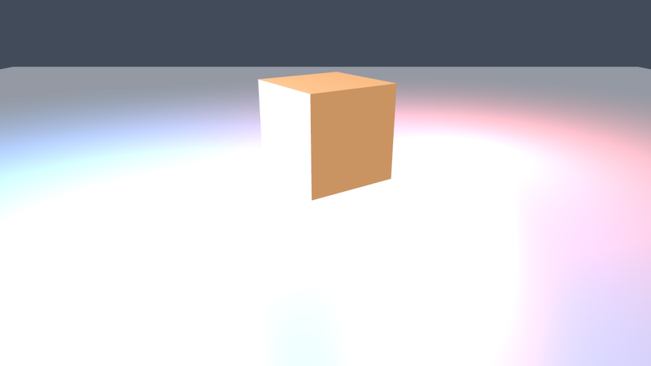

glTF 资产管线实测（`docs/gltf_preview.png`）：从 `assets/cube.gltf`（外部 .bin
buffer + POSITION/NORMAL/TEXCOORD + 45° 旋转节点）加载渲染，材质因子与点光正确。

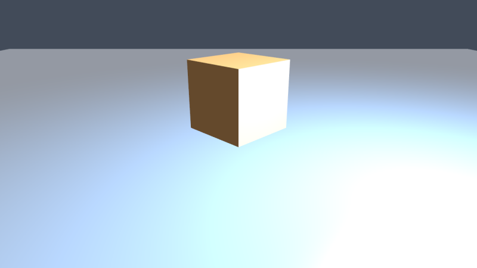

方向光级联阴影 CSM v2 实测（`docs/csm.png`）：2048² × 3 层 2D 数组深度图，
级联沿相机视锥深度按 PFS（λ=0.6 对数/线性混合）分割、逐级联拟合光空间
正交矩阵（XY 纹素对齐消除相机平移闪烁）——近 / 中 / 远三距物体排开俯斜视：
近处影子锐利（首级联 ~100 texel/m），~104 m 处影子仍在，136 m 处（超出
120 m 覆盖距离）正确无影，级联过渡带无可见跳变；片元按 view 深度选级联后
3×3 PCF 软阴影，`DirectionalLight.shadows = false` 可整帧关闭。**R61 起
偏移为「坡度缩放 bias + 法线偏移」**（逐级联按纹素世界尺寸缩放，常数只作
下限），掠射角 acne 与接触阴影浮起同时消除——四面板对照见
`docs/shadow_v2.png`。

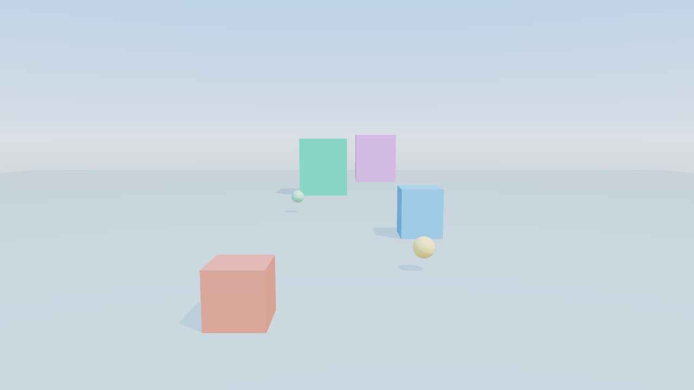

阴影偏移 v2 验收图（`docs/shadow_v2.png`，R61）：①掠射角平面 旧常数 bias
（acne 点状伪影 12883 px）| v2（0 px）；②0.07 m 薄板接触阴影 旧常数 bias
（整条消失、阴影浮起）| v2（完整且贴住根部）；③双点光 关 | 两盏同时投影
（两条方向不同的阴影带，互不串扰）；④CSM 级联 0/1 接缝 2× 放大（红线 =
接缝）| 同裁剪的暗化差分 ×6——阴影带跨接缝连续、相邻采样跳变 0.7/255。

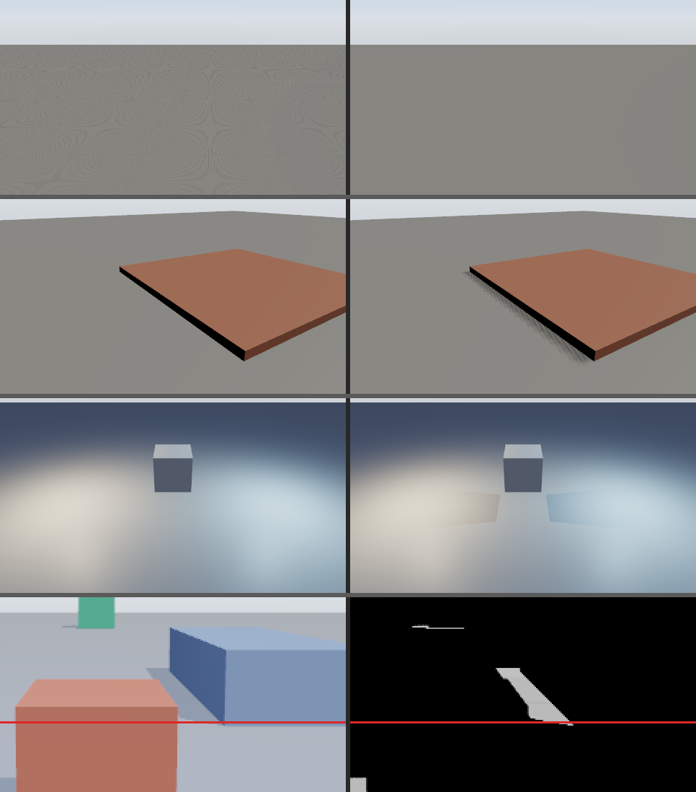

小场景单张对照（`docs/shadow_preview.png`）：立方体与球体向地面投射软阴影，
PCF 边缘自然、无 acne 条纹（v1 单张路径的验收图，CSM 下同场景近景更清晰）。

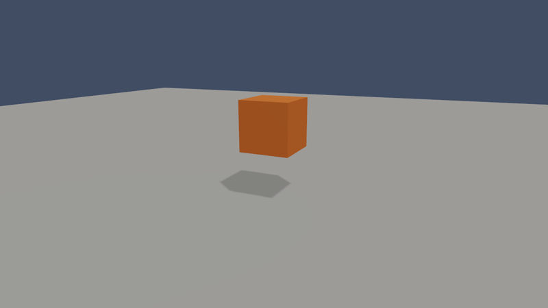

点光 cubemap 阴影实测（`docs/point_shadow_preview.png`）：暗色房间中央点光
（512² × 6 面 R32Float，存归一化线性距离），环灯方块/球的阴影从根部
**背离点光方向径向拉伸**——放射状阴影是点光区别于方向光平行阴影的视觉特征；
**R61 起为预算化多盏**：最多 4 盏 `PointLight.shadows = true` 同时投影
（cubemap 纹理数组，逐灯开关 + 槽位；超出预算按「相机距离升序, 实体位
模式升序」的确定性选择键裁掉并 warn）。

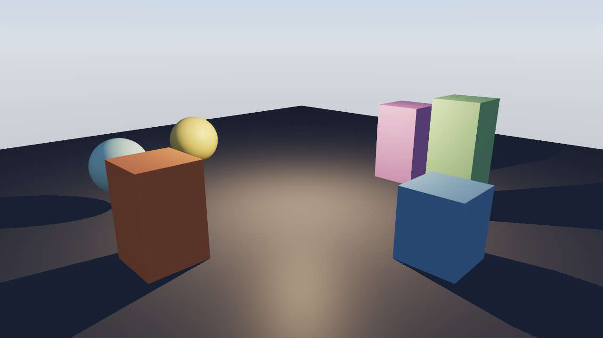

PBR + HDR + IBL 实测（`docs/pbr_preview.png`）：Cook-Torrance 金属度/粗糙度工作流——
金 / 铜 / 银 / 钢四种金属球（粗糙度 0.05 → 0.55 递增）+ 绝缘体红球，方向光软阴影，
程序化天空背景（inv_view_proj 射线采样），IBL 环境光照（天空立方体贴图：
漫反射辐照度卷积 + GGX 预滤波 + BRDF LUT 分割求和），金属球上半球反射蓝天、
下半球反射地面；线性 Rgba16Float HDR 渲染经 ACES 色调映射输出 sRGB。

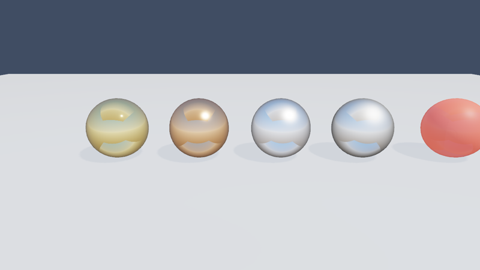

法线 / ORM 材质通道实测（`docs/normal.png`，R42）：左右两堵同色砖墙对比——左墙
纯标量材质（中性纹理路径），右墙挂程序化砖纹法线 + ORM 贴图（砖缝高度场中心差分
生成法线；R=AO 缝暗 / G=粗糙度缝大磨面小 / B=金属度的打包图）。侧光下右墙呈现
砖块凹凸与缝内阴影，右侧金属圆柱的 ORM 划痕条纹逐像素调制粗糙度高光。

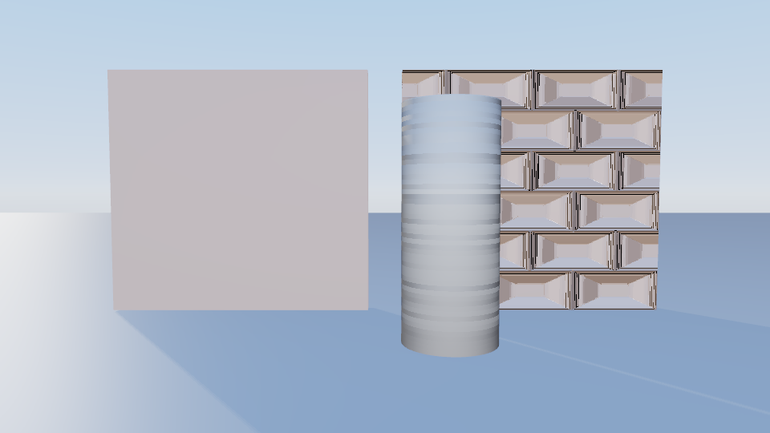

泛光实测（`docs/bloom_preview.png`）：HDR 亮度提取（阈值 1.0，软膝）→ 半分辨率
高斯模糊（三轮分离迭代）→ ACES 前按强度叠加。发光体溢出柔和彩色光晕，
暗部与地面保持干净；`BloomSettings` 资源可调强度 / 阈值或整帧关闭。

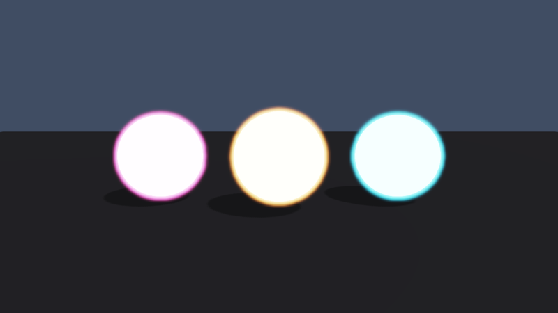

后处理链实测（`docs/post.png`，左→右：欠曝 0.4 / 标准 1.0 / 过曝 2.5 +
暗角 0.9 + 强泛光）：曝光在 ACES 之前线性缩放画面（欠曝压暗但 HDR 亮源
仍保细节，过曝提亮且亮源泛光扩散）；暗角压暗四角而中心无损（线性 HDR
域、曝光之前作用）。`ExposureSettings` / `VignetteSettings` 资源缺席 =
中性 / 关闭，默认画面与无曝光控制逐位一致。

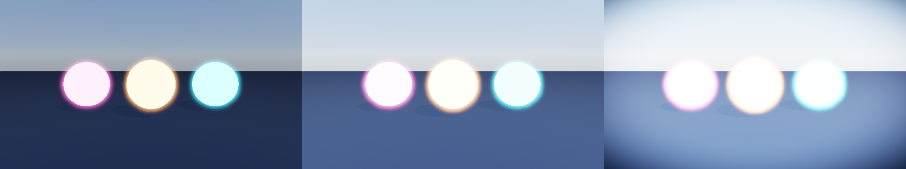

景深与运动模糊（R43）：相机级后处理两 pass，位于泛光之前（HDR 线性域）。
**景深**（`DepthOfFieldSettings`）按逐像素线性视距算混淆圈，12-tap 泊松盘
HDR 平均，清晰带内原色透传；**运动模糊**（`MotionBlurSettings`）用上一帧
相机矩阵重投影得屏幕速度，沿速度方向 N-tap 采样（v1 只覆盖相机运动）。
两资源缺席 / 关闭时整帧与基线逐位一致（FNV 哈希锁定），静止相机下即使
启用也逐位透传。

glTF 动画实测（`docs/anim_preview.png`，左 t=0 / 右 t=1）：`anim_cube.glb`
（GLB 容器）中的蓝色立方体按嵌入的自转 + 浮动剪辑运动——
`AnimationPlayer` 组件驱动节点 `Transform`，层级传播当帧更新世界变换。

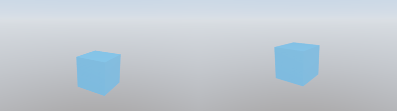

骨骼蒙皮实测（`docs/skin_preview.png`，左 t=0 / 右 t=1.5）：两段臂分别绑定
髋 / 肘关节，肘关节旋转 90° 时上段**绕肘点**扫成水平——关节矩阵
`J = inv(蒙皮全局) × global(joint) × ibm` 每帧算出后经 storage buffer
进顶点着色器做 4 关节线性混合（LBS）；蒙皮阴影管线复用同一份矩阵，
阴影随骨骼同步变形。

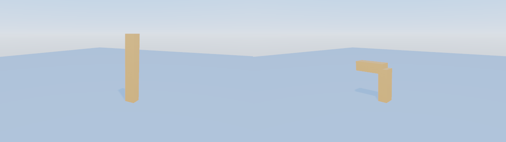

外部 HDR 环境贴图实测（`docs/hdr_preview.png`）：程序化生成的日落全景
`assets/sunset.hdr`（1024×512 equirectangular Radiance 文件，手写 RGBE 解析器
加载）经 `SkySource` 资源挂入世界，渲染器按 generation 失效自动重烘 IBL——
暖色天空与亮度 40 的太阳盘成为天空盒背景与泛光源，金属铬球反射出天顶蓝、
暖色地平线与太阳高光，地面承接 HDR 环境的漫反射辐射。

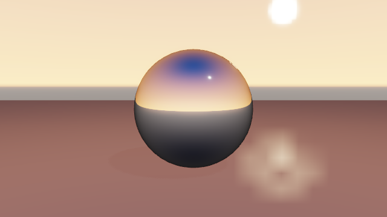

2D UI 叠加层实测（`docs/ui_preview.png`）：点光阴影 3D 场景之上叠加 HUD——
顶部 `IRIS ENGINE` 位图标题、左上血条（深底 + 红色前景两个矩形实体）、
右下青色占位文本。UI pass 位于色调映射 blit 之后：矩形与文本合批为
**一个 draw call**、直接写 sRGB 目标——文字与色块干净锐利，不受泛光 /
ACES 影响；屏幕像素坐标系（原点左上、y 向下），字体为内嵌公有领域
font8x8（ASCII 96 字形，等宽 8×scale 步进，逐亮位展开、形状由单测守护）。

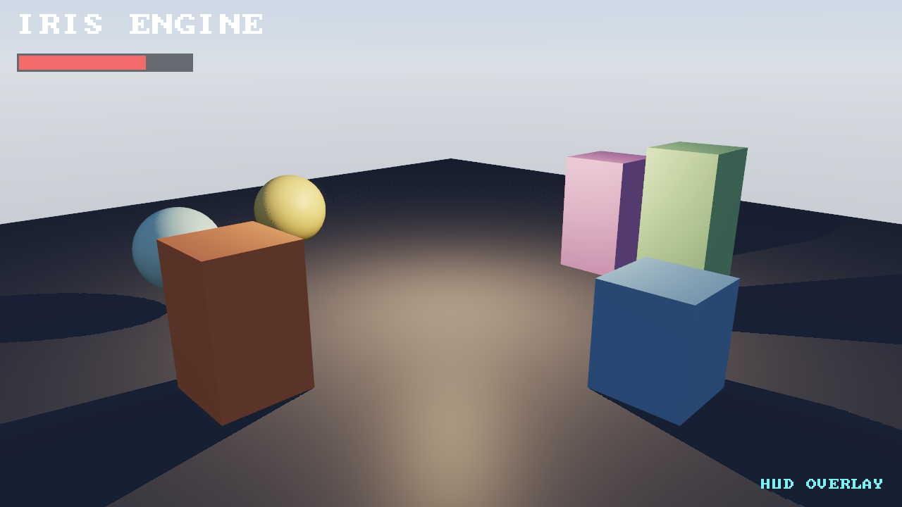

UI 与菜单框架实测（R41，`docs/ui_menu.png`）：3D 背景之上叠加**居中暂停菜单**
（半透明底板 + RESUME / SETTINGS / QUIT 三按钮）+ 右下角小地图（复用 R40
`RendersTo` 相机 + `UiImageRtt` 采样）。菜单系统经 `update_ui_layout` 把
`UiAnchor::Center` 锚点解析为绝对像素（纯函数 `anchor_to_position` 保证**改
视口不漂移**），`update_ui_focus` 把焦点落到 SETTINGS 并用高亮色改写其
`UiColor`（原色保存恢复，无样式表）；按钮为「底板 + 标签」两实体（v1
单实体因挂 `UiText` 只作定位载体、不绘制矩形）。设置持久化经
`Settings::load` / `save` 落盘 JSON（字段缺失向后兼容）。

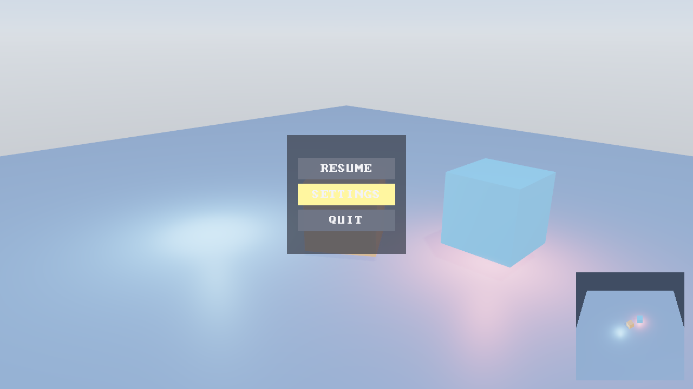

音频子系统实测（`docs/audio_preview.png`）：`AudioMixer` 离线编排三段程序化
音效——55Hz 低频 boom（t=0，起始强峰）、880Hz 短 blip（t=0.4，与 boom 尾部
线性叠加出更高峰）、噪声 burst（t=0.7，后段尖峰）——混音到 2 秒 48kHz 立体声
缓冲，逐 400 帧取峰值归一化，映射为 240 根青→橙渐变垂直条（暗色双层底条 +
波形条，复用 UI 矩形系统：481 个 UiRect 实体合批为**一个 draw call**）。
音量编排使全程峰值 0.95 不触软限幅——包络三段清晰、无爆音削顶的平顶；
混音数学（音量 / 叠加 / 循环 / 重采样 / 限幅）全部为确定性纯函数单测覆盖，
有真实音频设备时示例同步真声播放同一编排（无设备自动降级为纯混音器）。

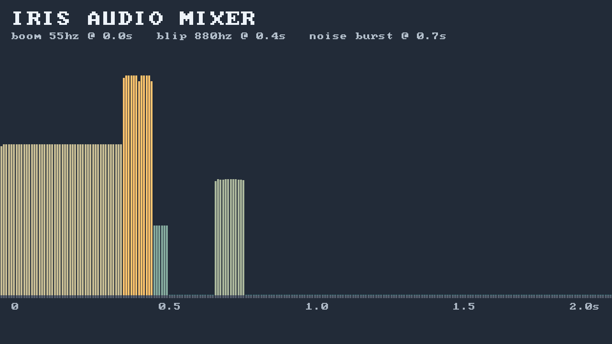

物理与碰撞实测（`docs/physics_preview.png`，左 t=0.3s / 右 t=3s，同一世界 headless
驱动到两个时刻各自离屏渲染）：10 颗彩色刚体球（restitution 0.2..0.9、半径
0.35..0.55）从 3.5~6.5 m 落向静态高台与地面——左图球群半空中（点光软阴影随球
移动），右图球群落定在台面顶与地面上、无穿插；同一运行内嵌 headless 终态断言
（全部球心 y > 0、球-球与球-静态体残余穿透 ≤ 2e-3、总速度 0.998 < 2.0 m/s 近似
静止）。求解器核心为纯函数（检测 = 穿透/法线、求解 = 分离/反弹/摩擦），17 项
单测覆盖球-球 / 球-AABB / AABB-AABB 几何、自由落体解析解、e² 回弹高度、静止
不抖、摩擦与阻尼衰减、静态体不动、逐采样确定性等。

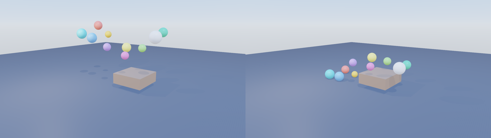

场景序列化实测（`docs/scene_preview.png`）：手写 JSON 关卡文件
`assets/arena.scene.json`（环境段方向光 + 12 个实体：地面、四围墙、中央台面、
台上圆柱、金属 / 漫反射两颗静态球、悬空动态球、点光、隐藏的逻辑标记实体）经
`load_scene` 整体载入世界——示例代码零场景搭建；装上 `PhysicsPlugin` 确定性
模拟 1.5 s 后离屏渲染：所有物体在位、材质区分清晰（金属球带高光反射、漫反射
球哑光）、方向光 + 点光阴影正常；动态球精确落到台面静息高度（球心 y = 1.500、
速度 0.033 m/s，headless 断言）。mesh 来源（图元参数）由 `SceneAssetRegistry`
登记表在 load 时登记、save 时还原，`load(save(load(f)))` 与 `load(f)` 实体
组件语义等价且二次保存逐字节一致（往返不变量单测守护）。

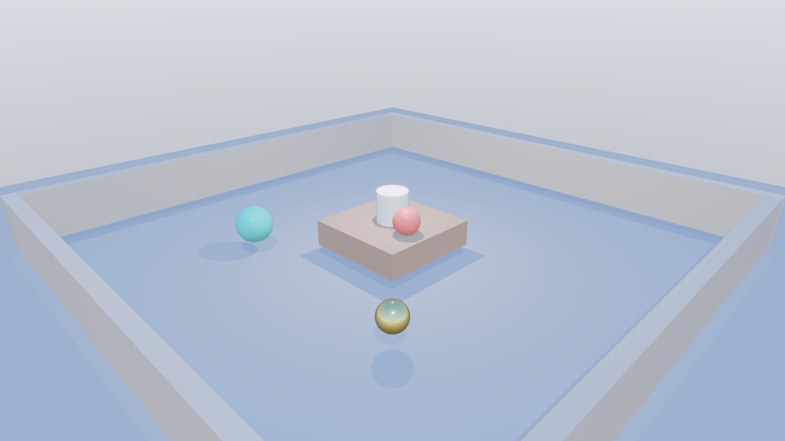

## 用 Iris 做的游戏

引擎的「真实用户」验证——只用公开 API（`iris-engine` 门面 + glam）拼完整游戏，
**引擎侧零改动**。三作递进：Iris Collect 验证「能不能拼出来」，Iris Arena
压榨「蒙皮动画 × 对象池 × 弹道 × 多游戏状态」的高强度真实用法，Iris Bastion
把 R21–R25 的五个新能力（射线拾取 / 蒙皮剔除统计 / 透明材质 / 粒子 / 空间
音频）当载荷整体压榨一轮。

### I. Iris Collect（`games/iris-game`）——第三人称限时收集

**Dogfooding I**——10 枚金币、60 秒倒计时、围墙竞技场、跳跃拾取、HUD、
程序化音效。
纯逻辑状态机（`logic.rs`，只依赖 glam、零引擎依赖）与插件接线（`GamePlugin`）
分离：**关卡来自 JSON 场景文件**——Startup 经 `load_scene` 载入
`assets/collect_arena.scene.json`（微弱日光环境段 + 地面、四面围墙（静态
Collider，内缘 ±17.5）、三根障碍柱（压在金币环路线上制造绕行）、中央点光），
玩家 / 金币 / HUD 为代码生成，相机作为玩家子实体（层级跟随验证
`ActiveCamera`）；Update 把 `Input` + `Time` 翻译进逻辑（移动积分 / 拾取 /
胜负全部可单测的纯函数）后，用物理库的**静态推离查询**实现运动学角色控制
器——玩家球体对场景静态体求推离、只回馈水平分量：墙体把玩家挡在 17.05
（= 内缘 17.5 − 半径 0.45，远早于 ±18 的逻辑钳制安全网），推离只沿法线 →
切向速度天然保留 = **贴墙滑行**；随后把结果写回实体 / HUD / `Audio`——
金币自发光供泛光、点光 cubemap 阴影、位图字体 HUD 全部来自引擎既有能力。
同一套插件系统链经 `GamePlugin::build_schedule` 在无窗口无 GPU 的 headless
测试与离屏快照中复用（测试经 `GamePlugin::new` 注入临时目录的 fixture 关卡，
全部测试跑在真实场景加载路径上）。这次实践撞到的 7 条 API 缺口（可见性开关 /
阶段排序 / 并行发事件 / 按名查实体 / Input 注入 / Audio headless /
Time·UI·图元小项）已在后续「引擎 API 打磨」轮全部修复，游戏内的绕行代码
同步替换为新 API；角色控制器也已由物理查询实现（清单见 ARCHITECTURE.md §8.12）。

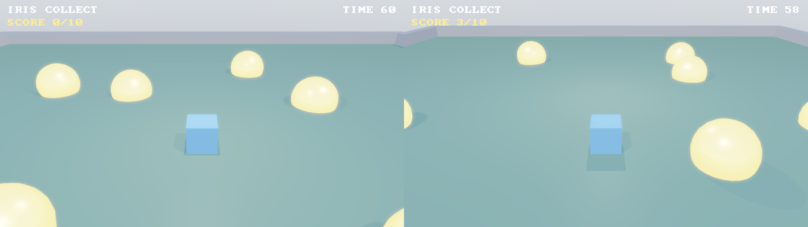

实测（`docs/game_preview.png`，左：开局 / 右：拾取 3 枚后，同一世界用 headless
方式驱动到两个时刻各自离屏渲染）：左图玩家居中、围墙与障碍柱在位、金币环
带泛光、SCORE 0/10；右图 SCORE 3/10、TIME 开始倒数、金币减少、玩家与子实体
相机已随输入移动——场景文件关卡、层级跟随、点光阴影、泛光、HUD 在真实游戏
负载下完整工作，玩家与墙体 / 障碍柱无穿插。

```sh
cargo run -p iris-game --release   # 玩游戏（WASD 移动 / Space 跳跃）
cargo run --example game_snapshot --release   # 双时刻离屏验收图
```

### II. Iris Arena（`games/iris-arena`）——波次生存竞技场

**Dogfooding II**——俯视 3/4 视角竞技场：WASD 移动（屏幕相对 + 贴墙滑行）、
**Shift 冲刺**（0.15 s 高速 + 0.25 s 无敌帧）、**自动开火**（每 0.25 s 朝
14 m 内最近敌人发射弹道，无敌人不开火）。蒙皮蠕虫敌人（`enemy_worm.glb`，
三段箱体关节链扭动循环）从场边刷新成波次（第 n 波 3 + 2n 只、追击速度逐波
+0.15）；接触掉 1 血 + 击退 + 连击清零；弹道命中 -1 HP + 小击退。清空一波
→ 3 s 间歇 → 下一波；玩家 5 HP 归零 GAME OVER，R 直接重开。连击：击杀 +1、
受伤或 3 s 无击杀清零，得分 = 25 × 连击数。

相比 Iris Collect 高强度压榨的引擎面：**蒙皮动画 × 对象池**——启动时一次
spawn 15 个蒙皮蠕虫实例（`spawn_gltf_instance` + `AnimationPlayer` 自动
循环扭动）与 40 个自发光弹道小球，全部 `Visibility::HIDDEN` 待命，波次间
按逻辑侧稳定 id 取用 / 归还槽位，**零运行期 spawn / despawn**（池不超发由
单测守护）；**根实体移动 × 蒙皮子树**——插件只写 glTF 根的
Transform，关节子树随层级传播跟随、动画逐帧覆写关节旋转，两者在同一实体
树上叠加；纯逻辑核心（`logic.rs`，只 glam、零引擎依赖、18 项单测含逐采样
确定性）内置本地 XZ 静态推离（与引擎 `resolve_static_push` 水平投影语义
近似、刻意解耦）与弹道扫掠命中判定（本帧 `prev → pos` 线段对敌人 / 静态体
测试，与引擎 `segment_hits_shape` 同款防穿模语义——弹速 × dt 步长可大于
敌人直径，当帧点判定会漏检；含「每帧位移 > 敌人直径 2 倍仍 1 s 内命中」的
穿模回归测试），插件层在 Startup 把场景 `Collider` 一次性转换为逻辑形状
（Update 每帧零查询）；多游戏状态 Title / Playing / GameOver + 波次间歇；
音效由逻辑侧单调事件计数器的前后差分触发（射击 / 命中 / 受伤 / 开波双音，
全部程序化生成）。headless 集成测试（9 项）复用与窗口程序同一编排的插件
系统链，覆盖池取用 / 归还 / 跨波复用、动画推进、HUD 刷新、弹道池封顶、
终局重开闭环、蒙皮实例根位移带动关节子树与混战 draw calls 记录性断言
（13 敌 + 20 弹 + 场景 + HUD 一帧 **25 次 draw call**）；本次实践撞到的
API 摩擦（AnimationPlugin 未入 prelude / 资产路径工作目录相对 /
蒙皮实例关节树不随根移动等）已在「引擎 API 打磨 II」轮全部修复，
游戏内绕行代码同步删除改用新 API（清单见 ARCHITECTURE.md §8.13）。

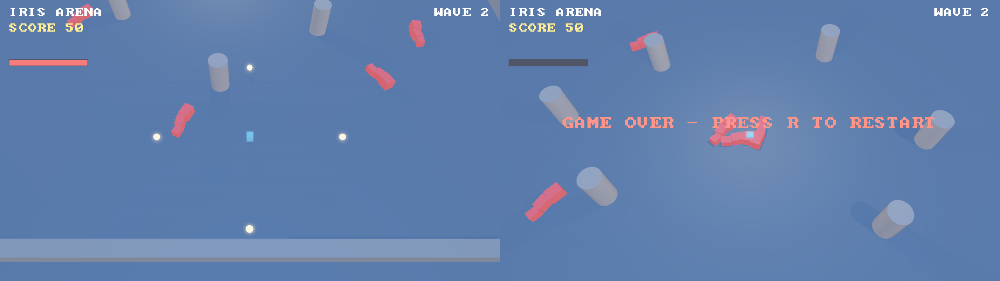

实测（`docs/arena_preview.png`，左：wave 2 混战 / 右：GAME OVER，同一世界
用 headless 方式驱动到两个时刻各自离屏渲染）：左图 5 只蒙皮蠕虫从场边
围拢玩家、自动开火弹道在飞、HUD（WAVE 2 / SCORE / HP 条）完整；右图蠕虫
围拢倒地的玩家、HP 条清空、GAME OVER 横幅——两时刻相隔真实推进的帧，
蒙皮扭动相位肉眼可见地不同（动画在跑）。玩家与障碍柱 / 墙体无穿插。

```sh
cargo run -p iris-arena --release   # 玩游戏（WASD 移动 / Shift 冲刺 / 自动开火）
cargo run -p iris-engine --example arena_snapshot --release   # 双时刻离屏验收图
```

### III. Iris Bastion（`games/iris-bastion`）——俯视塔防

**Dogfooding III**——俯视固定视角塔防：敌人沿 7 段 6 弯的航点折线进攻路径
末端的核心，玩家用击杀所得积分在 20×14 的 1×1 m 网格上放塔——**哨兵**
（速射单体，快速弹扫掠命中）与**臼炮**（慢速弹抛射、落点 AOE 半径 1.4 m）
两种塔、疾行虫 / 重甲兽两种敌人、5 波递增，全清获胜、核心 10 HP 归零告负。
放塔校验（界内 / 空格 / 积分够）是单独导出的纯函数，幽灵预览据此实时
红蓝着色。

本作把 R21–R25 的五个新能力当载荷压榨：**鼠标拾取（R21）**——`cursor_
position()` 像素 → NDC → 引擎 `screen_ray_from_global` 世界射线 →
`raycast` 打地面静态 Collider → 网格（刻意走引擎查询而非解析平面）；
**透明材质（R23）**——幽灵塔身 `AlphaMode::Blend` 可放蓝 / 不可放红 +
半透明射程指示盘；**粒子（R24）**——枪口闪光 / 命中火花 / 死亡爆炸 /
漏怪告警四类 burst 挂 FX 池槽位，参数覆写 + `reset()` 就地复用触发；
**空间音频（R25）**——开火 / 命中 / 爆炸 / 死亡 / 漏怪五种程序化音效
`play_spatial` 定位到事件世界坐标，听者每帧跟随俯视相机。逻辑侧事件自带
世界坐标（`BastionEvent`），表现层零反查。塔 / 敌 / 双弹 / FX 四池启动
预热，运行期零 spawn / despawn（池守恒由测试守护；三个同构池各自
distinct newtype——资源按 TypeId 寻址，type alias 同型会互相覆盖）。
纯逻辑核心（`logic.rs`，只 glam、零引擎依赖）含扫掠弹道命中、路径进度
索敌（射程内**打最靠前**）、航点匀速推进、波次间歇与逐位确定性；
headless 集成测试里的**脚本化自动玩家**经鼠标点击全链路放塔，真实模拟
跑完 5 波**获胜且核心无损**（经济 / 索敌闭环可玩的量化证据）。本次实践
撞到的 5 条引擎摩擦（屏幕射线辅助 + 视口资源 / 粒子重置 API / 粒子
Visibility 过滤 / 可见性层级级联 / 同构池 type alias 模式警示）已在
「引擎 API 打磨 III」轮全部闭合：游戏内的 `BastionViewport` 资源、手工
vp 逆与「换挂整只新发射器组件」绕行删除改用新 API，塔 / 敌池还原
「根 → 形态 rig → 网格」三层结构由级联真实生效（清单见
ARCHITECTURE.md §8.15）。

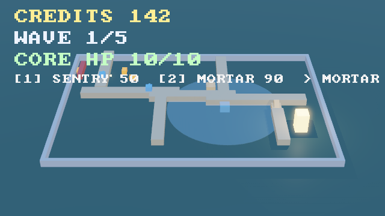

实测（`docs/bastion.png`，640×360 离屏单帧）：四塔就位（哨兵压西段 / 臼炮
守弯口）、第 1 波敌群在途（橙色疾行虫沿航点推进）、击杀爆炸粒子在扩散、
幽灵预览（臼炮形态 + 射程盘）悬停待放格、HUD（CREDITS / WAVE 1/5 /
CORE HP / 建造提示）完整；该帧 FrameStats：`draw_calls = 17` /
`instances = 366` / `culled_instances = 8`（界外岩柱全部被视锥剔除——
剔除在真实场景生效的量化证据）/ `particles_drawn = 338`。对比打磨 III
前的拍平池结构（`draw_calls = 18` / `instances = 367`）：旧逐实体可见性
语义下击杀归还的池槽位只隐藏根实体、网格子实体自带 `VISIBLE` 不级联——
被击杀敌人的机体**滞留在死亡点入画**（恰藏于 HUD 文字后，新旧帧逐像素
差分定位）；层级级联闭合后该伪影消失，还原「根 → 形态 rig → 网格」三层
池结构 draw_calls 18 → 17（与「旧结构 + 手工逐子隐藏」的帧逐字节一致）。

```sh
cargo run -p iris-bastion --release                  # 玩游戏（鼠标选格 / 左键放塔 / 1·2·右键换塔种）
cargo run -p iris-bastion --example bastion_snapshot --release   # 中期战局离屏验收帧
```

### IV. Iris Ascent（`games/iris-ascent`）——3D 平台跳跃

**Dogfooding IV**——第三人称线性上升关卡：角色沿悬浮台地（0.28 m 台阶）
→ 大球坡面（R = 14，走落 + 球顶定点跳）→ **四段跳板弹射**（竖直冲量
18 m/s，弹高 ~16.5 m，承担主要爬升）一路向上攀登 61 m，沿途收集 14 颗
宝石、激活 3 个检查点，抵达山顶信标获胜；坠落到坠落线（y = −12）回最近
检查点复活。全部机制集中在纯逻辑核心 `logic.rs`。

本作把 R28–R31 的四个新能力当载荷压榨：**动画状态机 / crossfade /
事件轨道（R28）**——双剪辑角色 GLB（`assets/ascent_bot.glb` 由
`gen_asset` 示例程序化生成：`idle` 呼吸压缩 2 s / `walk` 前倾摇摆
0.6 s），运行时 `request_state` 双向 0.15 s crossfade；walk 剪辑注入
「footstep」事件轨道（GLB 解析不产事件、API 侧构造），`take_events`
驱动脚步声；**CSM 级联阴影（R29）**——方向光斜照 ~130 m 场景（无需新
代码，快照目检 + 阴影开 / 关逐像素差分作证据）；**距离 LOD（R30）**——
22 个远景装饰（山景球 / 巨柱 / 浮岛剪影）挂 `LodMesh`（高 / 低模 +
60 m 切换），相机拉远 160 m 后 `triangles_drawn` 9 440 → 7 324 的量化
下降；**运动学角色控制器（R31）**——`move_and_slide_statics` 就是本作
的物理核心：纯逻辑核心只依赖 glam + 引擎纯函数（刻意 dogfooding），
headless 与窗口走同一模拟，台阶迈上 / 贴墙滑行 / 陡坡下滑 / 贴地吸附
全部由控制器五步管线承担。跳板不是物理——AABB 判定 + 一次竖直冲量
（`vel.y ≤ 0` 门禁保证每段接触恰好触发一次）。土狼时间 0.1 s、落地
冲量阈值 3 m/s（防小台阶误触发尘土）等手感参数集中在 `logic.rs` 顶部。

**脚本化自动玩家**（headless 与纯核心单测共用同一 `AutoPilot` 脚本）：
关卡被刻意设计成「前进 + 两个定点跳」（出生台地一跳 + 球顶一跳，其余
全部由控制器自动迈上 / 走落衔接、跳板自动弹射）——headless 集成测试经
**真实键盘注入**（Input → 相机相对翻译 → 逻辑 → 表现）全关通关：
**用时 19.5 s、宝石 14/14、检查点 3/3、坠落 0**；纯核心单测另有逐位
确定性（两次模拟 to_bits 逐帧比对）与弹射顶点解析对照。

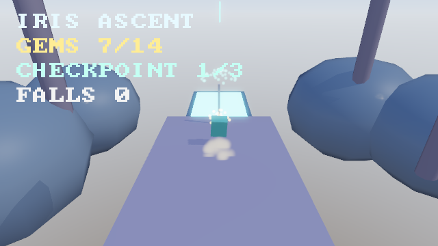

实测（`docs/ascent.png`，640×360 离屏单帧）：自动玩家真实打通第一段
登顶后定格在第一块弹射落点台 P6——角色（teal 机器人，落地尘土粒子
扩散中）、检查点 1 旗已点亮（激活火花在飘）、前方 P7 跳板辉光盘、
HUD（GEMS 7/14 / CHECKPOINT 1/3 / FALLS 0）完整、两侧远景 LOD 装饰
（山景球 / 巨柱）；该帧 FrameStats：`draw_calls = 13` / `instances = 116`
/ `culled_instances = 41`（远景装饰视锥剔除）/ `particles_drawn = 94`
（落地尘土 + 检查点火花）。CSM 证据：方向光 `shadows = false` 与 `true`
两帧逐像素差分 4 622 px（远景山体的受光 / 阴影面 + 角色 / 旗杆接触
阴影——级联 0 近景锐利、级联 2 覆盖远景山体）。

本轮 R32 的**摩擦清单**（现象 → 绕行 → 建议修法，全文见
ARCHITECTURE.md §8.18；**打磨 IV 轮已全部闭合**——①②③④ 引擎侧
修复 + 本作绕行删除，⑤⑥ 文档闭合）：

1. **crossfade 只混「双方都有」的通道，缺通道保持源姿势且混完定格**
   → 角色两剪辑都被迫写满同路径通道（idle/walk 都带 scale + rotation），
   否则呼吸缩放会冻结在过渡时刻的值 → **已修复**：
   `AnimationPlayer::capture_rest` 基姿势快照——混合期「仅源有」通道
   平滑淡回基姿势，过渡完成恰停在 rest（完成瞬间无跳变）；本作两剪辑
   已删除恒值对齐通道（idle 只写 scale、walk 只写 rotation）；
2. **GLB 生成器是纯手写 JSON 字符串**（bufferView 偏移 / accessor 下标
   全手工记账，错一位就加载失败或花屏）→ 绕行：以既有 gen_asset 函数
   为模板复制粘贴改数 → **已修复**：引擎提供 `GltfBuilder` 编程式
   组装 API（iris-engine `gltf_builder` 模块），gen_asset 全部资产生成
   已迁移、重新生成资产与旧文件加载语义等价；
3. **动画状态机无边时 `request_state` 硬切换**——调试时临时清空 edges
   会让所有过渡变成跳变，画面「闪一下」无任何告警 → **已修复**：
   无边硬切换打 `log::debug!`（含 from / to 状态与边表长度）；
4. **第三人称「子实体相机 + 平滑追随」没有现成模式**：相机挂根实体后
   平滑必须写在**局部**位置（局部 = 平滑世界位 − 根位置），且
   GlobalTransform 滞后一帧、复活瞬移需手动吸附 → 本作把 rig 世界位放
   资源里自行积分（约 30 行）→ **已修复**：引擎提供 `SmoothFollow`
   组件 + `update_smooth_follow` 系统（iris-engine `camera_rig` 模块，
   帧率无关指数趋近 + `snap()` 吸附）；本作 `CameraRig` 绕行已删除，
   相机改挂组件；
5. **`Input::press` 电平与 `key_pressed` 边沿的双轨**：脚本玩家「按住
   跳跃键」要在每帧 release+press 注入边沿，电平语义对跳跃这类
   「落地就跳」的玩法反而更自然 → 本作逻辑层直接采用电平语义
   （`input.jump` 按住即跳），绕开了边沿翻译 → **已闭合（文档）**：
   input 模块文档新增「输入语义选择指南」（判定法则 + 门控范式）；
6. **`move_and_slide` 参数整定无指导**：`step_height` 0.3 / `snap_
   distance` 0.2 的组合对「0.28 m 台阶 + 0.5 m 桥接缝」的走落衔接恰好
   工作，但缝隙 > 2×snap_distance、落差 > step_height 的衔接会卡墙
   （「贴边落在台缘角点」的失败模式）→ 本作以关卡不变量单测固化
   「衔接高差 ≤ 0.3、缝宽 ≤ 0.5」→ **已闭合（文档）**：character
   模块文档新增「平台跳跃衔接参数表」（可靠域 / 失败模式症状与诊断）。

```sh
cargo run -p iris-ascent --release                  # 玩游戏（WASD 移动 / 空格跳 / R 回检查点）
cargo run -p iris-ascent --example ascent_snapshot --release   # 中段战局离屏验收帧
```

### V. Iris Infiltration（`games/iris-infiltration`）——第三人称潜入

**Dogfooding V**——俯视偏斜 45° 第三人称的 24×18 m 单层设施潜入：玩家从
走廊西端潜入，绕过两名巡逻守卫取 3 个数据核心，抵达出口获胜；被发现 3 次
告负。Shift 潜行（守卫视锥发现半径减半）、E 从背后 2.2 m 内击晕守卫、
Esc 暂停菜单。全部机制集中在纯逻辑核心 `logic.rs`。

本作把 R34–R41 的新能力当载荷压榨：**NavGrid 寻路（R35）**——守卫巡逻 /
追逐全部走 `NavGrid::find_path` 航点（硬编码的只有「路线环目标点」，逐段
走位交给导航图），压力门被踩开后按引擎文档推荐的「便宜重建」姿势整图重建；
**动画 v3（R38）**——玩家与守卫共用双剪辑**混合空间**（`BlendSpace` 参数 =
移动速度 0..1，idle ↔ walk 连续混合，潜行半速时参数停在 ~0.48 的中间
姿势）+ **两骨足部 IK**（每角色双腿链 hip→knee→foot，脚踝贴地 ±2 cm，
headless 断言量化）；**ragdoll（R37）**——背后击晕 → `spawn_ragdoll_
kinematic` + `release_ragdoll` 六球人形瘫倒（v1 击晕不醒来，诚实限制）；
**接触事件（R34）**——压力板 sensor + 物理代理胶囊，`ContactStarted/Ended`
begin/end 成对计数（踩上开门为单向闩锁）；**RTT（R40）**——固定 RT 相机
俯瞰核心房，`UiImageRtt` 画中画贴 HUD 右上（R41 `UiAnchor` 锚定，改视口
不漂移）；**UI 菜单栈（R41）**——Esc push/pop `UiMenuStack`、按钮焦点
导航（↓ + Enter）、`UiClickEvent` 消费（RESUME/QUIT）、`Settings` 加载 /
QUIT 落盘；**距离关节（R36）**——NW 门洞的「弹簧门」动态面板被玩家物理
代理真实推开、`DistanceJoint` 拉回关闭位（纯展示语义，不在逻辑静态体）。

**脚本化自动玩家**（恒潜行 + 预设路线点 + 视线避让：被巡逻守卫看见就朝
反方向撤退、守卫背身窗口出现即恢复推进——「潜行跟随」行为涌现）：
headless 集成测试经**真实键盘注入**全关通关——**用时 49.5 s、核心 3/3、
被发现 0（设计余量 ≤ 1）、压力门已开**；纯核心单测另有逐位确定性（两次
模拟 to_bits 逐帧比对）、守卫巡逻绕墙断言（任意帧不进墙 0.3 m 域）、
视锥三要素（距离 / 夹角 / 遮挡）与警觉累积衰减的精确断言。

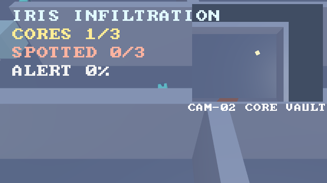

实测（`docs/infiltration.png`，640×360 离屏单帧）：自动玩家真实推进到
「核心 A 已到手、正穿走廊奔压力板」的中段定格——玩家（teal 机器人）
潜行中、守卫在身后 NW 室巡逻、右上角监控屏画中画（RT 相机俯瞰核心房：
金色核心 C 与红色压力门清晰可辨）、HUD（CORES 1/3 / SPOTTED 0/3 /
ALERT 0% / CAM-02 标签）完整；该帧 FrameStats：`draw_calls = 15` /
`instances = 29` / `culled_instances = 14`（外墙背面视锥剔除）/
`triangles = 348`。

本轮 R42（游戏五）的**摩擦清单**（现象 → 绕行 → 建议修法，全文见
ARCHITECTURE.md §8.22；本轮为游戏轮，全部只绕行不改引擎。
**更新：六条已全部闭合于「引擎 API 打磨 V」**——①事件双代轮换生命周期
（`UiClickEvent` 在 Update 直接消费，`MenuCommand` 信箱删除；QUIT 退出
修复）＋ 事件可读窗口跨两帧、消费必须 `drain`；②`IkRig` 组件解耦
FootIk（零剪辑播放器删除）；③`CommandQueue` 帧末命令队列（ragdoll 生成
改并行系统 + `spawn_deferred`）；④IK 链「节点 scale 恒 1」契约 + 骨长
偏差 > 10% 一次性 warn；⑤`set_subtree_hidden` 引擎原语；⑥
`RigidBody::body_type = Kinematic` 运动学碰撞体（物理代理删除，压力板 /
弹簧门由玩家胶囊真实碰撞驱动）。各条绕行实现详见下）：

1. **`UiClickEvent` 在 PostUpdate 产出、帧尾 `clear_all_events` 清空——
   Update 系统永远读不到**（焦点系统发事件在 PostUpdate，主循环事件清空
   在 PostUpdate 之后；连 `AppExit` 也只有 Update 阶段发出的能被帧尾退出
   检查读到）→ 绕行：游戏侧 PostUpdate 尾部独占系统（注册晚于 `UiPlugin`
   焦点系统）把事件转写成 `MenuCommand` 信箱资源，Update 消费 → **建议**：
   焦点系统改发「命令资源 / 回调」或事件清空移到窗口事件之后；
2. **`update_foot_ik` 与 `AnimationPlayer` 强耦合**——纯 IK 装配（无剪辑
   的腿链）也必须挂一个空 `AnimationPlayer` 才能被系统查询到 → 绕行：
   挂零剪辑播放器（语义无害但费解）→ **建议**：FootIk 独立查询或
   `IkRig` 组件；
3. **ragdoll 生成需要 `&mut World`**——实体分配是结构性修改，并行系统
   （`&World`）无法 spawn → 绕行：游戏 Update 里插独占系统做生成（屏障
   语义天然隔离）→ **建议**：命令队列（`World::spawn_batch` 类 API）；
4. **节点 scale 会污染 IK 链长**——用节点 `Transform.scale` 缩放关节网格
   时，scale 被 `chain_world` 的链矩阵继承，骨长随之缩水（腿直接缩短到
   一半），IK 落地查询跟着错 → 绕行：关节节点 scale 恒 1，网格尺寸放在
   独立子网格实体上 → **建议**：foot_ik 模块文档加「链上禁止非均匀
   scale」契约（或文档 + debug_assert 骨长突变告警）；
5. **「隐藏子树」无引擎原语**——击晕后要藏整个角色（模型 + 双腿链 +
   网格），只能游戏侧沿 `Children` 递归 `Visibility::HIDDEN` → 绕行：
   `hide_subtree` 10 行递归 → **建议**：`visibility` 模块提供
   `set_subtree_hidden`；
6. **运动学角色没有「物理碰撞体」概念**——逻辑角色（`move_and_slide`）
   要参与 R34 接触事件 / 推开 R36 动态门，必须额外 spawn 一个动态胶囊
   「物理代理」并逐帧同步位置 / 速度（漂移 ≤ 1 帧即被覆写）→ 绕行：
   代理同步（本作 `PROXY_NAME` 实体）→ **建议**：RigidBody 增加
   kinematic 模式（位置由调用方驱动、参与检测与推挤、不被动力学积分）。

```sh
cargo run -p iris-infiltration --release                  # 玩游戏（WASD 移动 / Shift 潜行 / E 击晕 / Esc 菜单）
cargo run -p iris-infiltration --example infiltration_snapshot --release   # 中段战局离屏验收帧
```

### VI. Iris Assault（`games/iris-assault`）——写实战斗庭院

**Dogfooding VI（写实路线垂直切片）**——20×14 m 战斗庭院：黄昏斜阳下的
砖围墙、四角石柱与中央喷泉（圆障碍），持刀 + 步枪的玩家与 4 名持刀敌人
死斗。刀剑三连段（每段 = 前摇 / 55° 扇形判定窗 / 后摇，第三段击退 +
更长硬直；横扫 / 后摇期按攻击键预约下一段）、步枪（0.16 s 射速 / 12 发
弹匣 / 1.6 s 换弹 / `ray_vs_shape` 弹道遮挡——被墙挡住的敌人不中弹、
命中墙面贴弹孔）、全歼胜利、HP 归零败北；开场绕庭相机演出与终局推近
结算。与前五作把单轮新能力压榨到极限不同，本作首要目的是把
**R42–R47 六轮新能力当载荷全量实弹**（接线验收 + 摩擦清单）：

- **写实材质（R42）**——地面石板 / 砖墙用引擎 `brick_normal_orm`
  程序化法线 + ORM 对；刀身拉丝划痕（`scratched_metal_normal_orm`）与
  布料褶皱（`cloth_normal_orm`）为本 crate 纯函数生成器（splitmix64
  哈希、确定性单测锁定），经 `GltfBuilder::material_textured` 把法线 /
  ORM 通道 PNG 内嵌进角色 GLB（打磨 VI 摩擦③ 闭合，运行期只剩敌我配色
  覆写）；
- **DOF / MB（R43）**——战斗默认开：`DepthOfFieldSettings::focus_target`
  指向最近活敌的胸骨，引擎每帧解析视距（焦外敌人虚化即距离感，摩擦⑤
  闭合）；`MotionBlur` 覆盖演出相机的 spline 运动；
- **流式音频（R44）**——pack 内 OGG 氛围循环上音乐总线（`play_music`
  后台线程分块解码 + `set_reverb` 庭院混响，v1 只作用于音乐总线）；
  挥砍 / 枪声 / 命中 / 换弹 / 胜负共 8 种程序化音效走 `play_spatial`
  （听者跟随主相机）；
- **pack 资产（R45）**——角色 GLB + 氛围 OGG 打包 `assets/assault.ipak`
  单文件，`AssetMount(Pack)` 挂载；GLB 走 `spawn_gltf_instance_from_bytes`
  内存入口（自包含约束实弹验证）；pack 缺失时诚实降级文件路径；
- **动画 v4（R46）**——上下身**双 `AnimationPlayer`** 组合姿势：下半身
  `BlendSpace`（idle/walk/run，参数 = 速度）+ 上半身动作剪辑
  （guard / sword1..3 / aim / reload）+ `AnimationMask`（节点集 = 上身
  12+2 骨）——两层写入集不相交 ⇒ 跑动中挥砍 / 瞄准不打断腿；受击 =
  `AdditiveLayer` flinch 增量叠加（不破坏步态）；**手 IK**：ADS 时双臂
  `HandIk` 吸附枪身握把 / 护木挂点（`IkTarget` 挂胸节点子树——不在手骨
  链内，无反馈环；headless 断言右手吸附握把 ±12 cm）；
- **演出时间线（R47）**——开场 6.5 s 绕庭 Catmull-Rom 相机 + 两段字幕 +
  2.35:1 黑边，`intro_end` 事件触发 `begin_battle` 交还控制权；胜利 /
  败北推近主角结算（`OutroLatch` 每局一次）。
  老能力照用：ragdoll 死亡（六球人形 + 受击方向轻踢）、贴花战痕
  （血渍 / 弹孔盒投影贴花）、粒子 FX 池（32 槽启动预热零运行期 spawn：
  血雾 / 枪口焰 / 刀光 / 火花四组）、NavGrid 绕喷泉追击（敌人 AI）。
**视觉上限轮（内容侧重建，引擎零改动）**——把「图元拼装」换成真正的资产：

- **角色**：22 个骨节点上逐块挂的缩放立方体 → **一张 GPU 蒙皮网格**（新模块
  `geom` / `soldier` / `soldier_tex`）。身体是超椭圆截面放样（躯干 / 四肢逐段
  变半径、三角肌把上臂接到躯干），装备是圆角盒与旋转体（头盔穹顶 / 面罩 /
  下颌板 / 护甲板 / 肩甲 / 弹匣包 / 腰带 / 水壶 / 匕首鞘），武器是渐缩刀身
  （双刃菱形截面）与整枪（机匣 / 枪管 / 制退器 / 护木 / 弹匣 / 握把 / 枪托 /
  光学瞄具）。权重沿脊柱 / 腿 / 臂三条骨链投影分配（关节两侧平滑混合），
  装备与武器刚性挂骨；全角色共用一张 512² 程序化图集（16 分区：布料 / 护甲 /
  皮革 / 钢 / 玻璃 / 织带 / 橡胶…）= **单次 draw**，31065 顶点 / 28974 三角形。
  验收图 `docs/soldier.png`（十机位：4 全身 + 头 / 躯干 / 双手 / 双靴特写，走真实
  guard 动画姿势——绑定姿势的「T 字站桩」不是玩家看到的样子；手与靴的特写机位
  由**骨节点实测世界位置**推出，写死坐标会拍空）。
- **角色建模迭代轮**（手足重建 + 部件法线纠向）：手按真人比例重做（指长 0.030 →
  0.064~0.080，绕掌心圆弧屈曲、三节起皱、拇指对掌、指背两节护片、腕口护套）；
  战靴重做（趾→跟一体鞋底 + 足弓抬起 + 鞋帮楦体 + 鞋头包 + 后跟杯 + 靴筒 +
  鞋舌 + 鞋带 ×4 + 黄铜鞋眼 ×8 + 踝束带 + 护踝片）；四肢加 8 道布褶 / 束带、躯干
  加立领。**修掉一个影响整身光照的真 bug**：20 个部件的放样 / 旋转体法线朝内
  （鞋楦三件、双肩三角肌、双掌鱼际、头盔耳罩、脸侧滤罐、腕环……，且左右未必
  同病——镜像部件的行方向相反），现在由基元层的几何自检统一纠向（geom::orient_outward）
  + Assembly 的「闭合壳有向体积必须为正」不变量兜底；材质 bump 按新量纲全部减半，
  枪械金属改磷化黑（原先与护甲钢的基色距离只有 1.65，被图集测试判为材质退化）。
- **角色建模迭代轮二**（四肢 / 躯体 / 关节 / 衣物 / 细节 / 头面）：四肢改用
  **带离轴截面中心的放样**（股四头肌前凸、腓肠肌后鼓、踝上收成跟腱、肱二头肌
  与肱三头肌分列前后），躯干 14 个截面同样允许前后偏移（臀后凸 / 腰内收 / 胸骨
  前凸）——侧影的每一处起伏都在前后方向；肘 / 膝改成**多片铰接护具**（肘三件、
  膝五件，全部走权重混合，旧版 rigid 的护具在弯曲时与肢体脱节）；补背部育克缝、
  臀部后袋、下摆抽绳、肩部徽记；头盔由「蛋」改成 FAST 型盔形并加颅顶中脊、
  通风窗 ×4、扫掠侧导轨、盔带与猫眼片；护目镜做成**镜框 + 左右镜片 + 鼻梁桥 +
  侧扣 + 连接带**，面罩加鼻梁脊、颊部滤罐、呼气阀与口栅。顺带修掉两个「护膝
  其实不存在」的真 bug：膝下裤脚比护膝还粗（整片埋进裤腿）、护膝绑带是两圈
  **悬在两腿之间且逐位重合**的 ring_shell（漏了平移，z-fighting）。
- **庭院**：15 个图元实体 → **程序化建筑 GLB**（新模块 `scenery` / `scenery_tex`，
  42980 三角形 / 9 材质）：石板铺地（缝与斑驳在法线贴图里）、砖墙 + 基座 /
  壁柱 / 柱头 / 檐口 / 雉堞、**拱形壁龛与龛内雕像**、多立克石柱（柱础 / 收分
  柱身 / 钟形柱头 / 顶板）、三层喷泉与水面、悬挂火盆（墙托 + 斜撑 + 铁链 +
  铜盆 + 炭火）、旗帜、木门与铁箍。关卡档仍是**碰撞 + 灯光 + 粒子**的权威
  （`level_roundtrip.rs` 零改动全过），视觉由 `assets/assault_courtyard.glb`
  承担——插件在 GLB 装配成功后按名隐藏档里的可见图元，失败则回退「能玩的
  旧庭院」。视觉几何受**碰撞契约**约束（玩家高度内不得越过碰撞面 8 cm 以上）
  并由逐顶点单测守护。验收图 `docs/courtyard.png`（四机位：英雄视角 / 拱形
  壁龛 / 喷泉 / 俯瞰）。


**脚本化自动玩家**（接近最近敌人 → 扇区内三连段 → 中距步枪补射 → 弹尽
换弹 → HP < 30 拉距射击）：headless 经**真实键盘注入**通关——
**用时 6.4 s（382 帧）全歼 4 敌、玩家 HP 100、开枪 16 发**；纯核心
19 项单测覆盖扇形越界不伤、同代次防重复命中、换弹时序、弹道遮挡解析解
（喷泉球体命中点 x ≈ −1.587）、硬直重置语义、击退位移解析（1.2 m）与
逐位确定性。

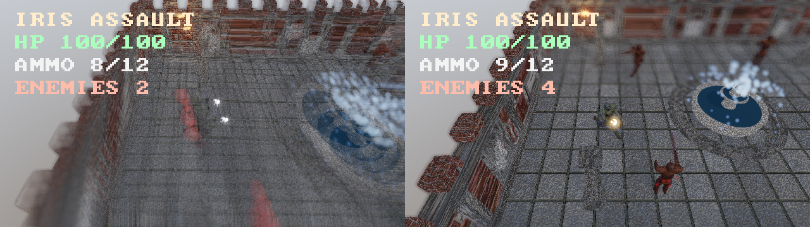

实测（`docs/assault.png`，640×360 两帧横拼）：左帧刀剑横扫判定窗中
（上身动作剪辑 + DOF 对焦交战距离、远处敌人焦外虚化）；右帧枪口焰当帧
（FX 池 additive 粒子 + 喷泉水花 + ragdoll 尸体可见）。帧 A
FrameStats：`draw_calls = 23` / `instances = 176` / `culled_instances = 1` /
`triangles = 133 400`；帧 B：`draw_calls = 17` / `instances = 204` /
`triangles = 161 428`（对照重建前：`draw_calls = 72` / `triangles = 3 150`——
旧几何是 15 个图元实体、三角形数不在同一量级；新场景单帧 11~13 万三角形，
而整具角色是**一次 draw**：单张蒙皮网格 + 单材质 512² 图集）。

本轮 R48（游戏六）的**摩擦清单**（现象 → 绕行 → 建议修法，全文见
ARCHITECTURE.md §8.26；本轮为游戏轮，全部只绕行不改引擎）：

1. **足部 IK 回写四元数不归一化 → 逐帧平方复合爆炸**（本轮最重）——
   `update_foot_ik` 旋转回写（旋转弧复合 + 共轭反推）产出**未归一化**
   四元数；当下帧无剪辑通道覆写该骨（idle 只有骨盆 bob、无腿通道）时
   幅度逐帧平方复合，实测 1.9 s 内 386 → 5.8e7 → NaN（骨长 NaN →
   `solve_two_bone_ik` 断言 panic；infiltration 未炸纯属其 walk 剪辑
   恰好每帧覆写双腿）→ 绕行：idle 剪辑补恒值腿通道（每帧重置骨旋转）
   → **建议**：两处 IK 回写前 `normalize()` + 单测锁定 ‖q‖−1 ≤ ε；
2. **GLB 内存加载入口不在 prelude**——`spawn_gltf_instance_from_bytes`
   （R45 pack 路径的刚需）未进 `iris-render` prelude，门面下游拿不到
   → 绕行：iris-assault 显式直依 iris-render（依赖纪律偏离，Cargo.toml
   注明）→ **建议**：补进 prelude；
3. **GltfBuilder 不支持纹理引用**——R42 法线 / ORM 无法在资产生成端
   表达 → 绕行：加载后克隆材质 + `with_normal/with_orm` 替换 →
   **建议**：builder 增加 `material_textured`（GLB 内嵌图片）；
4. **无 Vorbis 编码器**（R44 只有解码）——氛围 OGG 无法程序化生成
   → 绕行：复用引擎音频测试 fixture（2 s 正弦循环）→ **建议**：
   `procedural` 增加直写 OGG 编码或接受外部资产管线；
5. **DOF 动态对焦无引擎辅助**——对焦距离是交战几何的函数，静态值在
   快速接近时把敌人糊成一团；游戏侧每帧写 `DepthOfFieldSettings` 可用
   但无「对焦目标实体」原语 → 绕行：插件层每帧算相机→最近敌距离写资源
   → **建议**：`FocusTarget(Entity)` 组件 + 渲染器自动对焦；
6. **上下身分离剪辑的骨架契约全手工**——加载器不带节点名，22 节点下标
   契约（skeleton.rs）与资产生成器 / 插件层三方对齐只能靠 headless
   守护测试（第一版把网格做成独立子节点 → 42 节点错位立刻爆出）
   → 绕行：`skeleton` 模块单一事实来源 + 节点数守护断言 → **建议**：
   `GltfInstance` 携带节点名（`node_named` API）；
7. **example 跨 crate 同名冲突**——iris-assault 的 `gen_asset` 与
   iris-engine 的同名 example 输出文件互相覆盖（cargo 警告 future hard
   error）→ 绕行：改名 `gen_assault_assets` → **建议**：无引擎修法，
   记录命名约定（游戏 crate example 加游戏前缀）。

**打磨 VI 已把七条全部闭合**（引擎侧修复 + 本 crate 侧绕行删除，
ARCHITECTURE §8.26 逐条标注）：

1. **①** `update_foot_ik` / `update_hand_ik` 写回前 `normalize()`——
   归一化是 IK 的责任（模块文档有推导）；600 帧回归锁
   `foot_ik::tests::foot_ik_quaternion_norm_stable_without_clip_overwrite`
   与 hand 侧同名测试（逐帧断言 ‖q‖−1 ≤ 1e-3 + 同相位位形一致）；
   idle 的恒值腿通道**删除**（资产重生成）。删改前该场景在
   `intro_cinematic_plays_and_hands_over_control` 里 1.9 s 必炸；
2. **②** `spawn_gltf_instance_from_bytes` 进 `iris-render` prelude ⇒
   iris-assault 的 iris-render 直依删除（依赖纪律回归）；
3. **③** `GltfBuilder::material_textured`：baseColor / 法线 / ORM 三通道
   像素 PNG → base64 data URI 内嵌 GLB（自包含，内存加载路径可用），
   内容相同去重；插件层「加载后克隆材质挂纹理」的绕行删除，运行期只剩
   敌我 `base_color` 配色覆写；
4. **④** 引擎不做编码器（运行时职责，明文接受外部资产管线）——
   WAV → OGG 标准命令进 README「环境要求」与 ARCHITECTURE §4.14；
5. **⑤** `DepthOfFieldSettings::focus_target`（引擎每帧解析目标
   `GlobalTransform` → 视距，缺席 / 隐藏回退标量）——插件层逐帧写
   `focus_distance` 的绕行删除，战斗中对焦最近活敌的胸骨；
6. **⑥** `AnimationPlayer::node_names`（加载器携带 GLB 节点名）+
   `node_entity_by_name`——装配层（IK 链 / 挂点 / 配色）改按名寻骨，
   下标只服务动画通道与遮罩；
7. **⑦** example 命名约定（跨 crate 唯一前缀）记入 ARCHITECTURE §7.2。

```sh
cargo run -p iris-assault --release                  # 玩游戏（WASD 移动 / 空格·左键挥刀 / F 开火 / Q·右键瞄准 / R 换弹）
cargo run -p iris-assault --example assault_snapshot --release   # 战斗中段两帧离屏验收
cargo run -p iris-assault --example gen_assault_assets --release # 重新生成 GLB + pack
```

## 测试

```sh
cargo test --workspace   # 1685 项测试（release 1682 + 预算断言）：单元 + headless 集成 + GPU 端到端离屏渲染
```

集成测试在真实 GPU 上离屏渲染并校验像素（无 GPU 环境自动跳过），覆盖：
着色器编译、深度测试、MSAA、实例化合批、视锥剔除、多光源照明、
**粒子系统（喷泉可见性 + particles_drawn 与池状态对账 + additive 亮度
显著高于 alpha 混合 + 爆炸 one-shot 全灭不补发 + 模拟逐位确定性）**、
**方向光阴影（开/关整帧差分：成片变暗、无变亮、大部分不变）**、
**点光 cubemap 阴影（面矩阵全方向覆盖 + 偏置遮挡物阴影落在解析预测位置 +
开/关整帧差分 + 空跑不污染）**、
**泛光（开/关整帧差分：光晕变亮、无变暗、远场不变）**、
**IBL（铬球反射蓝天：蓝主导像素对比 + 整帧变亮）**、
**glTF 动画（旋转方块离屏渲染：正对 → 侧对红色像素锐减）**、
**骨骼蒙皮（肘关节动画驱动顶点位移：最左像素左移 ≥30px + 蒙皮阴影成片变暗）**、
**外部 HDR 环境贴图（红/蓝合成全景：画面上下半球主导通道 + 铬球反射上半球）**、
**2D UI 叠加层（矩形像素精确落地无溢出 + 文本亮像素命中逐位解析预测 ±25% +
HUD 区域不透 3D 且 HUD 外区域与无 UI 渲染逐像素一致）**、
**并行调度（原子计数观测真并发 / 读写冲突分批保序 / 独占系统屏障）**、
**实例缓冲增量上传（静态场景连续帧零上传且像素一致 + 单实体移动仅传变化段）**、
glTF 资产管线（内嵌 data-URI 与外部 .bin buffer、metallic/roughness 直通、双相机路径）、
Radiance .hdr 解析器（平面 / RLE 扫描线、RGBE 指数编解码、f16 位模式转换）、
**音频混音核心（音量缩放与即时生效、多声音线性叠加可分解、播完自动移除、
循环回绕、stop 静音与 SoundId 世代防悬垂、通道上/下混、重采样过零点保持、
软限幅边界）**、WAV 解析器（16-bit PCM 值映射、帧交错保留、奇数长度未知块
跳过、坏魔数 / 非 16-bit / 非 PCM / 声道数报错）与程序化音效（正弦 / 方波
对照解析解逐采样 1e-5 容差、噪声固定 seed 可复现、首尾防爆音包络）、
**headless 游戏集成（iris-game：不建窗口不建 GPU，`GamePlugin` 完整系统链 +
`Time::advance` 确定性推进 + `Input::press / release` 脚本化按键注入 +
临时 fixture 场景文件注入驱动真实游戏世界——静止 / 移动积分与朝向 / 单次
跳跃弧线 / 相机子实体层级跟随 / 脚本路线拾取与计分 / 金币可见性隐藏 /
HUD 文本刷新 / 全收集胜利与终局冻结 / 超时落败 /
**墙体 Collider 阻挡（玩家稳定贴墙 17.05，小于钳制上限 18——是物理而非
clamp 在挡）/ 贴墙滑行（法向被挡、切向持续滑行）**）、
**headless 竞技场集成（iris-arena：同款驱动 + 双池预热断言 + 蒙皮动画推进 +
任意键开局取池 + 波次间池槽位复用（第 2 波复用第 1 波全部 5 槽）+ HUD
四要素刷新 + 弹道池封顶与槽位回收 + GAME OVER → R 重开闭环（旧 id 全释放、
事件计数复位）+ 混战 draw calls < 300 记录性断言（实测 25））**、
**物理与碰撞（球-球 / 球-AABB（顶面 / 侧向 / 角点 / 盒内退出）/ AABB-AABB
接触几何与反弹 / 摩擦均值的纯函数断言；自由落体对照 y(t)=h-½gt² 的 60Hz 离散
容差、gravity_scale 缩放、e=0.8 回弹顶点 ≈ 初高×0.64 且逐次衰减、e=0 落地静止
穿透 <1e-3 不抖、摩擦切向衰减对比、线性阻尼对照 v₀e^(-λt)、静态体 bit 级不动、
双世界逐采样 bit 级确定性、7 球堆叠两两不穿透、100 球密集阵求解后两两不重叠
（broadphase 候选保守性回归）、Time 缺席零步长；
静态推离查询：单墙推离量精确且只沿法线（切向保留）/ 正交双墙顺序累加 /
空静态表恒等 / 世界封装跳过动态体并遵循静态缺席语义；
射线与线段查询：球面命中 t/法线精确值 / 未命中与背面 / 球内起点 t=0 /
盒面命中 / 盒内起点最浅出面 / 斜射角点法线取主轴 / 线段步长大于目标直径
仍命中（穿模防护）/ 世界级最近命中优先 + filter 排除发射者 + max_t 裁剪 +
空世界 None；球扫掠：畅通 None / 正碰 t 分数与法线精确 / 斜向滑过角点
不误报 / 起点重叠 t=0 / 世界封装跳过动态体；均匀网格：插入查询往返 /
负坐标 floor / 同输入两次 candidates 相等（BTreeMap 确定性）/ 确定性 LCG
生成 ~200 AABB 的保守超集断言（凡真重叠对都出现在双方候选里））**、
**场景序列化（最小场景与字段缺省值 = 引擎默认、未知字段容错、坏 JSON /
缺 entities / 缺文件 → 错误枚举各归其位；实体段逐字段进组件（Name / Visibility /
Transform 四元数 / 材质数值 / 点光 / 碰撞体 / 刚体）、静态体缺席语义、
glTF 引用挂载子实体树 + GltfMounted 标记、GLB 容器引用、方向光环境资源
（缺席不改）、sky_source 合成 HDR → EquirectHdr + 路径登记、材质贴图文件
载入 + 登记；往返：丰富场景（全组件 + glTF + 贴图）save → load → save
二次保存逐字节一致且逐实体语义等价、glTF 内部实体不泄漏进场景文件、
非场景来源 mesh / 材质优雅降级告警、默认材质段省略）**。

## 跨平台矩阵

| 平台 | 图形后端 | 状态 |
|------|----------|------|
| Windows x64 / ARM64 | DirectX 12 / Vulkan | ✅ 已验证（本机 DX12） |
| Linux x64 / ARM64 | Vulkan | ✅ wgpu 官方支持 |
| macOS / iOS | Metal | ✅ wgpu 官方支持 |
| Web (wasm32) | WebGPU | ✅ **端到端验证通过**：全 workspace 编译零警告 + 真实浏览器渲染确认（点光场景 + HUD 完整成像，见 `docs/web_preview.png` 与下方「Web 构建」） |

### Web 构建（wasm32-unknown-unknown）

需要 WebGPU 浏览器（Chrome / Edge 113+）；wgpu 30 在 wasm 下只编译 WebGPU 后端。

```sh
rustup target add wasm32-unknown-unknown
# wasm-bindgen-cli 版本必须与 Cargo.lock 中 wasm-bindgen 一致（先 grep 查询）
cargo install wasm-bindgen-cli --version 0.2.127 --locked
cargo build --example web --release --target wasm32-unknown-unknown
wasm-bindgen --out-dir web-demo --target web     target/wasm32-unknown-unknown/release/examples/web.wasm
# web-demo/index.html 已随构建脚本就位；起静态服务器访问：
npx serve web-demo    # 或 python -m http.server -d web-demo
```

平台要点（详见 ARCHITECTURE.md §6）：wasm 上 `Instant` 由 `performance.now()` 封装
（std 版本运行时 panic）；无 std 线程，并行系统自动内联顺序执行；GPU 适配器请求
是 JS Promise，引擎在事件循环内逐帧异步驱动（同步阻塞会卡死页面）；`env_logger`
编译通过但无输出（v1 未接 console log）；canvas 由 winit 自动附加到 `<body>`；
音频设备层不可用（cpal 不支持 wasm32，`AudioOutput::device()` 恒 `None`），
混音核心照常编译、`Audio` 资源自动降级为纯混音器。

## 路线图

- [x] 变换层级（父子级联）与全局变换传播
- [x] 多光源（点光数组）与视锥剔除
- [x] glTF 2.0 资产管线（网格 / 材质 / 纹理 / 节点层级）
- [x] 实体挂载相机（层级 × 相机）
- [x] 方向光阴影贴图（正交深度 pass + PCF）
- [x] PBR 材质模型（Cook-Torrance）与 HDR / ACES 色调映射
- [x] 法线 / ORM 材质贴图通道（切线空间 TBN 两路 + 逐像素表面参数，R42）
- [x] 泛光（Bloom）后处理
- [x] IBL 环境光照（程序化天空 + 分割求和）
- [x] 天空盒背景 pass（射线采样，与 IBL 同源）
- [x] GLB 二进制容器与 glTF 节点动画（AnimationPlayer + crossfade 混合 / 状态机 / 事件轨道）
- [x] 骨骼蒙皮动画（GPU LBS + 蒙皮阴影）
- [x] 外部 HDR 资产加载（equirectangular）
- [x] 点光阴影（cubemap，预算 4 盏 6 面归一化距离 + 确定性选择键）
- [x] 2D UI 叠加层（HUD：屏幕空间矩形 + 位图字体文本，单批单 draw）
- [x] 多线程系统调度（声明式读写集 + 冲突分批并行）
- [x] wasm32 Web 目标端到端验证（全 workspace 编译 + Instant/线程/异步 GPU 初始化平台封装 + 真实浏览器渲染确认）
- [x] 音频子系统（纯软件混音器 + cpal 设备层 + WAV 加载 + 程序化音效生成，wasm32 降级为纯混音器）
- [x] 3D 空间音频 v1（R25：距离衰减 + 恒功率立体声声像纯函数模型 + 听者/声源组件同步系统；Iris Arena 开火/命中音 dogfooding）
- [x] 音频 v2（R44：OGG/Vorbis 解码 + 流式音乐总线（后台线程分块解码、回调 try_lock 取块、60 s 立体声常驻 0.41 MB vs WAV 22 MB）+ 音乐总线 Schroeder 混响；解码器 symphonia 零 unsafe）
- [x] 实例缓冲 GPU 持久化与增量更新（帧级比对：静态场景零上传，动态实体仅传变化段）
- [x] 物理与碰撞 v1（Sphere/AABB 刚体：积分 / 检测 / 响应 / 迭代松弛，纯函数确定性求解器）
- [x] 场景序列化（JSON 双向：环境段 + 实体段 ↔ 世界实体，登记表驱动的资源来源往返）
- [x] 物理查询 API（射线 / 线段 raycast + 球扫掠 shapecast）与均匀网格 broadphase（候选升序 + `j > i` ⇒ 配对遍历序与 O(n²) 完全一致，bit 级确定性不破坏）
- [x] 竖直 Capsule 碰撞体 + 运动学角色控制器（R31：`ColliderShape::Capsule` 一等形状贯通 broadphase / 检测 / 射线 / 扫掠；`move_and_slide` 五步管线——水平滑行 / 台阶 / 斜坡限 / 贴地吸附 / 跳跃，纯函数确定性）
- [x] 导航网格与寻路（R35：2.5D `NavGrid` 光栅化（最近点 ≤ `agent_radius` 保守判定）+ A*（8 邻域防穿角、octile 启发、逐位确定性 tie-break）+ string pulling 平滑（cell 光栅 DDA 视线）+ 端点被阻就近修正；纯数据结构 + Resource，AI 行为结构留游戏侧）→ **R49 高度场语义升级**（`step_height` / `max_slope_radians` 参数、覆盖体顶面解析 + 隐式地面 0、可达顶面雕刻、A* 攀爬惩罚、3D 视线平滑、航点带表面高度 y；多层桥洞留白 v1 限制）
- [x] 物理约束与关节 v1（R36：`DistanceJoint` 距离/弹簧 + `TargetJoint` 目标点约束进 `step_physics` 松弛循环（每轮接触之后，约束优先级高于接触），纯函数求解器 + bit 级确定性；旋转约束留待角速度扩展）
- [x] 布娃娃与死亡混合 v1 + 碰撞过滤掩码（R37：`Collider.groups`/`mask` 默认全 1 的对称配对过滤（被过滤对不进接触事件，broadphase 不动、确定性不破坏）；ragdoll 球肢近似——`spawn_ragdoll_kinematic` 静态肢体（动画接管期，自碰撞免抖）→ `release_ragdoll` 翻转动体 + 继承速度 + 冲量（物理接管期），`DistanceJoint` 硬约束链不散架；旋转铰链仍待角速度扩展，见 `iris-core::ragdoll` 文档）
- [x] 角速度物理 + 旋转感知胶囊 + SwingJoint + 真人形 ragdoll v2（R50：`RigidBody.angular_velocity`/`angular_damping` + 四元数微分式积分（每步归一化、与平移不耦合、零角速度跳过 ⇒ 既有场景 rotation 逐位不变）；`ColliderShape::Capsule` 轴随实体旋转贯通检测 / 射线 / 扫掠 / 推离 / broadphase 包络（线段最近点算法零数学改动，恒等旋转逐位兼容）；`SwingJoint` = 锚点距离投影 + 摆动锥限位（锥轴随父端）+ 子端肢体轴最小弧定向 + 两轴速度阻尼（层级投影，根先叶后每轮精确满足）；ragdoll v2 十肢胶囊人形（`humanoid_v2`：肩/肘/胯/膝限位自动接线）+ 释放时冲量相关角速度注入（绕链根肩线前扑）；**接触不产生角冲量**、Box 仍 AABB（OBB 留后续轮）、无 hinge/twist 铰链——诚实清单见 ARCHITECTURE §3.8/§8；v1 球肢与六游戏逐位不变；验收 `examples/ragdoll_v2_snapshot.rs` → `docs/ragdoll_v2.png`）
- [x] Heightmap 地形：分块 3 级 LOD 渲染 + 碰撞拼块 + 导航 / 角色集成（R51：`iris_render::terrain`——`Heightmap` 高度场 + `generate_hills` 三频方向正弦叠加（splitmix64 派生、无 RNG、同 seed 逐位一致）；`height_at` 双线性 / `normal_at` 中心差分 + `Terrain::height_at_world` 贴地查询；**分块 + 3 级距离 LOD**（`LodMesh3` = `LodMesh` 三级一般化，收集期按 chunk 到相机距离选级，`triangles_drawn` 即验收口径）；**无 skirt 接缝不变量**（每级边界线全分辨率采样 + 拉链条带三角化 ⇒ 共享边顶点 y / 法线 / UV 逐位一致，9 种 LOD 组合单测锁定，UV 世界平铺跨块无缝）；**碰撞 = 自动粗 AABB 拼块静态体**（顶面贴 cell 最高角 ⇒ 台阶语义与 `step_height` 咬合，角色控制器 / 射线 / R49 导航图零 API 扩展可用；nav 边界须外扩地形域的衔接规则入文档）；`grass_textures` 程序化草地三件套；诚实限制：碰撞是台阶非光滑坡面、无滞回 / 流式 / 坡度染色、LOD 固定 3 级（§4.23 / §8.28）；验收 `examples/terrain_snapshot.rs` → `docs/terrain.png`）
- [x] 烘焙光照 a 阶段：CPU 光线跟踪核心 + 辐照度烘焙器（R52a：`iris_render::bake`——写实路线「间接光」三阶段（a 跟踪器/积分器 → b UV2 图集 → c 渲染集成）的第一步，纯 CPU 零渲染集成；**BVH**（中值分割、`(质心 total_cmp, 原序号)` 全序排序 ⇒ 两次构建逐位一致，slab 剪枝 + Möller–Trumbore 双面求交，t 并列取内部索引小者，512 三角 × 64 射线与暴力扫描逐位对账）；**无 RNG 采样**（van der Corput + Hammersley：余弦加权半球 Malley 投影 / 球冠均匀软影锥，解析矩 E[ω]=(2/3)n、E[cosθ]=(1+cos_apex)/2 配 3σ 容差）；**辐照度积分器**（直接光硬影/软影 k/8 档 + 天空 AO（开阔解析值恰为 π×sky_color 与朝向无关）+ 一次反弹即时辐射度（色溢解析值 = albedo⊙(E_direct+π·E_sky)），输出 = 世界空间采样点列表）；`collect_bake_triangles` 静态几何收集（蒙皮/隐藏/LOD 句柄排除、法线矩阵 + 镜像翻转、反照率 = base_color）；性能实测 1000 三角 BVH 217 µs + 1000 点 ×64 样本 ×1 反弹 34.3 ms ⇒ 单线程够用不引线程池；诚实限制：0/1 反弹、反弹二次阴影硬影、无面光/点光/HDR 天空、地形 chunk 暂不烘（§4.24 / §8.29）；22 项单测全解析对照 + 逐位确定性）
- [x] 烘焙光照 b 阶段：UV2 参数化与图集布局（R52b：`iris_render::bake_uv`——三阶段第二步，把 a 阶段「世界空间采样点列表」接到光照贴图 texel：**chart** = (实体, 主轴) 粒度 + 主轴投影完备分类（水平 XZ / WallX ZY / WallZ XY，并列取低轴号，投影面积 ≥ 0.5 × 世界面积）+ chart 内 UV 纯线性；**串光防护** = 投影正面积重叠判定（共边相邻不算）+ 贪心 +x 偏移到空位（终止有界）；**shelf 装箱**（面积降序 u64 全序 + 实体位 tie-break、尺寸不足 panic、利用率 = Σ chart ÷ (宽 × 已用高度)，规则网格解析 0.75）；**texel 回溯**（texel 中心 → 2D 重心 → 世界位 + 面法线，含边界 + 先者得，行主序输出 = 并行切分点）；`bake_lightmap` 全链组装 → `BakedLightmap { atlas, radiance }`；ACES（同 blit.wgsl Narkowicz）+ sRGB → PPM P6 预览；验收室内盒场景柱影带 23% / 墙根 AO 21% headless 断言 + 目检，11890 texel 全链 212 ms；诚实限制：非共形投影、贪心偏移、面法线无插值、单一分辨率、pad 无 dilation（§4.24 / §8.30）；11 项单测全解析对照 + 全链逐位）
- [x] 烘焙光照 c 阶段：GPU 集成与混合语义（R52c：`iris_render::lightmap`——三阶段收官，把 a/b 的 CPU 产物接到渲染器：**装配** `install_lightmap`（`LightmapStore` 目录 + `LightmapHandle`/`LightmapBinding` 组件 + `build_uv2_mesh` 逐实体 UV2 注入——跨 chart / 重叠偏移冲突**按需拆分顶点**（复制全部属性、索引改指、拓扑不变），共享网格每实体一份副本，局部三角序号 = 全局下标在实体区间内的秩）；**上传** Rgba16Float 单 mip 懒上传 + 句柄缓存 + 自带 IEEE 754 half RNE 纯函数 + 全图集共用双线性 ClampToEdge 采样器 + 常驻 1×1 黑兜底；**混合语义「静态 GI 补动态直射」**：图集存 `indirect`（天空 AO + 反弹色溢，不含烘焙直射），片元 `间接项 = select(IBL 环境, kd×albedo×E/π, mask)`（mask = 材质常量 `surface.w` 随 (材质, 图集) 绑定组缓存；`select` 不做算术 ⇒ 未挂光照贴图**逐位不变**，R52b / R41 两条 FNV 全帧基线锁原值看门；口径对齐 IBL 的 E/π；不双重乘 orm AO）；**分批** 材质绑定组键 (材质, 图集) + 段按 (键, 图集) 切、排序键不含图集 ⇒ 无光照贴图批划分逐位一致；**dilation** 未覆盖 texel 4 邻域均值扩散（`covered` 位图判据，封闭暗角真黑保留）消掉 chart 角点 UV 落 texel 边界的双线性黑边；验收 `examples/bake_lightmap_snapshot.rs` → `docs/bake_lightmap.png`（左原状 / 右挂载：受影响像素 99.3%、暗部四分位 81% / 亮部 95%、目检接触暗化连续 + 柱旁暖红色溢 + 无 chart 黑边）；实测烘焙 213 ms + 装配 1.3 ms、256² 图集 512 KiB；诚实限制：动态物体/蒙皮不烘焙、透明普通路径不采样、挂光照贴图实体失去 IBL 镜面、无 mipmap、多图集切段、无卸载路径（§4.24 / §8.31）；12 项单测（lightmap 9 + mesh 3）+ 3 项 GPU 集成测试）
- [x] 遮挡剔除 + FXAA（R53：`iris_render::occlusion` + `shaders/fxaa.wgsl`——写实路线 W4 收官，**默认路径全部既有 GPU 测试像素零变化**（双 FNV 兼容锁 + 保守性像素级硬断言）：**硬件遮挡查询两阶段**（帧 N 对「视锥内全部普通不透明实例」画世界 AABB 代理盒——查询 pass 紧随主 pass 复用本帧深度 Load 不写、深度比较 LessEqual（可见者与自己写的深度共面，严格 Less 自遮挡误剔，贴花同款教训）、每实例一查询槽 4096 封顶；resolve → copy → `map_async`，帧 N+1 开头 `poll(Poll)` + `try_recv` 消费——双帧读回环、至多一条在途、迟到即弃；计 0 ⇒ 保守性论证（查询盒 ⊇ 几何 + 硬件保守下界）⇒ 静止场景开启前后**逐位一致**；剔除只作用主 pass、阴影/深度副本保留；`FrameStats.occlusion_culled` 单列；`OcclusionCulling` 缺席 = 关 = 零分配；读回节拍依赖帧间 poll 推进，headless 背靠背 draw 自动退化全部可见（保守））；**FXAA 3.11 console 档**（链尾 LDR sRGB 域：blit 后、UI 前——开启时 blit 改写中间 LDR 纹理、FXAA 再写最终目标，HUD 不被抹糊；8 邻域显示域亮度 + 自适应阈值早退逐位透传 + 梯度定向两点采样；专属线性采样器——Nearest 把亚纹素偏移量化回同纹素（实测教训）；`FxaaSettings` 缺席/关 = blit 直写 = 命令流逐位不变）；**TAA 已做**（R60，§4.29）；实测 13 实例剔 3、主 pass 三角形 116→80、draw CPU 0.125→0.085 ms/帧；验收 `examples/occlusion_fxaa_snapshot.rs` → `docs/occlusion_fxaa.png`（上排遮挡 关|开 逐位一致、下排 FXAA 关|开 边缘缓坡 + HUD 两侧同样锐利）；诚实限制：决策滞后一帧、只剔普通不透明、每实例一 draw、AABB 非逐像素、RT 相机不参与（§4.25 / occlusion.rs）；4 项单测 + 5 项 GPU 集成测试（含「指标学」教训：TV 对单调平滑不变，改最大跳变 + 过渡带计数））
- [x] 透明渲染（R23：alpha 混合材质 + 视深排序透明 pass）
- [x] 粒子系统 v1（R24：Emitter 组件 + CPU 确定性模拟 + billboard 实例化渲染，additive / alpha 双混合）
- [x] TAA 时域抗锯齿（R60：`TaaSettings` + `shaders/taa.wgsl`——写实路线 W6 首轮，**缺席 = 不抖动不分配不入链、全部既有 GPU FNV 基线逐位不变**：**链首 HDR 域时域累加**（与链尾 LDR 域 FXAA 正交、推荐同开）；Halton(2,3) 8 点抖动（纯整数 radical inverse，只作用于纯投影矩阵再乘 view，NDC 位移解析单测）贯穿主 pass/视锥剔除/scene_depth/遮挡代理/MB 一致抖动（CSM 与 RT 不抖）；重投影复用 MB 的深度副本数学与上帧实际渲染矩阵；Rgba16Float 双历史 ping-pong；重置 = 显式 `reset_taa()` + 自动（首帧/关→开/分辨率变化），重置帧抖动置零透传 = 与无 TAA 帧逐位一致；无逐物体 MV ⇒ 鬼影由 3×3 RGB AABB 钳制压制（§8.36）；静止收敛 ≈ 32 等效样本 SSAA、稳态 8 帧轨道 FNV 锁库 + 残差 ≤ 2 LSB；**确定性硬要求升级**：两个同输入 130 帧会话逐帧逐位一致；指标（内部 ROI）硬翻转 |Δ|>100：296 → 0、|Δ|>75：8.8×、过渡带 215 → 782；验收 `examples/taa_snapshot.rs` → `docs/taa.png` 跨运行逐字节一致；4 纯函数单测 + 5 GPU 测试）
- [x] 预积分皮肤次表面散射（R63：`iris_render::sss`——写实路线 W6 材质上限，**缺省强度 0 = 着色器整段分支不进入 = 全部既有 GPU FNV 基线原值通过**：程序化预积分 (NdotL × 曲率尺度) 漫反射 LUT（球冠法线分布投影面积加权平均，方位角闭式解 + 极角 Simpson，f64 累加；无 RNG ⇒ 逐位可复现），`Rgba16Float` 64×64 常驻纹理 + 纹素中心对齐（端点逐位精确）；**只改直射漫反射**——相加补项 `kd·albedo/π·radiance·(nol_sss − nol)`，镜面留在几何 NdotL，金属经 `kd` 权重自动归零（GPU 断言整帧逐位一致），点光同样适用；**阴影协同**（补项乘同一个阴影因子 ⇒ 不晒穿投影阴影，点光阴影内逐位无关硬断言）；**光照贴图协同**（只进直射项，与 R52c `select` 正交，双路径行为一致）；参数 `subsurface_strength` / `subsurface_scale` 进 `MaterialDef`，关卡档可选字段（v2 旧档往返逐字节不变）；9 项 LUT 单测 + 6 项 GPU 集成；验收 `examples/sss_snapshot.rs` → `docs/sss.png`（终结线 关|开 / 尺度梯度 / LUT 本体 / 阴影区 / 人形角色））
- [x] 烘焙反射探针（R62a：`iris_render::probe`——写实路线 W6，**无探针场景与 R61 逐位一致、既有 GPU FNV 基线全部原值通过**：`ReflectionProbe` 局部**轴对齐长方体**影响域（选盒理由：室内房间是盒 / 视差投影几何是盒 / 权重可逐轴分离），权重 = 逐轴 `clamp((E_i−|p_i|)/falloff,0,1)` 乘积（域内 1 / 过渡带单调降 / 域外 0）；`bake_reflection_probe` = 6 面 90° 捕获（面矩阵与点光阴影同源）+ GGX 预滤波成与 env 同档 mip 链（同一 `roughness × env_params.x` 映射，mip 级数编译期锁死）；片元域内 ⇒ 镜面走探针 + **视差修正**（box projection：射线 × 盒求交重定向，中心恒等 / 逐轴并行 / 盒外回退等特例解析单测），域外 / 无探针 ⇒ 全局 env；逐片元取权重最大者、并列按实体位模式（全序、与插入序无关），预算 4、不做多探针混合；捕获含天空（完整辐射度函数、采样零回退）、方向光阴影按探针盒单级联拟合（封顶为「临时借用主帧级联槽 0」）；**不扩 Globals**（独立缓冲 binding 9 + CubeArray binding 10）；**闭合 §8.31④**（挂光照贴图实体「漫反射走贴图 / 镜面走探针」，无探针时语义不变）；显存 ≈ 5.2 MiB；实测抓到真 bug：捕获面矩阵 NDC y 翻转反转环绕方向 ⇒ 捕获管线须 `front_face: Cw`；18 单测 + 7 GPU 集成测试；验收 `examples/reflection_probe_snapshot.rs` → `docs/reflection_probe.png`（室内探针 关|开 / 视差 关|开 / 粗糙度 0.1|0.8 / 光照贴图 关|开）；诚实限制 §8.37）

- [x] 数据并行分片调度（R73：`add_sharded_system`——实体列表按 `shard_count_for` 固定连续区间切片，分片闭包只读世界返回写缓冲，join 后按「成员序 × 分片序 × 缓冲序」稳定全序串行写回 ⇒ 结果与分片数 / 线程数 / 机器核数无关，native 多线程与 wasm 单线程逐位一致；列级锁存储模型下的诚实边界：写回段串行，写密集轻计算变换分片收益有限；`whole_transform_100k` / `sharded_transform_100k` 基准对照）
- [x] 帧数据窗口 + 参数曲线轨（R74：`AnimationClip.windows` 命名区间标记——半开 `[start, end)`、战斗判定的「攻击判定开 / 可取消 / 无敌」载体，纯函数 `window_active` + 播放器 `window_active(name)`，与事件轨道同帧衔接（事件帧 = 窗口首帧）；`AnimationClip.curves` 命名标量关键帧轨——线性插值 / 端点钳制 / 并列 key 确定性，`update_animations` 每帧重采样 `parameter_values`、查询 `parameter(name)`；GLB 解析不产，API 侧构造或 `clips_mut()` 注入；诚实限制：倒放不触发事件、区间状态与消息流语义刻意分离）
- [x] 帧数据战斗（R67：iris-assault 三连段时序权威迁移——`frame_data` 表为单一事实源，模拟相位常量从表 const 派生、插件层把同一张表生成为窗口 / 事件 / 曲线注入动画（模拟与表现构造性同源）；**取消窗口**新玩法：后摇期内判定窗关闭后的按键边沿当帧接续下一段（第 1/2 段，第 3 段终结不可取消），判定窗内按键仍为预约语义；`SwordStageStart` / `EnemyWindupStart` 事件驱动动画切换（删两处首帧启发式轮询）；动画事件 / 窗口 / 曲线运行期实弹——cancel_ready 刀尖火花、strike 窗门控逐帧刀光、dmg_scale 甜区曲线缩放粒子数）
- [x] 战斗相机反馈（R68：iris-assault `camera_fx`——trauma² 屏震（splitmix64 × 帧计数器哈希流，逐位确定；受击 0.45 > 重劈 0.35 > 击杀 0.25 > 刀 0.18 > 枪 0.06）+ FOV punch（三段命中 +6° / 受击 +4°，指数回落写回 ActiveCamera）+ 取景呼吸（敌进锁敌半径机位拉远 ≤ 12%）；演出期时间线接管时反馈只衰减不上屏，静默帧相机行为逐位不变）
- [x] IK v2（R75：`iris_render::chain_ik`——FABRIK 任意长链 `ChainIk`（触手/尾巴/脊柱；链首锚定、固定迭代上限 + 数据驱动早退、不可达摆直指靶、末端局部旋转与位置都不写 ⇒ 骨长结构性严格保持——照 foot_ik 回写末端位置会让偏移长喂进下帧骨长测量形成吸收态漂移，实现期探针实测已闭合）+ look-at 瞄准 `LookIk`（单遍闭式分布：每节点份额 S^(weight/n) 轴角幂，权重 1 时瞄准方向精确；诚实边界：近目标残差 ∝ 末端位移×sin 摆角/目标距离，不累积）；与两骨 IK 并存不替换、无关节角限制（v1）、不挂组件零行为变化；23 项单测含 600 帧移动目标范数/骨长回归锁）
- [x] GTAO 环境光遮蔽（R77：主 pass 前独立全屏 pass 读上一帧深度副本（与 SSR 同款上帧语义）——深度纹素中心重建视空间位 + ±1 纹素深度差分法线 + 4 切片×正负 8 步世界半径搜索（切片方向像素哈希 dither 旋转）+ 可见度 = (1−切片平均 sinθ 水平角和)^intensity 写半分辨率 R16Float；`standard.wgsl` 按 `@builtin(position)` 屏幕坐标采样后乘间接光（IBL/光照贴图/探针镜面/环境常量），直接光不乘（ORM ao 同靶）；`AoSettings` 缺席 = binding 14 回落 1×1 哑纹素 1.0——×1.0 IEEE 逐位精确零分支默认路径，全部既有 FNV 基线零改动；重置语义 ao_depth_frame 记账 + FrameStats::ao_on；三个实现级归因入档：半纹素错配假仰角、越界样本弃权、screen uv 投影量顶点 varying 在近平面裁剪三角形上爆炸改 position 口径；`tests/ao_render.rs` 4 项 + CPU 镜像纯函数 6 项（重建公式与 glam 透视正反算互锁）；验收 `docs/ao.png` 三排关|开对照 + 跨运行逐字节一致）

- [x] 前向光源分箱 + SpotLight（R78：`iris_render::light_bins`——**CPU 屏幕空间 32² tile 分箱 × storage 灯表 × 双路径位等价**，突破 `MAX_POINT_LIGHTS = 8` 全局均摊并补上锥光：`SpotLight` 组件（显式世界空间锥轴 + inner/outer 软边锥角，`spot_cone_factor` CPU/WGSL 同式镜像，inner>outer 钳硬边、零方向不发光）；`bin_lights` 纯函数 = 近平面门（球心 `clip.w≥0.05`）+ 相机轴 8 角投影 NDC 矩形（角深度钳近平面保守外扩）+ `BTreeMap` 确定性展平（tile 内下标升序=灯数组序即求和序）；globals 组 binding 15/16/17（32B 参数 + 512×80B 灯表 + 1MiB tile 索引，超容量按序截断），灯表前 8 盏与 `Globals` 阴影字段逐字段镜像；`LightBinningSettings` 缺席=自动阈值（点光>8 或有锥光）、`force` 验收入口，探针/RT 捕获恒绑哑资源；**fs_main 点光循环逐式提取 `point_light_contrib` 共享函数 + 均匀门互斥 ⇒ 同一灯集合两路逐像素同串位，全部既有 FNV 基线零改动原值通过**；`tests/light_bins_render.rs` 4 项 GPU（force 对缺席逐字节相等含阴影灯 / 第 9 盏照亮暗角 / 锥内亮于锥外同灯距点 / 双会话逐位+移灯变帧）+ CPU 纯函数 9 项；验收 `examples/lights_snapshot.rs` → `docs/spotlight.png`（2×2：8 灯基线 / 12 灯分箱 / spot 关 / spot 开，跨运行逐字节一致）；诚实限制 §8.47：锥光不投影阴影 / 锥轴不随 Transform 旋转 / 捕获不渲染锥光与第 9+ 盏点光 / 2D tile 深度不敏感）
- [x] 天空 v2 大气散射 + 体积雾（R79：**片元内解析单次散射（无 LUT——确定性零基础设施）× 链头 16 步光线步进**，路线图 v5 第二梯队首轮；`SkySettings`：平面指数大气 + Kasten 气团近似的 Rayleigh + Mie（Cornette-Shanks g=0.76）+ 解析积分 ∫₀ᴰe^(−σt)dt=(1−T)/σ 逐通道闭合 + HDR 太阳盘（乘太阳路径透射——日落红化）+ 地平线淡出，太阳方向 = −light_dir 与方向光同源，β_R 蓝端艺术化增强 + SKY_INTENSITY 折算非物理量纲（诚实声明 §8.48④）；`SkyParams` 64B uniform 挂**专用 `sky_layout`** binding 7（globals 组 7 号已是点光 cubemap 不能扩号，Globals 并行前缀一字未动），探针捕获同一着色器同一参数——探针内天空与主视口同源；`FogSettings`：链头全屏 pass（主 pass/TAA 后、DOF/MB/泛光前），密度场 `density·exp(−(h−offset)·falloff)` + HG 相位（g 钳 ±0.999）+ 像素哈希抖动去条带 + 天空像素射线长 = max_distance，深度 = scene_depth 链上同帧（与 DOF/MB 同款；对规格「上帧语义」的偏离声明 §8.48①），CPU 纯函数 `fog_density_at`/`fog_phase_hg`/`fog_dither`/`fog_transmittance` 与 WGSL 逐行镜像；槽位拓扑新纯函数 `full_chain_slots_with_fog` 单点定义（雾占全分辨率 A、相机级链 A→B→A 轮转），**旧 `full_chain_slots` 及既有单测零改动，雾关返回值逐字段相同——全部既有 FNV 基线零改动原值通过**；`tests/sky_fog_render.rs` 5 项 GPU（缺席两两逐位 / 雾距单调纯消光隔离 / 高度衰减 / 大气色移+太阳盘 / 双会话逐位+phase_g 变哈希）+ CPU 纯函数 9 项 + 链拓扑 2 项；验收 `examples/sky_fog_snapshot.rs` → `docs/sky_fog.png`（2×2：旧渐变 | 大气抬头构图 / 平视雾关 | 雾开，跨运行逐字节一致）；诚实限制 §8.48：雾深度同帧（偏离声明）/ 捕获 RT 不吃雾 / IBL env 不与大气联动 / 艺术化解析近似非物理量纲 / 雾不参与 TAA 抖动前处理 / max_distance 截断）
- [x] 昼夜循环 + 全局风场（R80：`iris-core/daynight` + `iris-core/wind`——纯相位解析解 × mix64 阵风采样，**四条下游线共用接口轮**（R82 粒子 v2 / R90–R91 毛发 / R92 降水 / 布料植被），路线图 v5 第二梯队 2/5；`DayNightCycle` 资源：归一化相位（0 日出 / 0.25 正午 / 0.5 日落 / 0.75 午夜）+ 速率（Default 1/600 = 10 分钟一天）+ 暂停，f64 `rem_euclid` 回绕**纯相位函数无累积漂移**；太阳方向 = 倾斜平面圆弧解析解（默认倾角 35°——正午仰角 55° 不在头顶、日出日落钉地平线，`normalize_or_zero` 兜底）；光照包络 = 正弦仰角分段线性（地平暖橙 → 正午白、夜间强度归零；环境光夜间**下限底光 (0.035, 0.045, 0.07) 不黑屏**）；`DayNightPlugin`（含于 DefaultPlugins）每帧把四纯函数写进 `DirectionalLight` direction（= −sun 光传播方向换算）/ color / intensity / ambient，`shadows`/`shadow_range` 不动、SkySettings/FogSettings 不自动联动；**`DayNightCycle` 缺席 = 方向光逐位零触碰（headless 实证）**；`Wind` 资源 + `wind_sample(wind, pos, t)`：恒风 + 阵风调制（(x,z,t) 格点三线性值噪声 ∈ [−1,1]，splitmix64 哈希流 = particles.rs mix64 范式，量化 2 m / 0.25 s，五次平滑 C2 连续），v1 引擎内无消费者（接口轮诚实声明）；单测 22 项（解析解对照 / 包络端点 / 逐位确定性 / 回绕 / 上界 / 连续性）；快照 `examples/daynight_snapshot.rs` → `docs/daynight.png`（2×2 四相位，正午地面 427 vs 午夜 74、黄昏 R−B=90、双会话逐字节一致）；诚实限制 §8.49：星空/月亮不做 / 渲染参数不自动联动 / 单平面无季节 / 阵风只调幅不旋向）
- [x] 平面水体 v1（R81：`iris_render::water` + `shaders/water.wgsl`，路线图 v5 第二梯队 3/5；**`WaterSurface` 组件**声明世界空间水平矩形面（height / half_extent / Gerstner 波形参数 / 深浅双色 / 吸收特征深度），多实体按**实体位模式升序选择键**取首盏（与点光阴影选择键同哲学），**无水体实体 = 无捕获 pass、无 write_buffer、像素与命令流逐位不变**；**Gerstner 4 波**（45° 起步等角、振幅 [1, .5, .35, .25] / 波长 [1, .55, .35, .25] 衰减、深水色散 ω = k·speed·√(λ_i/λ_0)、解析偏导法线、Q ≤ 1 不卷绕界），CPU 纯函数与 WGSL **逐式镜像**（fog.rs 同款纪律），**波形时间 = `Time.elapsed_secs`**（缺席 = t 0 静止，无渲染器内部时钟）；96² quad 静态网格 CPU 一次生成（顶点只带 XZ+uv，顶点着色器乘 half_extent 展开 + 位移）；**反射 / 折射两张半分辨率 RGBA16Float 捕获**（镜像相机 view × 反射矩阵 / 主相机，探针同款最低配组装——不透明 + 天空，无递归；镜像环绕反转由 cull None 吸收（R62a 教训），反射捕获用镜像视锥独立收集、折射直接复用主 pass 实例区间零额外上传；**内部捕获不占用户 RT 预算 2（§8.20 修订）**）；**水体 pass**（scene_depth 之后、TAA 之前，HDR MSAA alpha 混合 a=1 替换，独立 `water_layout` 五槽位不扩 globals）：Fresnel（Schlick F0=0.02 水的物理值）+ 镜像 VP 投影采样反射（法线波纹扰动 0.04 uv）+ 折射 × **深度吸收**（水下厚度 = scene_depth − 水面 clip.w，T = exp(−厚度/特征深度) Beer-Lambert，深浅双色渐变承担谱选择性）+ 太阳镜面（Blinn-Phong × Fresnel）；**scene_depth 第六消费者**（fog_on 同款门、链上同帧），水像素不写 scene_depth（近似入档）；`tests/water_render.rs` 4 项 GPU（生效反证 FNV 不同 / 镜像几何解析落点倒影红移 / 深水 deep_color 主导 R−G 差 ≥ 90 / 双会话逐位 + wave_speed 变哈希）+ CPU 单测 9 项；验收 `examples/water_snapshot.rs` → `docs/water.png`（1×2：水体关 | 开，海岸斜切构图，倒影 / 深浅吸收 / 双会话逐字节断言全带）；诚实限制 §8.50：单水面 / 无递归 / 相机入水无处理 / 水像素不写 scene_depth / 4 波等角无频谱 / 网格边缘露缝 / 水面后合成覆盖其前透明粒子 / height 不随 Transform / CSM 主相机拟合 / Time 缺席静止）
- [x] 粒子 v2（R82：`iris_render::particles_v2` + `shaders/particles_v2_sim.wgsl` / `particles_v2_draw.wgsl`，路线图 v5 第二梯队 4/5；**全仓首个 compute 管线**——`ParticleEmitterV2` 组件（字段沿用 v1 形状 + `trail_length` / `trail_width` 拖尾参数），**无本组件 = 零计算零绘制**（无 write_buffer / 无 dispatch / 无 draw / 不分配 GPU 池，像素与命令流逐位不变），**v1 CPU 轨一字不动**继续作对照轨与 wasm 回退；**固定池 4096 + 恒定 dispatch 64 工作组**（池 / 工作组常量算出、const 断言锁定，不随存活数变）+ 每线程只读写自己索引（无原子无竞争）= **会话内逐位确定性的根基**，同适配器双会话逐帧逐位一致、**跨适配器位级不可保**（§8.51）；**CPU/GPU 镜像契约四处同步**（`particles.rs` / `wind.rs` / `particles_v2.rs` / WGSL）：发射节律 CPU 判定（累计分数法 `spawn_budget`）逐帧上传 96 B `SimParamsRaw`、出生哈希 = mix64(绝对池索引, seed)（WGSL 无 u64 算术 ⇒ u32 肢对 `mulhi32` 16 位裂项 schoolbook 逐式复刻，整数精确跨适配器恒等）、半隐式欧拉 + 风加速度、拖尾环写指针；**死粒子不回收索引**（固定池顺序发射，池满永久停发）；**Wind 消费（R80 接口首个引擎内消费者）**：CPU 在发射器原点单点采样 `wind_sample` 写 uniform，GPU 当常值加速度与重力合并（逐式镜像；`Wind` 缺席 = 无风；CPU 镜像值与 `wind_sample` 恒等）；**拖尾渲染 = 相机面向条带 + 头部 billboard，固定顶点数 = 池 × trail_length × 6**（顶点全由 vertex_index 派生、数据从 storage 读——无顶点缓冲无实例缓冲），条带两端按各自 1/w 展宽 ⇒ 恒定世界宽度、横向软边 (1−v²)² 相邻节共享端点 ⇒ 关节连续，颜色沿历史按 age 比例渐变 × alpha 向尾部线性淡出；死粒子 / 历史不足 / 端点在身后 / 零长度节 → 全顶点画面外同点**零面积退化**（按索引确定性消隐）；渲染进 v1 粒子 pass 位置（透明之后泛光之前），HDR alpha 混合、深度只测不写、**不写 scene_depth**（v1 / 贴花同纪律）、无视锥剔除（位置在 GPU，`Visibility` 过滤照常）；帧队列每步一份（零发射帧同样入队——积分与拖尾照常推进），渲染器每帧排水一次按序 dispatch（同状态重复渲染不重复步进），上限 1024 超限丢最旧；`tests/particle_v2_render.rs` 4 项 GPU（`GPU_SERIAL` 串行化：v1 零改动与缺席语义 / v2 生效与推进 / 拖尾发光像素与三角数倍率 / 双会话逐位 + 换种子变哈希）+ CPU 单测 13 项；**度量学**：天空恒亮（sRGB R ≈ 208）且 additive 经 ACES 压缩（峰值贡献仅 12–30 级）——判据一律用与空场景 / 仅头部帧的逐像素差分，阈值按条带解析面积给依据；验收 `examples/particle_v2_snapshot.rs` → `docs/particles_v2.png`（1×2：拖尾关 | 开，旋转喷射 + 暗色地面 + 背光太阳，目检连续性 / 渐隐 / 无断层）；诚实限制 §8.51：跨适配器位级不可保 / 固定池恒定 dispatch / 条带无体积 / 镜像同步契约 / 不写 scene_depth / 风单点采样 / 无视锥剔除 / 帧队列上限 / 池按实体绑定不回收 / 无场景序列化）
- [x] GI 探针逐片元化（R83：`iris_render::irradiance` 三阶 SH 段 + `standard.wgsl` 逐片元支，路线图 v5 第二梯队收官 5/5；把 §8.40 的**①逐片元 GPU 插值与②SH 方向性探针从拒绝清单移进实现**（③可见性加权维持拒绝），v1（§4.33）数据与路径**一字不动**作 mode = 0 兼容轨。**三阶 SH 烘焙**（`probe_sh_coefficients`）：与 v1 同一份烘焙口径（同 BVH / 同 `BakeParams` / 同辐射率公式 `probe_sh_radiance`，不新增捕获 pass），六面 × 32² 方向 × **精确固体角权重**（闭式四角 inclusion–exclusion，六面合计 4π 钉到 f64 的 1e-12）投影后做 **Lambert 带通卷积 + 除 π**（`A/π = (1, 2/3, 1/4)`）⇒ 存「**E/π 直读**」系数，片端求值退化为 **9 项纯点积每通道**（与 `irradiance_map` / loc14 同口径）；解析锚点 = 常量场任意方向求值恒 C、纯 L1 场 `E(+Y)/π = 2C/3`。**GPU 接线（R78 模式复刻）**：binding 18 = 256 × `ShProbeRaw` 160 B read-only storage、binding 19 = 16 B 参数 uniform（`x = mode`、`y = 探针数`），**Globals 一字节不动 / 顶点布局不动（loc14 保留）/ skybox 并行布局不受影响**；哑资源（160 B / 16 B 全零）恒在 ⇒ 缺席 / 无 SH / 捕获 / RT 帧 mode = 0 分支死码、**零 write_buffer**。**mode 均匀门**：0 ⇒ R64 逐实体支**逐位不变**、1 ⇒ GI 项由逐片元 SH 替代；两支都只替换 `in.probe.w > 0.5` ⇒ **天空兜底与 R52c `select` 混合语义零触碰**；裁决 = 探针集是否带 SH（「烘了就用」，无独立开关资源）。**逐片元混合**：径向权重 `w = (1−(d/r)²)²`（与点光衰减窗同式同源）+ `Σw ≤ ε` 回退**最近探针**（球边界连续、延续 v1 包外无衰减语义）+ 固定循环序 = 固定累加序（会话内逐位）+ 出口钳 ≥ 0（**无去振铃窗**）。**影响半径**自动 = 最近邻 × 1.5（`total_cmp` 全序 ⇒ 输入重排不变；单探针 +∞ / 重合 0）+ `IrradianceProbeRadius` 覆盖组件（**偏离声明**：规格写「`IrradianceProbe` 加字段」——单元结构体加字段撞「既有测试零改动」硬约束 ⇒ 独立可选组件）。**CPU/WGSL 同步契约**：SH 常数表与 `sh_basis` / `probe_influence_weight` / `sh_blend` 逐式镜像，常数表由源码层看门单测逐位比对。`tests/gi_sh_render.rs` 5 项 GPU（`GPU_SERIAL`：缺席 = 空集 = 退化集逐字节 / **空间梯度**（4 m 高柱横跨红区绿区：SH 柱脚偏红柱头偏绿中段单调、v1 上下同色、跨模式作差 ±50–70 级）/ **方向性**（同一探针内球顶朝亮面 vs 球底朝暗面 +77/−173 级、常量场对照逐位同源、v1 差 1 级）/ 真实烘焙贯通（天窗房间 GPU 与 CPU 同侧互证）/ 双会话逐字节 + 改单探针变哈希）+ CPU 单测 16 项；验收 `examples/gi_sh_snapshot.rs` → `docs/gi_sh.png`（2×2：空间梯度 v1 | SH、方向性 v1 | SH；**每世界独立渲染器**——句柄缓存按值复用，跨世界复用会串味）；诚实限制 §8.52：无可见性加权 / 无去振铃窗 / 三阶截断 / 6×32² 中点求积 / 跨适配器位级不可保 / mode = 1 帧每帧重传 40 KiB / 捕获 RT 恒 mode = 0 / 存储 160 B 偏离规格 128 B / 带 SH 集 loc14 口径换零阶 / 探针布局仍是作者责任）

- [x] 虚拟几何体 V1：簇构建 + 资产格式（R84：`iris_render::meshlet` + `iris_engine::meshlet_builder`，路线图 v5 第三梯队 R84–R87 连役 1/4，**渲染器绘制路径零改动**——meshlet 资产经既有常规网格路径渲染验证等价，compute 剔除是 R85 的事。**运行期表示**：`MeshletMesh`（全局顶点 / 全局索引 / 逐簇元数据）+ `MeshletClusterRaw` 48 B POD（布局为 R85 GPU storage 前置，`reserved` 显式占位消除隐式填充满足 bytemuck::Pod）；逐簇边界锥（面法线均值归一 + min 点积 cutoff，退化 ⇒ 全向锥永不剔除）+ 包围球（球心相对网格包围盒归一、半径世界单位）+ `error` 恒 0（R86 简化器启用）。**确定性贪心聚类**：顶点邻接表种子生长（种子 = 索引序最小、候选 BTreeSet 升序、评分 = 共享顶点数降序 + 索引升序全序、满 128 三角封簇），簇内局部重映射、跨簇顶点不去重；输入即索引序、同输入两跑逐位一致。**IRML 资产容器**：版本化 + CRC-32（与 pack 同一定义）+ 簇偏移连续性 / 簇内局部索引 / 保留位全链校验，API 与 Pack 同构。**渲染等价性锚点**：`expand` 纯函数展开 ⇒ 不透明几何「常规 vs meshlet 展开路径」渲染**逐字节一致**（GPU `tests/meshlet_render.rs` 4 项 `GPU_SERIAL`：两机位逐字节 / 反空洞 / 重渲逐字节）；CPU 26 项单测（48 B 契约 / 包围球与锥解析解 / 容器往返位级与损坏拒绝 / 覆盖守恒 / 连通性 BFS / 立方逐面解析解）；快照 `docs/meshlet.png`（2×2 常规 | meshlet × 两机位，FNV 断言）；工具 example `meshlet_build_example`（GLB → 簇化 → `.imesh` 往返验证，球 2976 三角 → 24 簇）；MVP 边界：单 LOD 无简化器 / 无 visbuffer / opaque-only（蒙皮带切线网格拒收）/ 无压缩 / 非流式，诚实限制 §8.53）

- [x] 虚拟几何体 V2：compute 簇剔除 + 前缀和压缩绘制（R85：路线图 v5 第三梯队 R84–R87 连役 2/4；wgpu 无 mesh shader、WebGPU 无 multi_draw_indirect ⇒ **前缀和压缩绘制**（wasm 兼容）。**数据流**：`MeshletInstance` 组件（`MeshletMeshHandle` + `GlobalTransform`，`MeshletMeshStore` 目录）→ 实例表双缓冲上传 → compute `main_cull`（一线程一（实例, 簇）对：包围球视锥（Gribb-Hartmann 平面提取 `frustum.rs` 同式）+ 背面锥）→ compute `main_compact`（单工作组 256×64 两遍扫描，**u32 前缀和结合精确 ⇒ 扫描树形状无关**、无原子、紧凑序 = 全局簇号升序 ⇒ 绘制序确定）→ staging + map_async 回读（遮挡同款协议，**下一帧使用**）→ 一个 instanced draw（实例数 = 回读计数）。**vertex-pull 绘制**：无顶点 / 索引缓冲，紧凑簇列表 → 48 B `MeshletClusterRaw` 逐字词 storage → storage 拉顶点 / 索引；**片元阶段 = standard.wgsl fs_main 本体**（wgpu 跨模块管线阶段，PBR 零复制零漂移）+ 顶点侧逐式同构 ⇒ **expand 常规路径与 compute 剔除路径全帧 FNV 相等**（跨管线像素等价实锤，快照 `docs/meshlet_v2.png` 1×2）。**背面锥谓词定稿修正**：全背 ⇔ 视线角 ≥ 90° + acos(cutoff)（R84 的「点积 < cutoff」松散表述对近平坦簇会误剔）。**回读兜底**：产出帧 ≠ 恰好上一帧（首帧 / 迟到 / 失败）⇒ 恒等列表全量绘制（剔除只删不可见几何 ⇒ 兜底与剔除像素恒等）；`FrameStats.meshlet_surviving` 剔除有效性可观测；`MAX_MESHLET_CLUSTERS = 16384`（IRML 构建期拒绝 + 注册 warn + 缓冲定长三处同源）；缺席 = 零 dispatch 零回读零绘制逐位不变。测试：CPU +7（词布局锚点 / 视锥平面解析解内切外 / 锥符号约定 / 紧凑化扫描镜像 / 顶点词往返 / IRML 上限拒绝）+ pipeline 接口看门；GPU 6 项（三机位全量 vs 剔除逐字节 / 紧凑序升序 / surviving 口径 / 缺席语义 / 双会话逐字节 / 旋转哈希变化）；诚实限制 §8.54（一帧延迟 / 单材质 / 只吃 irradiance_map / 不投影 / 顶点数展开 / 非均匀缩放 / 16384 / 跨适配器边界）
- [x] 虚拟几何体 V3：层级 LOD——簇 DAG + 屏幕空间误差选择（R86：路线图 v5 第三梯队 R84–R87 连役 3/4；**「单 LOD」边界解除，GPU 管线零改动**。**简化器 = 体素网格顶点聚类（Rossignac）**：QEM 确定性成本过高，顶点聚类对三角汤友好、简化 = 空间网格函数 ⇒ 逐位确定免费（质量折衷 §8.55）——可合并格吸附格心、单点格原位、**边界顶点永不合并**（组间接缝防线）、塌缩剔除 + 规范序去重、误差 = cell×√3/2（位移上界）。**层级构建（自底向上 DAG）**：叶簇每簇一组 → 连续贪心分块（≤ 8 组一块）→ 块内合并简化（cell = 叶簇半径均值 × 2^level，未达半数 ≤ 4 次倍增）→ 复用 R84 聚类产出父组（叶在前父簇追加 ⇒ 组范围连续 + 子组号 < 父号），group_error = max 链沿 DAG 单调；停止 = 单组 / 三角 < 128 / 层数 ≤ 8。**IRML v2**：+叶簇数 / 组数 / 根数 + 组区段（children / 簇范围 / 误差 / bounds / cone）+ 根区段；**v1 文件照常读取**（单层 = 全叶，单层写出保持 v1 字节布局零漂移）、其余版本拒读。**逐帧选择（CPU）**：组屏幕误差 = group_error × (screen_h×0.5)/(dist×tan_half_fov) ≤ 阈值 ⇒ 选中本组停止下钻（叶组恒选自身 ⇒ threshold 0 恒全叶）；`MeshletLodSettings` 资源**缺席 / 关 = 全叶表 = R85 行为逐位不变**。**渲染器接线只换输入集合**：选中区间 = 帧实例表 run 形条目（arena 连续 ⇒ cull / compact / draw / 读回协议零改动），紧凑序 = 选中集升序（绘制序确定）；超预算实例级退化全叶（确定性）。测试：CPU +16（选择解析解三档 + 恰等边界 + 距离单调 + 非对称升序 / IRML v2 往返位级 + v1 兼容 + 语义校验 / 简化器逐位 + 误差公式 + 边界锁定 + 去重 / 层级良构 + 误差单调 + 层数上限 + 构建选择联动）；GPU +3（**τ→全叶等价逐字节** / 距离单调 54→18→8 簇物体不消失 / 双会话逐字节 + 阈值换哈希），既有 R84/R85 GPU 10 项零改动全过；快照 `docs/meshlet_lod.png`（1×3 近细 / 中过渡 / 远粗）；诚实限制 §8.55（体素聚类非 QEM / 残余 T 型接缝 / 选择在 CPU / v1-v2 兼容矩阵）
- [x] 虚拟几何体 V4：分页流送 + 遮挡整合（R87：路线图 v5 第三梯队 R84–R87 **连役 4/4 收官**；兑现 R84/R85 两次推迟的 **pack 集成**与路线图 §一裁定的**流式红线收窄声明**。**页划分**：固定簇数页，**定稿 16 簇/页**（规格草案「如 256」的偏离：256 下中等资产只落 1–8 页，叶层与粗层几乎必然同页 ⇒ 粗化回退与字节预算双双失去页粒度）；页 p 簇区间 = `[p×cpp, min((p+1)×cpp, 簇总数))`，顶点 / 索引区间由簇元数据连续衔接性导出，逐簇所属组号 = 首覆盖者（重叠时最低组号赢，防御式定序）；`derive` ≡ 构建期写入。**IRML v3**：头 40 B（+ 每页簇数）+ 页区段（页数 + 逐页区间 + 逐簇组号），**v1 / v2 文件照常读取**（页表缺席 ⇒ 流送激活时按同参数现算，逐位等价），v3 读侧四连校验（页数 / 区间导出值 / 组号越界 / 组号与组范围）；版本矩阵 {1,2,3}，其余拒读。**驻留状态机**（`ResidencyManager`，CPU 纯逻辑）：`tick(budget, pages_per_frame, requests, page_bytes)` → `{evict, upload}`——键合并（同页多请求取最小误差）→ 预算收缩强制执行 → 按优先级准入（页数封顶 + 逐未请求页腾位）；**优先级 = 固定字典序全序**（页**紧迫度**的**倒序**位映射 + 页号升序收尾）⇒ 乱序请求同队列，浮点键位映射全序 u64（NaN 归 +∞）⇒ 两跑逐位一致；**页紧迫度 = 页内「被请求区间覆盖的簇」的簇紧迫度最小值**（只计请求方覆盖的簇——叶/父同页时不被同页叶簇拖低），簇紧迫度 = 所属组屏幕误差、**无所属组 ⇒ `+∞`**（无回退 ⇒ 最紧急）；驱逐选未请求的最低优先级页、本帧请求页受保护（**无抖动**）。**偏离声明**：规格「最小误差升序」→ 取**倒序（粗页优先）**——字面升序时叶页恒最先驻留、粗页恒被逐出 ⇒ 选中的叶组沿 DAG 找不到驻留祖先 ⇒ 实例整帧消失，与「小预算 ⇒ 粗层、无洞」验收硬标准矛盾。**驻留感知选择**（`select_lod_cluster_ranges_resident`）：与 R86 逐式同构（**全驻留 ⇒ 输出逐位一致**），选中组页缺 ⇒ **沿 DAG 上取第一个全驻留祖先**，链上无驻留祖先 ⇒ 实例整帧跳过；输出请求页 = 理想集 ∪ 可绘区间 ∪ **回退链祖先页**（末项防自锁：理想集只含叶页、预算只容粗页时粗页从未被请求 ⇒ 回退永不成功）。**渲染器接线**：`MeshletStreamSettings` 资源**缺席 / 预算 `None` = 无预算 = 全驻留 = R86 行为逐位不变**（页表仍构建，不门控不逐页传）；有预算 ⇒ 分帧上传（tick 消费上帧请求，一帧延迟同 R85 读回节拍）+ 门控绘制，注册期跳过整库上传、驱逐 = 页数据清零、流送→非流送迁移整库重传、**运行期注册触发 arena 重建时按驻留集全量补传**（否则新缓冲零初始化而驻留标记仍在 ⇒ 簇元数据完好、顶点/索引全零 ⇒ 零面积三角：**静默消失**，计数照报存活）；**页槽 = arena 规范区间**（无 packed 页池 + 无页间重定向）⇒ `meshlet_cull.wgsl` / `meshlet_draw.wgsl` **零改动**；arena 全量容量预留 = v1 VRAM 诚实成本。**遮挡整合（R53 两阶段，实体级）**：`MeshletInstance` 实例 AABB（簇包围球联合盒，注册期预计算）追加在普通实例查询条目之后（收集序 = 查询序），被遮挡实体**收集期整帧跳过**（不进实例表 = 不进 cull dispatch 输入）；AABB 条目先于任何跳过路径产生（持续重查是恢复可见的唯一路径）；**与流送正交**（未驻留实例在选择期已跳过，不双重处理；遮挡隐藏者不产生流送请求）；**逐簇 GPU 遮挡（Hi-Z）不做**。**pack 集成**：`iris_engine::pack::read_meshlet`（一个函数 + 往返测试，`MeshletPackError { Pack / NotIrml / Irml }` 分档，魔数为准），编辑器 / AssetMount 全接线不做。**流式红线收窄**：地块流式仍不做（§4.23 / §8.31 原样保留）；**资产级 meshlet 分页流送（GPU 显存分页）允许且已落地**；visbuffer / 软件光栅 / Lumen 类 / 网络多人 / DCC 编辑器仍不做。测试：CPU +21（`meshlet_stream` 18：页划分守恒与字节守恒 / 末页短页 / `derive`≡`build` / 全驻留 ≡ R86 三档阈值 / 父组回退解析解 / 双子组回退去重 / 根未驻留整帧跳过 / 单层整块门控 / 页请求键只计请求方覆盖簇（解析解 = 根误差，断言严格大于同页未请求簇的误差）/ 无组簇 `+∞` ⇒ 倒序键最小 / 乱序请求同队列 / 双重预算 / 驱逐最低优先级 + 无抖动 / 收敛零操作 / 多请求取最小 / 预算收缩 + 全保护超预算 / 位键全序 / 越界页防御；`meshlet` +2：IRML v3 往返位级 + 页区段四连校验；`pack` +1：`.imesh` 往返 + 错误分档）；GPU +5（**全驻留等价逐字节**（最强回归锚点）/ 预算流送（粗层哈希变化 + 选中簇数下降 + 画面非空 + 单调趋近 + 全量预算收敛帧 ≡ R85 全叶逐字节）/ **遮挡整合**（柱后实体整帧跳过且像素 ≡ 实体缺席帧；前提校验 = 无遮挡配置的在缺席帧亦逐字节相等；帧 1 保守全可见；柱侧可见实体恒不被剔）/ **重建补传**（运行期新增资产触发 arena 重建后像素与重建前逐字节相等）/ 双会话逐字节），既有 R84/R85/R86 测试零改动全过；快照 `docs/meshlet_stream.png`（1×3 全驻留 | 低预算粗层 | 遮挡整合）；诚实限制 §8.56（数据在内存的 GPU 分页 / arena 全量预留 / 页粒度固定 / 实体级遮挡 / pack 最小入口 / 请求一帧延迟 / 单层无回退 / 预算非硬上限 / 上传字节无独立上限 / 维持不压缩 / 4096 槽共用封顶）
- [x] DDGI 动态全局光照 v1（R88：`iris_render::ddgi` + `iris_engine::ddgi` + `standard.wgsl` mode = 2 支，路线图 v5 第三梯队「全局光照」1/2；**闭合 §8.52①**——R83 的径向权重不感知遮挡、「隔着薄墙的两个探针在墙两侧互相串味」，本轮以逐探针方向深度 + chebyshev 权重消灭该串味，附带缓解 §8.52⑩（探针布局是作者责任 ⇒ 规则网格自动生成）。R83 / R64 的数据与路径**一字不动**继续作 mode = 0/1 兼容轨。**选 DDGI 而非 SSGI**：无屏幕空间假影、不依赖步进基础设施、网格代数更新天然 `to_bits` 可测。**规则探针网格（纯资源态、不落实体**——避免 256 实体的 ECS 开销与 `&mut World` spawn 限制）：格心点阵、索引序 **x 最快**（⇒ 滚动刷新是 x 行扫描）、`bounds = None` ⇒ 静态几何 AABB 外扩 1×spacing **且 Y 下限额外抬 0.5×spacing**（探针埋地板下会把地板上的着色点判成「墙后」）；超 256 容量 ⇒ **确定性抽稀**（整数二分求最小 k 使 `⌈nx/k⌉⌈ny/k⌉⌈nz/k⌉ ≤ 256`，`spacing_eff = spacing×k`，网格仍规则无洞、**覆盖范围不变**——按序截断会砍掉远端一整块空间 ⇒ 该块 GI 回退 env 出现可见断界）；半径用解析式 `spacing_eff × 1.5`（规则网格最近邻恒定 ⇒ 不跑 O(n²)；单测断言与 `derive_probe_radii` **逐位一致**）。**时间片滚动重照明**（复用 R52a 的 BVH 追踪器）：`advance` 纯函数自 cursor 环形扫描取前 k 个 dirty 者，收敛帧数 = `⌈n_dirty/k⌉`（解析可断言，默认 256/2 = 128 帧 ≈ 2.1 s）；光照 / 几何指纹变化 ⇒ 全表标脏但**不清空旧值**（无闪烁 = DDGI 的时域行为）；**稳态（无脏探针）⇒ tick 立即 return，CPU 与上传成本双零**；安装帧**粗填**（24 方向/探针、深度置中性，满载一次性 ≈3.3 ms）避免「SH = 0 的黑波按网格索引序扫过场景」。**单探针重照明 = SH 投影与深度两阶矩同一批射线**（⇒ 深度项**零额外光线成本**），SH 累加与 R83 `project_probe_sh` **逐式同构**；辐射率口径的单一事实源改由 `probe_ray_radiance_depth` 承担（返回 `(L, t)`），`probe_sh_radiance` **改薄壳**返回 `.0`（**偏离声明**：避免逐式复制漂移；R83 既有测试原值通过 + 等价锚点② 逐位相等双重看门）。**深度表**：每探针 **cube-face 参数化**两阶矩 6 面 × 8² 纹素 × `(μ, σ²)` = 3072 B/探针、满载 **768 KiB**（binding 20 的 `array<f32>` **标量数组**——WGSL 无动态 swizzle，vec4 打包要 3 次 select，正是 `ShProbeRaw` 偏离声明记录过的坑）；**偏离声明**：cube-face 而非八面体图集（DDGI 论文原味是 oct atlas）——同批射线零额外成本 + 省掉 oct 编解码的双侧镜像与看门面；**σ² 在 CPU 用 f64 求差后钳 `≥ (0.1μ)²`**（`E[t²] − μ²` 在 f32 里灾难性抵消，单测量化 μ=1e4/σ=1e-3 时 f32 归零 f64 保住信号；钳位同时消掉「零方差 ⇒ chebyshev 退化为硬阶跃」⇒ 着色器零减法零钳位）；未命中 ⇒ **有限**哨兵 `1e4`（不用 `inf`：会污染矩累加）；深度 = `hit.t + BAKE_SHADOW_BIAS`（`t` 从偏移后的原点起算，加回才与片元侧 `distance(x,p)` 同原点，单测直证垂直向下深度恰为探针高度）。**深度感知混合**：`w = 径向窗(R83 原式零改动) × chebyshev 单侧上界`（`dist ≤ μ ⇒ 1`；`dist > μ ⇒ σ²/(σ²+(dist−μ)²)` = 「真实深度 ≥ dist」的概率上界 ⇒ 墙后趋 0），双剪枝后才做 9 项 SH 点积；纹素查表 CPU/WGSL **同式同序** + 往返双射单测 + 逐格穷举「累积格 ↔ 查表格同格」（四个合法档位全测）+ 源码层看门三重钉住。**偏离声明**：mode 2 的 `Σw ≤ ε` 兜底**回退 `env_irradiance` 而非最近探针**——回退最近探针会绕过深度项 ⇒ 把要消灭的漏光从后门放回来。**GPU 接线**：binding **20** = 深度表（组 0 的 0..=19 已满；片元只读 storage 计数 = 4（16/17/18/20），**恰在** WebGPU 默认 `maxStorageBuffersPerShaderStage = 4` 之内 ⇒ 下一轮再加片元 storage 必须先申请特性或改用纹理）；binding 19 参数扩位 `x = mode(0/1/2)`、`y = 探针数`、`z = 深度格边长`、`w = 深度项开关`（**偏离声明**：设计稿写「w 保留 0」，但对照模式必须有落脚处，照 `probe_params.count.w` 先例）；**不扩 `Globals`** ⇒ `skybox.wgsl` 并行布局零触碰；768 KiB 真表**惰性创建**（首个 mode = 2 帧，照 `AoGpu`/`OccGpu`），关闭帧绑 4 B 全零哑缓冲；SH 表沿用 binding 18 的 40 KiB 现缓冲（`ShProbeRaw` 零改动）。**mode 门三支**：0/1 的语句**逐条不动** ⇒ R83/R64 既有 GPU 断言原值通过。**增量上传（偏离 R83「每帧重传」）**：只写本帧重照明的 k 个探针段（SH `k×160 B` + 深度 `k×3072 B`，按索引偏移 `write_buffer`），比对键 = 逐探针 `probe_stamp` + `structure_generation`；默认参数 ≈ **6.3 KiB/脏帧、稳态 0 B**（理由：数据量 19× + DDGI 有变更记账 + 与实例缓冲「静态零上传、动态仅传变化段」同纪律）。**三态裁决与互斥**：`DdgiGrid` 非空 ⇒ mode = 2 + **整表替换** binding 18/19 + **忽略** `IrradianceProbeSet`（warn 一次；两份间接漫反射叠加会双重计入天空与色溢）；缺席 ⇒ R83 裁决原样；loc14 逐实体载荷改由 `DdgiGrid::instance_payload` 给出（`sh_blend_l0` 零阶径向混合，**与 R83 带 SH 的集同口径**，只被 mode = 0 的捕获 / RT 路径消费）；**捕获 / RT 相机恒 mode = 0**（§8.52⑦ 同款立场）。**运行期光照口径**（`ddgi_bake_params` 纯函数）：`sky_color` 默认取 `DirectionalLight.ambient` ⇒ **R80 昼夜免费联动**（不乘 `EnvironmentSettings.intensity`——`ibl_env` 已被 `env_params.y` 缩放，预乘会双计）；`globals.ambient` 常量补光项**不动**（⇒ 天空底色双计入 §8.57⑬）。**编排**：`DdgiPlugin`（`DefaultPlugins` 已含，注册在 `DayNightPlugin` **之后** ⇒ 昼夜当帧写的方向光当帧被消费）Startup 插空网格 + Update 注册 `tick_ddgi`；两阶段锁，**稳态帧一次三角形都不收集**（几何变化靠宿主 `geometry_generation` 显式宣告，照 `SkySource.generation` 先例）。**确定性**：轮转序 = 纯索引环形扫描、重照明 = 固定面序×固定行列序×f64 定序累加、深度矩 = 固定子格序 f64 累加 + CPU f64 域求差钳位、指纹 = `to_bits` 固定序位组合、hysteresis = 固定 α 一阶递推；**两条等价锚点**：①α=0 且 k≥n ⇒ 表逐位等于「全量重照明一遍」②`rays_per_face = SH_CUBE_GRID`(32) ⇒ SH 表**逐位等于** `probe_sh_coefficients`（跨模块锚点，同时证明改薄壳未漂移）。**hysteresis 旋钮默认 0（关）**⇒「收敛帧数 = `⌈n/k⌉`」可解析断言（α=0 纯替换 / α=1 冻结 / α=0.5 解析中点三条单测钉住）。**成本账**（`rays_per_face = 16` 质量档，用户裁定）：每探针 1536 方向 = 3072 射线 ≈ **0.83 ms**（1000 三角 BVH），默认 k=2 的脏帧 ≈ **1.7 ms/帧**，显存 768 KiB（惰性）+ 40 KiB；**昼夜循环场景是持续脏表 ⇒ 1.7 ms/帧是常态开销而非峰值**。**对照模式** `Renderer::set_ddgi_depth_weight_enabled(false)`（照 `set_legacy_probe_parallax` 先例，默认 `true`；只改片元权重口径、不改重照明与深度表内容 ⇒ 像素差只能来自 chebyshev 项）。**观测** `FrameStats::ddgi_updated` + `DdgiStats`（不进任何排序键）。测试：CPU 34 项解析 / 逐位单测（格心解析解 / 抽稀 k 最小性穷举 + `k = ⌈n/6⌉` 解析对照 / 抽稀后覆盖不变 + 规则无洞 / 半径逐位 ≡ `derive_probe_radii` / `advance` 七种入参解析对照 / 收敛帧数 = `⌈n/k⌉` 九组 / 粗填非零 + 深度中性 / **等价锚点②③** / hysteresis 三档 / chebyshev 解析解 + 半高点 + 单调 + NaN / σ² 下限钳 + f64 求差的灾难性抵消量化 / 纹素往返双射 + 并列主轴 tie-break / 累积格↔查表格逐格穷举 / GPU 索引式 / WGSL 源码层看门 / 指纹稳定性与敏感性 + 不消费字段不入指纹 / generation 失效重建 BVH / 默认 bounds 派生 / 稳态零字节改动 / 光照变化标脏但不清空 + 未重照明探针保留旧值 / 双跑 `to_bits` / 漏光抑制解析构型 + 全屏蔽回退 env / 混合边界 + 钳负 + dist=0 守卫 / 参数校验 5 条 should_panic / 真实重照明的深度解析对照）+ 7 项编排单测（口径映射 / 缺席零操作 / generation 重建 / 昼夜当帧消费 / 收敛 + 穿墙抑制端到端 / 非法设置 panic / 零长度方向光 panic（防 NaN 污染整表））；GPU 6 项（`GPU_SERIAL` 互斥、跨世界各用独立渲染器）：缺席逐位不变（含**空 DDGI 网格不得扰动 R83 mode = 1**）/ 开关可判别 + 门口梯度（受试点 = **墙面而非地板** ⇒ `NdotL ≤ 0` ⇒ 直射项结构性为零；梯度走 CPU 对照轨的墙面 z 剖面：严格单调衰减 + 首末落差 ≥ 3×，实测 4.04×）/ **漏光抑制有效性**（同世界同渲染器只翻开关，墙面 ROI 比 ≥ 1.8 且差 ≥ 60，实测 2.88 / 265；三条 CPU 归因：穿墙权重 < 0.25、同侧 ≥ 0.9、**开阔无遮挡处 ≈ 1** ⇒ 遮挡感知而非一律调暗）/ 滚动收敛（`ddgi_updated` 序列 = k,k,…,尾帧,0,0 + `⌈n/k⌉` 帧后画面 FNV ≡ 全量重照明 + CPU 表逐位）/ 双会话 48 帧逐帧逐位（像素 FNV 序列 + CPU 表哈希序列）/ 昼夜联动（阶跃 ⇒ L0 单调跟随、`⌈n/k⌉` 帧后逐位到位）；快照 `examples/ddgi_snapshot.rs` → `docs/ddgi.png`（2×2：关 | 开 | 深度项关（漏光对照）| 夜间相位；warmup = `⌈n/k⌉+1` 帧并在 example 内断言 `dirty_count == 0`）；诚实限制 §8.57（单色天空 / 无点光聚光 emissive / 1 次反弹 / 几何变化靠显式宣告 / `⌈n/k⌉` 帧收敛 / 6×8² 角分辨率 + nearest 查表 / 薄墙仍可能漏 / 无 relocation / hysteresis 默认关 / 跨适配器位级不可保 / CPU 单线程 / 与光照贴图·反射探针·SSR 的合成语义未修订（R89）/ ambient 双计 / 无持久化 / 片元 storage 占满 4/4 / 全表线性扫描 / 探针不落实体 / **网格覆盖范围外回退 env ⇒ 可见等值线**（半径是有限球 ⇒ 验收图天花板与墙交接处的扇贝形亮带 = 等值线，修法是抬 `bounds` 盖住所有被着色表面）
- [x] DDGI v2——合成语义五方定稿 + 覆盖度连续化 + 编辑器入口（R89：`iris_render::ddgi`·`bake`·`post`·`renderer` + `iris-editor` + `iris-engine/level`，路线图 v5 第三梯队「全局光照」2/2 收官）。**五方裁决**（§4.45）：× 烘焙光照贴图 = **互斥、贴图赢**（挂图集实体不发探针标志位 ⇒ 吃不到 DDGI；**差值法裁定拒绝**）；× env 兜底 = 覆盖度连续混合；× ambient 补光 = 按覆盖度分摊；× 反射探针捕获 = 恒 mode 0 吃零阶载荷（显式裁决 + 锚）；× SSR = 零代码改动的一致性（上帧颜色副本含全部 GI）。**覆盖度连续化**（一次修掉 §8.57⑬ ambient 双计 + ⑱ 扇贝带）：`cov = max_i clamp((r_i − d_i)/(r_i × 0.25), 0, 1)`（内区 `d ≤ 0.75r` 恒 1、最外 25% 羽化带），①`mix(env, gi, cov)` 取代硬 `select`（半径球面并集断界 → 连续过渡）②ambient 行 `× (1 − cov)`（同源天空底色不再双计）；逐位口径：`cov = 1` ⇒ mix 精确恒等（内区 = R88）、`cov = 0` ⇒ ×1.0 恒等（DDGI-off 与 mode ≤ 1 零变化）；CPU 镜像 `ddgi_coverage` / `ddgi_coverage_with_fade`（fade→0 退化锚）/ `ddgi_blend_with_cov`（`ddgi_blend` 原签名薄壳保留）。**像素修订声明**：DDGI 在场场景的像素被修订（外壳羽化 + ambient 分摊），R88 四面板断言原样复跑全过。**编辑器入口**：`BakeExcluded` marker（缺席 = 收录；叠加层不再进 GI 共用三角收集——两阶段收集阶段二逐实体判定，零重构）+ `DdgiEditMode` 四模式（`X` 循环、默认 Inert = 键位零变化）+ 间距 / bounds / 每帧探针数 / 射线四档 / hysteresis 五条步进命令（`WorldSnapshot.ddgi` ⇒ **「启用 DDGI」本身可撤销**）+ `V` 探针标记球叠加（脏红 / 稳态绿状态着色，`EditorTransient` + `BakeExcluded` 双标记，手动重建不自动刷新）+ `level.ddgi` 段入档（**不 bump 版本**，加载段 → 资源、保存活动资源 → 段，`geometry_generation` 不入档、**探针表持久化维持拒绝**）。**Fixed（两条既有 bug）**：SSR 强度旋钮 26 轮未生效（`intensity` 上传后零读取点 ⇒ 命中权重补乘 `clamp(… × intensity, 0, 1)`：0 ≡ 关、> 1 钳 1 = 命中权重非亮度倍率；配套整条公式镜像 `post::ssr_blend_weight` + 非默认强度断言；全仓 `intensity` 恒 1.0 ⇒ 既有像素逐位不变）；`reset_taa` 漏清跨帧时域状态（补清 `ao_depth_frame` ⇒ 切镜首帧 GTAO 中性、`ao_on == 0`；`prev_view_proj` 清空 = 首帧零速度语义；**DDGI 探针域是故意不清的那一类**；iris-exp 三连渲绕行撤除）。测试：`ddgi_render.rs` 6 → 11 项（R88 六项原值零改动 + cov=1 内区新基线（与 R88 实测差 = 全帧 1 字节 ±1 LSB，R63 同款编译期噪声，归因报告在 CHANGELOG）/ 图集互斥 / SSR 旋钮 / reset_taa 双锚）+ `ddgi_coverage` 边界解析解 / mix 端点恒等 / fade→0 退化 / 编辑器 undo 逐字符复原 / `DdgiSection` 逐字节往返；验收图 `docs/ddgi.png`（重生成）+ `docs/ddgi_v2.png`（ambient 拉高 40× 而内区逐位不动 = 去双计的锐利证据）+ `docs/ddgi_editor.png`；诚实边界 §8.58（cov 不判可见性 / 羽化带宽固定 25% / ambient 衰减与 cov 共用量 / 图集实体不吃动态 GI / 捕获零阶无方向性 / 叠加层手动重建 / 表不入档 / SSR 强度是钳位 / BakeExcluded 声明式 / reset_taa 探针域故意不清）

- [x] 行为树 + 黑板 + 感知事件（R65：`iris-core/behavior` + `iris-core/perception`——W7 AI 首轮，**结构是纯数据 / 决策带记忆 / 通信只有黑板 / 感知是纯函数 + 事件**：`NodeSpec` 前序展开成扁平节点数组（零动态分发、零遍历分配、可序列化），八种节点（Sequence / Selector / Parallel 双阈值失败优先 / Inverter / Repeat / Cooldown / Condition / Action），叶子按具名动作 id 经 `BehaviorContext` 分发；`BehaviorState` 记忆恢复；`Blackboard` 五型值 + BTreeMap 键序；`BehaviorAgent` 三合一组件（despawn 即消亡）；`in_view_cone` / `has_line_of_sight` / `can_see` / `within_hearing` 纯函数 + `Perception` / `PerceptionTarget` 组件 + `perception_system` 差分事件（Seen / Lost / Heard）；**iris-infiltration 守卫迁移验收：迁移前后全状态轨迹 FNV 逐位相同**（2993 帧自动玩家 + 900 帧发现/追逐/放弃/击晕），两个演示能力（逃跑 / 呼叫增援）默认关、新增 `tests/guard_behavior.rs` 精确断言；诚实限制 §8.41）

### Web 端到端实测

`docs/web_preview.png`：真实浏览器（WebGPU）中加载 wasm 版引擎的截图——
位图字体标题 "IRIS WEB"、血条 HUD、四个彩色方块 + 中央点光径向照明 +
天空盒背景完整成像。整条链路（wasm 模块实例化 → winit canvas →
WebGPU 适配器/设备 → 全渲染栈 → HUD 叠加）在浏览器主线程上逐帧运行。

- [x] 闭合战役 C2·渲染伪影役（诚实声明清账批次三，路线图 v5 暂停新功能后的清账战役：贴花受光 / 光照贴图 mip / 粒子 v2 序列化 / 探针编辑入口——`DecalLighting` 资源在场时贴花逐片元乘「方向光 Lambert + ambient」因子（逆盒矩阵重建法线、朝相机翻正，缺席 = v1 逐位不变 + 中性光照退化锚）；`MipSettings` 在场时光照贴图上传线性域 2×2 box mip 链 + 三线性采样器（`mip_chain_half_bytes`，缺席 = 单 mip 逐字段一致）；关卡档新增 `particles_v2` 与 `probe` 段（全配置字段往返位级一致、运行态不入档、退化半边长加载期拒绝）；编辑器 `M` 摆放反射探针 + `[ ]`/`- =` 步进 + 探针入 undo 快照（修复声明的 undo 丢失 bug）+ 烘焙回报 `probe_count`；闭合 §8.14/19/31⑤/37⑧/51⑩ 五条诚实声明，全部既有像素锁原值通过）
- [x] 闭合战役 C3·物理深化役（诚实声明清账批次四：CCD / 铰链关节 / 可断关节 / OBB，全 opt-in、缺席 = 逐位不变——刚体 `Ccd` 组件把积分位移按「本体最小投影宽度」拆等分子步、首个嵌入终点停步交还本帧接触管线（区间论证捕获任意厚度静态障碍、亚阈值位移逐位 = v1，高速弹丸不再穿墙）；角色 `move_and_slide_ccd` 子步包装闭合「全贯穿不检出」；`HingeJoint` 单轴铰链（双轴对齐闭合摆动自由度 + 绕铰链线扭转限位 + 速率限制伺服马达）；`JointBreak` + `BrokenJoints` 队列 + `prune_broken_joints` 两拍兑现（判据 = 每帧位置修正累计量，断裂清该实体全部关节并发 `JointBroken`）；**C3d：GJK 确定性专章过审拆段落地 `ColliderShape::OrientedBox`**（obb×obb SAT 15 轴闭式 + 局部系变换复用、算子看门 / 固定种子 200 池 / 边界归属 / 恒等兼容四件套验收、关卡 `oriented_box` 段往返；凸包 GJK/EPA 维持缓行）；闭合 §8.27②/28 声明，诚实边界新增 §8.59/§8.60）
- [x] 闭合战役 C4·动画役（诚实声明清账批次五，池 #8 形变目标 / #9 状态机 v2 + 运行时重定向 交付；#10 动画压缩按三门「需要闭合」偏弱——无近痛纯内存收益——走计划预授权的裁出口子改期回池，不阻塞收官）：**C4a 形变目标 v1 ✅**（`iris-render/morph`：`MeshData.morph` 侧表 + `MorphWeights` 逐实体组件 + `blend_morph_vertices` 纯函数——CPU 混合（表序固定累加、法线参与时重归一化、`w == 0` 整体跳过保 `-0.0` 逐位透传）+ 逐实体 `COPY_DST` 动态 VBO 换绑蒙皮绘制分支 11 个 slot 0 绑定点，**零着色器 / 零管线布局改动**；glTF `primitives[].targets` + `extras.targetNames` 加载；组件缺席 = 绑定姿势 = 现路径逐位不变（像素级锚）；查询元组扩至 8 项补 `iris-core` 一档实例化；v1 仅蒙皮路径生效、大网格 GPU 全量形变缓行，闭合 §8.9/§8.24「形变目标在路线图」，诚实边界新立 §8.61）；**C4b 状态机 v2 + 运行时重定向 ✅**（`AnimationPlayer` 参数黑板 `params` + 条件转移表 `transitions`——守卫 `AnimGuard` 封闭枚举（浮点阈值/布尔/`ClipFinished`/And·Or·Not 组合），`step_state_machine` 由 `update_animations` 每帧步检：声明序首条命中、一帧至多一条、空表 = v1 逐位不变；`retarget_by_name` 按归一骨名（剥 mixamorig 等前缀）把 `node_entities` 重绑到另一具骨架——不猜语义改名、未命中断绑、无名保留，兑现 §8.35⑨ 的运行期对偶，替代离线烘焙重定向路线；诚实边界 §8.62）；C4c 动画压缩（可裁出）待裁定
- [x] 闭合战役 C5·格式役（批次六，池 #11 BC7+KTX2 / #12 热重载局部 全数交付）：**C5a-1 BC7 Mode 6 ✅**（`iris-render/texture_bc7`：全整数确定性编码器 + DirectXTex 逐式移植的 Mode 6 CPU 解码镜像——CPU 往返解析锁 + **GPU 硬件解码保真**双闸（自洽位序错误的唯一兜底）；`TextureStore::declare_bc7` 侧表 + 决策树最高优先 BC 分支三口径同步；manifest `compression` 枚举 + 旧 `bc3` 读兼容择新；BC7 永不自动，§8.63 六条边界）；**C5a-2 KTX2 容器 ✅**（`iris-render/texture_ktx2`：仅未压缩载荷 + mip 级 × 2D 单面 BC1/BC3/BC7（用户裁定，vkFormat 白名单以 vk.xml 为准）；`add_ktx2` 侧表 + `upload_compressed` 免编码直传 + 场景 `.ktx2` 扩展名接线；无 BC 设备/非 4 对齐白图兜底；`build_ktx2` 产侧对偶（非通用导出器）；§8.64 五条边界）；**C5b 热重载局部 ✅**（`iris-engine/hot_reload`：场景 JSON 材质数值 / 点光 / 方向光**参数子集**开发期热应用——`SceneHotReload` 资源缺席 = 零文件读取、FNV 内容指纹轮询（std-only 不引 notify，免疫 mtime 粒度噪声）、按 `Name` 匹配、基线轮不应用、坏内容一次消费；结构级编辑明确不吃（§8.4 句柄不可变边界的机理使然）；§8.65 六条边界）
- [x] 闭合战役 C6·音频役（诚实声明清账批次七，池 #13 空间化 v3；用户三裁定：HRTF 裁出回池 / 遮挡二值 / 多普勒双向径向钳 [⅓,3] 常速 343 可配）：**多普勒 ✅**（`doppler_factor` 纯函数：双向径向合成 `f=(c+v_o)/(c−v_s)`、声学时不对称如实保留、超音速病理钳界、静止 = 精确 1.0 逐位锚；因子乘进重采样播放步长；组件源速度由 `update_spatial_audio` **帧间位置差分**自动推估含听者——游戏零改动）；**遮挡 × 逐声音低通 ✅**（引擎侧「听者→源」线段 × `effective_static` 静态碰撞体二值判定（守卫视线同一事实源、源自身豁免），混音器只吃 [0,1] 强度：一阶低通 `y += k(x−y)` 作用于增益前源值、逐声道状态持久槽位（实时零分配）、`muffle=0` 整体旁路三型逐位锁；`add_frame` 以 Option 接入，音乐恒 None ⇒ R44 逐位锁原值通过）；全 opt-in `with_doppler`/`with_occlusion` 缺席 = 与 v1/v2 逐位不变；顺手校准 §8.11 三行 R44 过期陈述（流式/OGG/总线混响早已上线）；§8.66 六条边界）
- [x] 闭合战役 C7·大裁决役（批次八收官，池 #5 OIT + #21 DDGI 动态光源与天空同源；设计稿 `docs/private/c7-design-v1.md` 四点裁定全按推荐，验收口径升级「全部既有基线零改动原值通过」）：**C7a DDGI v3 ✅**（`RelightInputs` 薄壳/_with 双档旁路逐位 = R89；`sky_from_source` 程序化渐变 CPU 镜像 + 源码双看门 / HDR 全景 nearest-texel 逐向采样（`EquirectHdr` Arc 化零拷贝、atmosphere 拒绝冒充、作者覆盖恒胜）；`lights_in_gi` + `point_light_shadows` 点/聚光进命中点入射（逐字段镜像主灯表 + window²/max(d²,.01) 衰减窗 + 共享 `spot_cone_factor` + 逐灯硬影单射线，墙后火把严格零进表）；合并指纹含灯集/generation；§8.57①② 翻转、§8.67 八条、§4.47）；**C7b Weighted Blended OIT ✅**（`OrderedIndependentTransparency` 标记资源 opt-in，缺席 = painter 逐位不变：gather 任意序累进 accum RGBA16F `(ONE,ONE)` + reveal R16F `(ZERO,ONE_MINUS_SRC_COLOR)` 固定功能连乘 Π(1−α)，resolve `out = avg·(1−reveal) + bg·reveal` 写回 HDR MSAA；`fs_main` 提取 `fs_shaded` 共享体双入口薄壳（R78 先例）；遮挡改 scene_depth 副本手动线性测深（副本 pass 前移、内容逐位不变、SSR 读上帧语义保持）；主测 = 顺序无关性精确判别（交换 spawn 序：painter 两帧必不同、OIT 整帧逐位一致）+ 单层兼容锚 + 无覆盖逐位护栏；§8.3 划线翻转、§8.68 八条、§4.48；验收图 `docs/oit.png`）；**闭合战役 C0~C7 就此全部收官**
- [x] 毛发 v1（R90：`iris-render/groom`·`fur`·`kajiya_kay` + `hair_vs.wgsl`·`shell_vs.wgsl`，路线图 v5 第三梯队尾巴 1/2；设计四点裁定全按推荐——相机面向展宽带 / fs_shaded 材质 flag / 实例化壳层 / 本轮补 AlphaMask）。**双路线**：壳层 shell fur（`ShellFur { layers, height }` 挂任意 Mesh+Material 实体——单网格 N 实例一次 draw，层比 t=k/N 进实例数据（`ShellInstanceRaw` = InstanceRaw + loc15），VS 沿法线膨胀 t×height，FS 统一 cutout `base.a < max(材质 cutoff, 层比)`——**base 贴图 alpha 即毛长图**（值 d 处毛长 = d×height，毛尖渐隐）；底皮照常走普通不透明路径）× Kajiya-Kay 发带（`HairStrands` 组件 + KK 材质——`hair_vs.wgsl` 相机面向屏幕展宽（投影常量从 view_proj 列长推导，零 Globals 扩容）+ standard.wgsl fs_main 复用（KK 分支 = 材质 uniform 门，`pbr_light`/`point_light_contrib` 本体零触碰——R63 FMA 漂移教训的兑现，shadow_v2/sss 像素锁原值通过）；漫反射 sin(T·L) KK 原式 + 根梢移位高光 sin(T'·H)^e（T' = T + N·shift·(2t−1)）+ 伪法线走 world_normal ⇒ fs_shaded 的 n 零改动；**关节无缝由数据共享保证**（相邻段共享控制点顶点 ⇒ 展宽逐位一致——cutout 语义下无缝是硬要求））。**程序化 groom**：`generate_hair_strands` 纯函数（头皮圆盘面积均匀 + −Y 下垂 + 逐束随机正弦弯曲，mix64 无状态哈希流，逐束随机字消费序即契约——同参数同种子 ⇒ 同网格逐字节）。**AlphaMask（glTF MASK 闭合）**：`AlphaMode::Mask` + `alpha_cutoff`（缺省 0.5 = 规范默认），不透明分区全同 + fs_shaded 开头逐像素 discard（两开关皆 0 ⇒ 分支整段不进）；glTF `alphaMode:"MASK"`/`alphaCutoff` + 场景 JSON + 热重载补丁接线；阴影实心近似（§8.69③）。**VertexOutput 影子契约四方扩展**：`fur_aux` @location(6) 于 standard/meshlet_draw/hair_vs/shell_vs 并行声明 + 源码层看门。**缺席 = 逐位不变**（GPU 锁）。测试 CPU 17 + GPU 5（`fur_render.rs`：缺席逐位/发带可见性/壳层毛高单调 + **毛高 0 零点锚**（与不挂壳层整帧逐位）/ Mask 三档阈值（纯垫板参考渲染法）/ 复合双会话逐位）；快照 `examples/fur_snapshot.rs` → `docs/fur.png`（左：16 层绿毛 + 8 层蓝毛 + 无毛红对照；右：KK 发帘 160 束真实着色）；诚实限制 §8.69 九条（蒙皮不跟随/单级高光/间接项各向同性/阴影实心/缓存不可变/GI 载荷恒零/RT 不画/密度即 alpha 通道/跨适配器不可保）；**排障教训入档：`MeshStore::add` 从 0 起（与 MaterialStore 不同）——判别位不得借用句柄值**（首版 mesh==0 哨兵与合法网格句柄 0 相撞，改显式 FurKind）
- [x] 毛发 v2（R91：`iris-render/fur`·`groom` + `shadow_hair_vs.wgsl`·`shadow_shell_vs.wgsl`，路线图 v5 第三梯队尾巴 2/2 收官；设计四点裁定全按推荐——CPU Verlet / 阴影全接 alpha 感知 / 交叉卡片 LOD / 蒙皮继续不做）。**风场摆动**（`HairDynamics` opt-in）：`update_hair_dynamics`（ParticlePlugin 同层）——半隐式 Verlet + 根部钉扎（rest[0] 随实体变换）+ 刚度回弹 + 从根到梢单遍距离约束；`wind_sample` 发根单点采样（R80 同源，粒子 v2 同口径）× mix64 逐束去相关（±33%）；**世界空间模拟局部写回**（实体移动发梢惯性自然）；`points_per_strand` 显式声明布局（分解有歧义不猜）；动态实体每帧重传 VBO（morph 范式）、静态零触碰。**alpha 感知毛发阴影**（**§8.69③ 闭合**）：`shadow_hair_vs`（光空间屏幕展宽——主 pass 同式换 CascadeParams）+ `shadow_shell_vs`（膨胀同式）+ `fs_fur`（`base.a < max(cutoff, 层比)` discard——与 fs_shaded 同一判定语义 ⇒ 毛形阴影 + Mask 阴影孔洞一并闭合；组 1 复用主 pass 材质 bind group；只接 CSM，点光不接 §8.70④）；`ShadowFurVertexOutput` 三方影子契约看门。**远景卡片 LOD**：`generate_hair_cards`（60° 交叉卡片，标准顶点格式走标准管线 KK 照常）——**与发带同一随机字消费序**（切换不跳变）+ 距离滞回 20%（`hair_lod_memory` 范式）。**测试 CPU +8 / GPU +3**（Verlet 稳态/段长守恒 1e-5/确定性双跑/写回往返；GPU：摆动差分+缺席双帧逐位/阴影差分 >200px/LOD 档位可判别）。基线 debug 1707→1715 / release 1704→1712，六门禁全绿；验收图 `docs/fur.png` 三面板（壳层毛+毛影 | 静止发帘 | 恒风吹 1.5 s 偏摆）；诚实限制 §8.70 八条；**排障记录：验收图「全画布雪崩」= PPM 合成行字节数错位（每行多一个 GAP），非 GPU 病灶（阴影开关两轮 FNV 一致为旁证）**

## License

MIT OR Apache-2.0